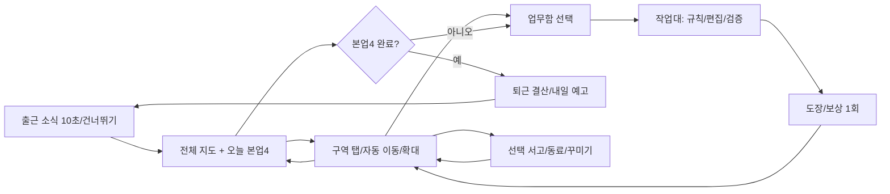

# 마스터 게임 디자인

## 약속과 재미

가상의 **모서리구청 생활보장과**에 첫 발령을 받은 주무관이 서류를 검사하는 데서 출발해, 일이 잘 흐르는 방법을 직접 설계한다. 한 줄 목표는 ‘오늘 네 건을 현명하게 마치고 내 책상에 무언가 남기기’. 행정 지식 없이 화면에 공개된 가상 규칙만으로 풀 수 있다. 풍자는 요청/절차/기한/버전 혼란에 집중한다.

순발력+추리 혼합의 기본을 유지하되, 본업의 난도는 조건·관계·최적화로 만든다. 순발력은 10~20초짜리 선택 전화 응대/도장 리듬 챌린지로 나중에 넣는다. 반응 속도 때문에 본편/아이템/스토리가 막히지 않는다. 업무 퍼즐70 / 성장·수집20 / 사무실10은 기능 수/시간을 강제로 나누는 규칙이 아니다.

즐거움의 순서: **관계 이해→내 해법 실험→서류가 실제로 흘러가는 검증→도장 한 번→다음 날 결과/소품 변화**. 현실의 보고서 입력·법령 암기·단기 기억 반복은 본편 주력이 아니다.

## 플레이 루프와 하루 계약



본업4건/일 고정 기본. D1~5는 기존 표를 보존한다. D6~15는 [03의 정확한 편성](03_STORY_WORLD_NPCS_EVENTS.md)이다. 새 조작은 필수에서 하루 최대1종, 90초 이상 어려운 설계 둘을 같은 날 필수로 넣지 않는다. 상 난도 고급은 ‘간단 제출로 오늘 업무 완료’와 ‘연구실에서 최적화’ 선택을 제공한다. 최적화가 끝나야 퇴근하는 구조는 없다.

6~10분 목표 예산: 소식/짧은 대화40~60초, 업무4건 합계240~400초, 이동/확대 총20~35초, 도장·결산20~40초. 이 값은 플레이 목표이며 측정 전 사실이 아니다. 중앙값이10분을 넘으면 필수 워밍업을20~40초로 줄이고 고급 레벨은 연구실로 옮긴다. 4건을 무조건6건으로 늘리지 않는다.

시간은 `09:00 → 10:40 → 13:20 → 15:40 → 17:50`의 처리 건수 기반 표시를 유지할 수 있다. 실제 벽시계와 무관하며 남은 시간을 강요하지 않는다. 본업 회신 대기는 최대1건, 다른 본업1건 완료 시 회신. 유일한 남은 업무가 waiting이면 ‘회신 확인’ 무료 버튼으로 즉시 ready; 대기 때문에 퇴근 불능 금지. 타과 요청은 별도 optional이며 본업4건에 추가하지 않는다.

## 상태와 업무 계약

업무 상태: `locked → available → started → suspended → started → evaluating → completed`. 회신: `available → waiting → available`, 실패 평가: `evaluating → started`, 보조완료: `started → completed`와 결과의 `assisted=true`. `completed`는 재실행 가능한 연습 모드로 연결하되 보상0.

```json
{
  "taskId":"campaign1:d06:main:0",
  "departmentId":"life_support", "type":"conveyor",
  "stageId":"conveyor_e01", "contentVersion":1,
  "difficulty":"easy", "seed":60101,
  "required":true,"zoneId":"desk","objectId":"o12",
  "status":"started","rewardClaimId":null,
  "storyEventId":"st_conveyor","startedAt":0
}
```

stage/seed/difficulty/contentVersion를 첫 진입 트랜잭션에서 고정한다. 현재 난도 설정을 나중에 바꿔도 진행중 과제가 교체되지 않는다. stage가 삭제되면 저장된 원문 문제 snapshot으로 진행, 판정기마저 없으면 알려진 호환 모듈 또는 보조 완료를 제공한다.

## 실패·힌트·점수

모든 편집은 되돌리기/다시하기, 최초 상태 복원, 중단 후 초안 이어하기 제공. 불완전 제출은 알려주되 오답 횟수에 넣지 않는다. 실행 시뮬레이션은 감점 없음. 사용자가 최종 ‘제출’한 결과가 규칙 위반일 때만 잘못 제출1회를 기록한다.

점수 기본: `max(60,100-10*wrongSubmissions)`, 보조완료60, 도구 자동 처리90. 힌트단계/보조 여부/최적화 기록은 별도 badge로 표시; 힌트 자체 감점은 없다. XP15/P20, 퇴근P15는 난도/힌트/보조완료에 관계없이 동일하다. 하 난도로도 주요 도감/소품/15일 엔딩100% 도달 가능.

복수 정답: 출력/제약이 맞으면 성공. ‘제작자가 준비한 배치와 동일’ 검사는 금지. 같은 결과의 기록은 유형별 `parts/ticks/edits/steps/makespan/pushes/cost` 중 정의된 축만 비교한다. 최고기록은 Pareto 후보 최대5개 또는 대표축2개, 제출횟수를 반복 파밍 보상으로 바꾸지 않는다. 난도/보조/자동 기록을 섞어 최고기록을 덮지 않는다.

힌트3단계: 놓친 조건/위치 → 적용 근거/부분 해법 → 완전한 한 해법 보기. 3단계 뒤 ‘보조 완료’는 적용된 결과와 이유를 보여주고 동일 보상을1회 지급. 실패한 민원인이 다음날 와도 추가 불이익/영구분기 없이 재확인 기회를 준다.

## 메뉴와 공간의 역할

전체 지도는 위치/오늘업무/구역7개를 읽는 화면. 구역 확대는 캐릭터·동료·손에 쥔 도구·실제 소품을 크게 보여준다. 작업대는 집중 조작 화면으로 교체하고 작은 구역 맥락띠만 남긴다. 좁은 폰에서 큰 지도 위에 퍼즐 모달을 겹쳐 읽게 하지 않는다.

하단 기본4칸: `사무실 / 업무함 / 내 책상 / 기록`. 성장 도구는 내 책상 탭, 도감은 기록의5분류. 설정은 상단 기어. 퇴근 버튼은 업무함 상태띠/출입문 양쪽에서 동일 action을 호출한다. 4건 미완료면 남은 task 목록을 보여준다. 화면 뒤로가기는 [04](04_OFFICE_ZONES_CAMERA_UI.md)의 상태 전이를 따른다.

## 배포 범위·콘텐츠량

|빌드|체험 가능한 범위|고정 문제량/자산 최소|
|---|---|---|
|P2 탐색 검증|원본46물품+내자리/창구/결재3구역+기존 compare 진입/복귀|현재5종 규칙 유지, 기존 기본 sprite 재사용|
|P3 합동 슬라이스|내자리 컨베이어+NPC소라+도장+1회 보상+v2 저장|난도별3개=9레벨(쉬움3/중3/상3), 2해법 fixture 포함|
|P4 첫 주|5일·4본업·소식/결산·기존5종 장소 연결|기존 생성기 유지, 각 유형의 읽기용 기본 exemplar3개 고정|
|P5 A군|conveyor/rules/macro 총3종|유형별9개=27개, 각난도3. 일부 매크로 상은 연구실|
|P6 시스템 최소|10일 서사/도구10/장식6장착/도감5/업적 초반8|NPC5→주요9명 palette 공유; 처음부터18장식을 그리지 않음|
|P7 B군|owner/approval/archive; 서고 선택|유형별9개=27개, archive도 난도선택. 총54개|
|P8 생활보장과 베타|15일/8종/도구10/소품18/업적18/5도감|C18개를 더해 신규72개. 유형당3변형 중 첫2변형 우선|
|P9 첫 배포|검수된 베타 + 기존저장/Android/오프라인 게이트|부서 선택 초안만 표시. 미구현 타과 버튼은 ‘준비중’ 비필수|
|P10 이후|타과4종→4종→3종|먼저 각난도2개=유형6개, 실제 검사 후9개로 확장|

고정72문제는 플레이 중 같은 문제를 계속 주는 목표가 아니다. 캠페인은 easy/normal/hard각 15일 경로에 맞춰 골라 쓴다. 매개변수만 바뀐 내용은 문제량으로 부풀리지 않는다. 절차 생성은 witness/솔버와 콘텐츠 검수 통과 후; 초기엔 authored 무작위 순서만 사용한다.

## 재미를 검증하는 방법

P3 신규 플레이어3~5명에게40초 설명 없이 시작해보게 하고, 규칙 질문/첫 의미있는 배치까지 걸린시간/힌트3필요/한판더 의향을 기록한다. 표본은 방향 점검용, 시장 예측이 아니다. 대표 목표:80%가 첫 입력을10초 안에 하고, 중 난도 대부분60~120초, 자발적 최적화 의향 절반 이상. 미달이면 장치 수/첫 규칙을 줄이고 제출-실행 용어를 합리화한 후 새 사람에게 재점검한다.

본편 반복의 지루함은 문제 seed 수보다 **변형 규칙과 관계**로 해결한다. 이동 시간을 재는 목적은 사무실 연출이 퍼즐을 방해하는지 판단하기 위함이다. 연출 합계가 하루10%를 크게 넘거나 반복 스킵률50% 이상이면 걸음/줌을 함께 짧게 하고 마지막 선택 구역에서 연속업무를 지원한다.

이미 소개한 설계형 유형이 같은날 여러 건이면 두 번째 이후에는 20~40초의 고정 짧은 변형을 편성한다. 일차표의 유형 수가 고급 레벨 수를 뜻하지 않는다. 새 대표 한 건만 60~120초를 목표로 하며, 상 난도는 결과 제약을 간단히 만족한 뒤 최적화 연구를 분리한다. 이 편성이 실제 6~10분을 만족하는지는 P3/P8/P9 플레이테스트로 확인한다.
