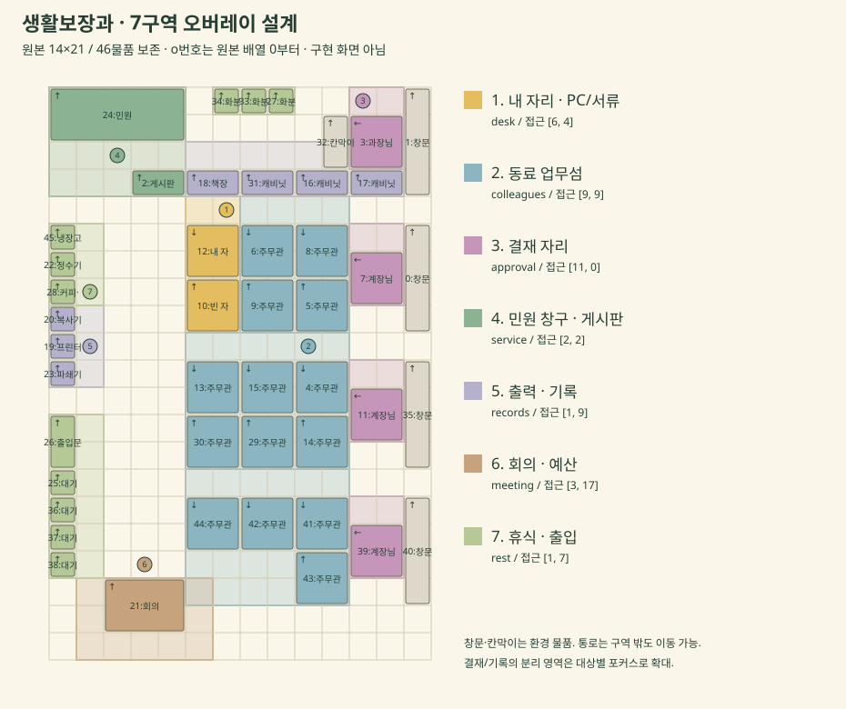
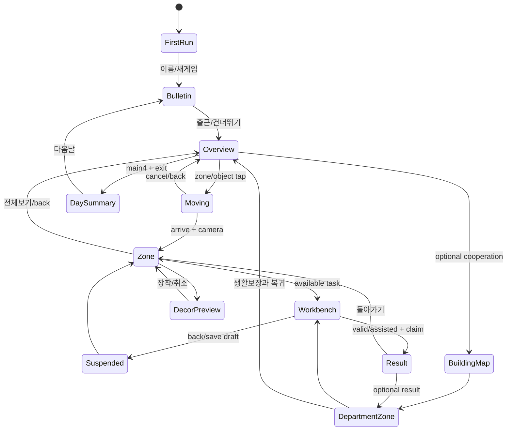

# 원본 사무실·7구역·카메라·UI 명세

설계 [D]. 좌표만 사용자 확정 [U]. SVG/와이어프레임은 구현 화면이 아니다. [원본 JSON](data/office_original_v1.json), [구역 데이터](data/planning_contract.json), [BFS 분석](evidence/map_analysis.json).



## 좌표와 물품

원점 북서(0,0), x→동쪽, y→남쪽. `rect=[x0,y0,x1,y1)` 반열린 경계; 타일칸은 정수좌표, 세계좌표 초점은 타일 경계 기준 실수값. objectId=`o`+원본 배열0기준 인덱스. 원본 `up/down/left`는 착석/표현 방향, footprint는 회전하지 않는다.

|ID|종류|원본 라벨|좌표|크기|방향|
|---|---|---|---|---|---|
|o0|window|창문|(13,5)|1×4|up|
|o1|window|창문|(13,0)|1×4|up|
|o2|board|게시판|(3,3)|2×1|up|
|o3|boss|과장님|(11,1)|2×2|left|
|o4|staff|주무관|(9,10)|2×2|down|
|o5|staff|주무관|(9,7)|2×2|up|
|o6|staff|주무관|(7,5)|2×2|down|
|o7|chief|계장님|(11,6)|2×2|left|
|o8|staff|주무관|(9,5)|2×2|down|
|o9|staff|주무관|(7,7)|2×2|up|
|o10|empty|빈 자리|(5,7)|2×2|up|
|o11|chief|계장님|(11,11)|2×2|left|
|o12|me|내 자리|(5,5)|2×2|down|
|o13|staff|주무관|(5,10)|2×2|down|
|o14|staff|주무관|(9,12)|2×2|up|
|o15|staff|주무관|(7,10)|2×2|down|
|o16|cabinet|캐비닛|(9,3)|2×1|up|
|o17|cabinet|캐비닛|(11,3)|2×1|up|
|o18|shelf|책장|(5,3)|2×1|up|
|o19|printer|프린터|(0,9)|1×1|up|
|o20|copier|복사기|(0,8)|1×1|up|
|o21|meeting|회의 테이블|(2,18)|3×2|up|
|o22|water|정수기|(0,6)|1×1|up|
|o23|shredder|파쇄기|(0,10)|1×1|up|
|o24|counter|민원 창구|(0,0)|5×2|up|
|o25|wait|대기 의자|(0,14)|1×1|up|
|o26|door|출입문|(0,12)|1×2|up|
|o27|plant|화분|(8,0)|1×1|up|
|o28|coffee|커피·탕비|(0,7)|1×1|up|
|o29|staff|주무관|(7,12)|2×2|up|
|o30|staff|주무관|(5,12)|2×2|up|
|o31|cabinet|캐비닛|(7,3)|2×1|up|
|o32|partition|칸막이|(10,1)|1×2|up|
|o33|plant|화분|(7,0)|1×1|up|
|o34|plant|화분|(6,0)|1×1|up|
|o35|window|창문|(13,10)|1×4|up|
|o36|wait|대기 의자|(0,15)|1×1|up|
|o37|wait|대기 의자|(0,16)|1×1|up|
|o38|wait|대기 의자|(0,17)|1×1|up|
|o39|chief|계장님|(11,16)|2×2|left|
|o40|window|창문|(13,15)|1×4|up|
|o41|staff|주무관|(9,15)|2×2|down|
|o42|staff|주무관|(7,15)|2×2|down|
|o43|staff|주무관|(9,17)|2×2|up|
|o44|staff|주무관|(5,15)|2×2|down|
|o45|fridge|냉장고|(0,5)|1×1|up|


원본139칸 점유,155칸 통로, 중첩/범위밖0. 주무관14+내자리1+과장1+계장3=occupied19, 빈자리1. 모든 물품 footprint는 MVP 이동에서 막는다. 출입문도 충돌상자 안으로 들어가지 않고 인접 통로에서 퇴근 action을 실행한다. 벽 장식처럼 보이는 게시판도 원본 footprint 보존; 통과시키려면 별도 collisionVersion과 QA 승인이 필요하다.

## 구역7개 정확 명세

구역은 **상호작용 소유권**이지 통로를 막는 벽이 아니다. 복수 사각형의 합집합을 polygon으로 취급한다. 가구 소유구역은 하나; 창문4/칸막이는 환경 객체. cameraRect는 논리구역 경계와 독립적이고 다른구역의 가구가 보일 수 있다. 전체도에서는중성통로를 자유롭게 통과한다.

|구역/목적|경계 [x0,y0,x1,y1)|대표초점|접근칸|모바일/PC배율|물품|퍼즐/행동|NPC|장착anchors|
|---|---|---|---|---|---|---|---|---|
|desk / 내 자리 · PC/서류|[5, 4, 7, 9]|[6, 6]|[6, 4]|2/3|o12, o10|compare, memory, sort, sequence, conveyor, macro, brief|player, npc_sora|desk.plant, desk.mug, desk.stationery, desk.lamp, desk.chair, desk.monitor, desk.stamp|
|colleagues / 동료 업무섬|[7, 4, 11, 9] + [5, 9, 11, 14] + [5, 14, 11, 19]|[9, 11]|[9, 9]|2/3|o4, o5, o6, o8, o9, o13, o14, o15, o29, o30, o41, o42, o43, o44|owner|npc_sora, npc_jae, npc_dan|colleagues.memo|
|approval / 결재 자리|[11, 0, 13, 3] + [11, 5, 13, 8] + [11, 10, 13, 13] + [11, 15, 13, 18]|[12, 2]|[11, 0]|2/3|o3, o7, o11, o39|conveyor, approval, brief|npc_chief1, npc_chief2, npc_chief3, npc_boss|approval.tray|
|service / 민원 창구 · 게시판|[0, 0, 5, 4]|[2.5, 1.5]|[2, 2]|2/3|o24, o2|route, rules, owner|npc_miru, visitor_a|service.poster, service.badge|
|records / 출력 · 기록|[5, 2, 13, 4] + [0, 8, 2, 11]|[1, 9]|[1, 9]|2/3|o16, o17, o18, o19, o20, o23, o31|owner, archive, brief|npc_dan|records.label, records.bookend|
|meeting / 회의 · 예산|[1, 18, 6, 21]|[3.5, 19]|[3, 17]|2/3|o21|approval, budget|npc_jae, npc_chief2|meeting.coaster, meeting.mat|
|rest / 휴식 · 출입|[0, 5, 2, 8] + [0, 12, 2, 18] + [6, 0, 9, 1]|[1, 7]|[1, 7]|2/3|o22, o25, o26, o27, o28, o33, o34, o36, o37, o38, o45|커피/퇴근|npc_miru|rest.coffee, rest.cushion, rest.calendar|


NPC/anchor/puzzle 목록은 위 기준 데이터와 [03](03_STORY_WORLD_NPCS_EVENTS.md)/[06](06_GROWTH_DECOR_COLLECTIONS_ECONOMY.md)에 연결. 방향과 무관하게 **아래 접근 칸을 검사하고 최단 reachable 후보**를 쓴다. o7(계장1) 왼쪽(10,6)은 o8 staff가 점유하므로 접근칸으로 쓰지 않는다. 오른쪽도창문; 북쪽(11,5)로 접근한 뒤 책상 안 착석 연출만 별도 재생한다.

|대상/핫스폿|우선 접근(타일칸)|원본 근거/추가 action|
|---|---|---|
|o12 내자리/phone,papers,PC,inbox|6,4 / 대체5,4|소품은 원본2×2의 로컬 anchor, 새 장애물 없음|
|o3 과장|11,0 / 12,0|칸막이(10,1)·동쪽창문을 피함|
|o7 / o11 / o39 계장|11,5 / 11,10 / 11,15|북측통로. 좌우를 임의로 열린 것으로 가정하지 않음|
|o24 창구|2,2 / 1,2 / 3,2|창구 아래, NPCportrait/route 진입|
|o2 게시판|3,2 / 4,2|rules 공지진입. 북쪽창구 밑 통로|
|o19 프린터 / o20 복사기 / o23 파쇄기|1,9 / 1,8 / 1,10|출력·주인찾기·요약 연출|
|o18책장 / o31캐비닛 / o16 / o17|5,4 / 7,4 / 9,4 / 11,4|row3 물품아래 통로,archive/rules/read-only도감|
|o21회의|3,17 / 2,17 / 4,17|회의위쪽; 사업블록/일정표|
|o28커피 / o26문|1,7 / 1,12|휴식/퇴근. 필수4건 모두완료시 문표시|
|동료 staff down / up|각 footprint 위(y-1) / 아래(y+h)|막혔으면 옆칸도 포함한 perimeter BFS. 모든 후보는 evidence JSON에 있음|

### BFS와 이동

MVP **4방향 BFS** 선택. 294칸·등가 이동비용이므로 A*의 복잡성이 필요없다. neighbor순서 북→동→남→서, shortest path tie는 이순서로 결정적. A*는 큰부서맵/가중장애물 도입 시 Manhattan heuristic으로 교체 가능하나 같은 `findPath` 계약 유지.

`findPath({grid,start,approachCandidates}) -> {ok,path,targetCell,reason}`. 모든 접근 후보까지 탐색하고 최단길이→y→x순. path에 막힌칸/범위밖/대각선 없음. 주인공 발 충돌 반경0.22tile, 다른NPC는 MVP에서 고정좌석/비충돌 연출. 몸 그림이 통로에 약간 걸쳐도 발 충돌 영역을 늘리지 않는다.

타일당 이동120ms 기본; 길어서총2초를 넘으면 remaining 길이에 맞춰 최대2초로 압축, 걷는모습/경로는 유지. 카메라 follow는 전체 지도에서 시작한 이동동안 overview를 유지하고 마지막2칸에서 선택표시만 강조. 이동완료→350ms pan/zoom→대상 actionable. reduced motion이면 경로검사 후 targetCell로 즉시 도달, 카메라도 즉시. 부정확한 점을 골라 가구를 관통하는 즉시이동은 금지.

이동중 다시탭: 마지막목적지만 큐로 보관, 다음 칸 도달 시 현재경로취소/재탐색. 이전목적 업무를 동시에열지 않음(`transitionToken`). 뒤로: 이동취소→overview, 현 위치 마지막안전칸 저장. 모달/퍼즐열린상태에서는지도입력잠금. 비활성화/회전 시 애니메이션중지, 논리위치는마지막완료칸, 재개시에경로재탐색.

길없음/대상삭제/300ms내전환안됨: 안내 ‘이동을 마치지 못했어요’, 버튼 `다른 접근점 / 바로 업무 선택 / 전체보기`. 즉시이동은 **확인된 reachable 접근점이 있을때**만 쓰고, 없으면캐릭터위치그대로 업무선택(workbench 직접진입)으로 퇴근가능. 이것은 장애물관통 이동으로 숨기지 않는다. 서버/네트워크 불필요. fallback 사용기록은 QA로그, 사용자벌점0.

## 카메라/좌표 구현 계약

타일T=24 worldpx, world W=336/H=504. cell(x,y)의발중심=`((x+.5)T,(y+.5)T)`. 물품bounding=`(xT,yT,wT,hT)`. 장식anchor world=`((x+u*w)T,(y+v*h)T)` (u/v0~1).

viewport CSS rect=(L,Top,Vw,Vh), camera center=(Cx,Cy), scale=k:

```text
screenX = L + Vw/2 + (worldX-Cx)*k
screenY = Top + Vh/2 + (worldY-Cy)*k
worldX  = Cx + (clientX-L-Vw/2)/k
worldY  = Cy + (clientY-Top-Vh/2)/k
tileX=floor(worldX/T); tileY=floor(worldY/T)
overview k=min(1,Vw/336,Vh/504), center=(168,252)
zone k=2 mobile; k=3 PC; constrained landscape may use k=1
clampCenter(vSize,wSize,k,desired):
  if vSize/k >= wSize: return wSize/2  // letterbox, not negative clamp
  return clamp(desired,vSize/(2*k),wSize-vSize/(2*k))
```

DPR은 Canvas의 내부 비트맵 크기에만 적용하고 최대 2로 제한한다. 터치 역변환은 CSS 픽셀 기준이며 DPR을 다시 곱하지 않는다. `ctx.imageSmoothingEnabled=false`로 두고 resize 후 비트맵을 다시 그린다. 전체 지도는 화면 맞춤을 위해 소수 배율을 허용한다. 구역 확대의 최종 배율은 모바일 2, PC 3의 정수이며, 스프라이트 위치는 CSS 1px에 맞춘다. 350ms 전환 중에는 소수 배율을 허용한다. 텍스트는 별도 DOM 레이어로 16px 이상 표시하며 저해상도 Canvas 글자를 확대하지 않는다.

확대 초점은 누른 물품의 중심을 우선하고, 구역 배지는 표의 기본 초점을 사용한다. 북쪽과 서쪽 가장자리에서는 카메라를 클램핑해 대상이 화면 안에 남도록 한다. 업무 버튼은 화면 하단 DOM 카드에 고정하므로 대상이 정확히 화면 중심에 있을 필요는 없다. 결재석은 `과장/계장1/2/3`, 출력·기록 구역은 `서고/출력` 버튼으로 대상별 초점을 바꾼다. 떨어진 구역 전체를 한 화면에 맞춰 소품을 작게 만들지 않는다. 최종 화면에서 대상이 가려지면 초점을 조정하고, 그래도 불가능하면 업무 목록을 제공한다.

상태전환 중 sceneInput=false, layout measuring/pointer inverse는같은camera snapshot. resize/newfont startsnewrender snapshot; 이전좌표 클릭을 즉시판정하지 않음. camera tweencancel emits one cleanup. 월드위치/선택zoneId/objectId는저장, raw픽셀camera/진행중tween은저장하지 않는다; restore에서viewport에맞춰derivedcamera를계산한다.

## 터치 판정·작은 화면

phone/paper/PC는 원본내자리의로컬 소품이며전체도에서는너무작다. 작은대상을 억지로독립44px hit에겹치게하지않고 **구역배지44×44 이상→목적물sheet**를 쓴다. 확대후는보이는phone/papers가각44~56 CSSpx가능, DOM버튼활성영역은그림과분리. 공개label/keyboardfocus 제공.

판정우선: (1) DOM업무버튼, (2)실제그림footprint내object, (3)확장hit44근처후보, (4)zone polygon. 후보2개이상이면 `전화 / 서류 / PC` 선택sheet, 최근목표를위에두되 자동선택안함. z-order라벨/장식이책상action을가로채지않음. 8px이상pointer이동은scroll/pan, click취소. no-longpress-only; 확대pan은내부canvas에서한손드래그, 줌은`+/-/전체`버튼으로도가능. `touch-action:none`은조작canvas만, 페이지/자료스크롤은`pan-y`.

전체mapzone badge탭→대표접근→확대→큰업무버튼. 전체map에서정확한목적물탭→그대상접근→확대→ready1건이면작업대자동진입(350ms연출후,동작줄이기즉시);2건이상이면업무목록. 확대화면에서물품탭은바로업무. 같은구역연속업무는overview재이동없이다음ready목록, 재방문할때선택기억. 결과뒤‘이구역에남기/전체보기’ 제공.

## 화면 상태/뒤로가기



Result의reward이미claimed이면뒤로/reload는표시만반복, 지급0. Workbench뒤로는초안flush후Zone, 작성된내용삭제확인불필요. 초기화/새게임/가져오기덮어쓰기는구체적확인. 메뉴뒤로는그메뉴전scene복귀. Zone뒤로overview; overview의브라우저back는site밖정상복귀허용. `history.pushState`는내부screen전환당1회·replaceforcamera만, 과도한뒤로trap금지. 삼성file/content문서에서동작은실기검증필요; 보이는`뒤로`버튼을동일reducer action으로연결한다.

## 5개 기기 와이어프레임/영역 계약

아래크기는CSS viewport다. OS내비게이션은가능한`env(safe-area-inset-bottom)`이외추가24px 보수여백으로처리하고실제기기에서확인. `100dvh`우선/`100vh`폴백+resize, viewport-fit=cover. status20은저장상태, canvas이외가로overflow없음. 폰은패딩좌우12,본문16px/line-height1.45,부제14px,터치최소44 권장48. 큰글씨18/20 설정에서는비핵심상단정보를접고본문스크롤,버튼은유지.

|기기|전체지도canvas Vw×Vh 목표|overview k/지도그림|구역 확대|퍼즐|
|---|---|---|---|---|
|320×640|296×360|0.714 / 240×360 가운데|k2,6.17×7.5tile보임; actioncard는selection48영역/펼침sheet|헤더56·규칙48·탭40·작업368·액션104·safe24. 격자6×6@44=264;7열이상zoom/pan|
|360×800|336×520|1 / 336×504|k2,7×10.83tile|작업528;컨베이어7열@44=308가능|
|390×844|366×564|1 / 336×504|k2, 7.63×11.75타일|작업대 높이572; 자료 탭2개. 8열×44=352px 격자 가능|
|412×915|388×635|1 / 336×504|k2,8.08×13.23tile|작업643;45px격자/더큰rulecard|
|1280×800|704×560, 오른쪽업무300,외곽여백|1 / 336×504|k3,9.78×7.78tile;상단edgeclamp|중앙작업640 + 오른쪽규칙/로그280,아래액션104;격자56px가능|

전체지도기본세로:

```text
┌───────── 320 / 360 / 390 / 412 ─────────┐
│ 제목                         설정  [56]│
│ 6일차   본업0/4  P…  저장상태     [44]│
│ ┌──────── 전체 생활보장과 ─────────┐   │
│ │ [창구]     [기록]    [결재]      │   │
│ │    통로     [내자리★]           │   │
│ │ [출력]      [동료]              │   │
│ │ [휴식/출입] [회의]              │   │
│ └──── 지도만fit / 터치배지44 ─────┘   │
│ 선택한곳 · 대기업무            [48]   │
│ 사무실 / 업무함 / 내책상 / 기록 [64]   │
│ 저장상태20 + 패딩24 + safe24           │
└───────────────────────────────────────┘
```

PC:

```text
┌──── 제목 / 일차 / P / 설정 ─────────────────────┐
│ 전체/구역보기 ┌── 704×560 office ──┐ 오늘업무300│
│               │ 선택대상·캐릭터     │ 4건상태목록 │
│               │ 구역줌 k3          │ NPC1줄/도구 │
│               └───────────────────┘             │
│ 사무실 / 업무함 / 내책상 / 기록 / 퇴근           │
└─────────────────────────────────────────────────┘
```

### 상세 구역1: 내 자리

```text
┌ [전체보기] 내자리★    본업2/4     [설정] ┐
│ 캐비닛/책장 + 옆책상(맥락,문자없음)     │
│    모니터[PC]    장착화분/메모꽂이       │
│      서류[1]  전화[1]  결재함[1]         │
│      주인공 idle→type/paper/phone        │
│  NPC소라 초상: “한장씩 보죠.” 닫기       │
│ [PC업무] [서류] [전화]  큰44~56버튼      │
│ [연속업무]            [내책상꾸미기]     │
└─────────────────────────────────────────┘
```

phone local(u=.18,v=.35),paper(.72,.42),PC(.48,.24),inbox(.86,.60); 전부o12내부. 꾸미기anchor는[06]과별도. 선택된action만강조하며모든label항상표시안함. 320에서label버튼3개는2열2행sheet로전환,창문/동료는맥락으로부분표시. 퍼즐진입시이장면을다시큰이미지로배경에넣지않고작업대로전환.

### 상세 구역2: 창구·게시판

```text
┌ [전체보기] 창구/게시판          [설정] ┐
│ 게시판[새공지] ┃ 오늘번호03             │
│ 창구counter + 미루 + 방문자팔레트초상  │
│ “접수한 기록을 확인하려고요.”          │
│ [규칙보기]  [질문1개]  [업무시작]      │
│ 대기2(연출용) / 개인정보없는요청        │
└──── 대상전환: 창구 | 게시판 ──────────┘
```

창구focus(2.5,1.5)경계clamp후상단에위치, actionDOM하단이라터치가능. 민원인전신1개/표정2개, 요청문HTML3줄. rules는게시판타일작업대로교체. 질문은단서보충하고재질문무료; 긴대화트리안만듦. 대기열이업무실패로영구늘지않음.

### 상세 구역3: 결재 자리

```text
┌ [전체보기] 결재             [설정] ┐
│ [과장] [계장1] [계장2] [계장3]     │
│   선택책상/칸막이/동쪽창문          │
│   NPC초상+가능시간 ‘목 오전’       │
│   제출서류가결재함에한장쌓임       │
│ [결재일정] [결재라인] [한장보고]   │
│ 설명 ‘오늘가능한업무1건’ / 완료표  │
└───────────────────────────────────┘
```

간부 네 자리 전체를 한 화면에 맞추지 않는다. 대상 버튼 → 접근점 BFS → 같은 구역의 대상별 카메라 초점으로 연결한다. 마감 조건은 작업대에 명시하고 사무실의 한 줄 대사는 요약으로 쓴다. 반려한 간부의 초상·책상 라벨·판정 사유가 일치해야 한다. 정상 완료는 도장 연출 0.8초 후 선택한 결재석으로 돌아온다.

## 전체 화면 목록/상태 명세

기호 H=고정헤더56, R=규칙/요약48, B=고정액션104+safe, V=본문스크롤/작업대. 각화면의문구는짧고정확하게; 긴게임계획문을상품UI에넣지않음.

|화면/텍스트 와이어|정보우선/상태·뒤로·복구|touch/자산|
|---|---|---|
|첫실행 `제목→[이어하기][새게임]→이름12자→[출근]`|이어하기valid에서만활성, 없으면새게임. 이름설정중뒤로첫실행,키보드가버튼을가리면scrollIntoView. 저장실패도시작허용+backup안내|48버튼,player초상32×32;실명기본요구안함|
|소식 `날짜→어제결과1→새규칙1→[출근][건너뛰기]`|규칙은퍼즐에도있음. skip효과동일,다시보기기록탭|HTML기사,작은게시판decal|
|전체지도 `H/HUD→canvas→선택48→nav`|오늘4건/위치/구역중요;진입중target표시;뒤로site밖허용|7badge48,원본물품sprites|
|이동 `선택외곽→경로점→걷기→[건너뛰기/취소]`|업무시작잠금,latesttap큐,실패시작업목록|walk4방향×4frames;경로도트|
|구역확대 `breadcrumb→scene→물품버튼→NPC1줄`|대상ready/waiting/done구분. 전체보기,backoverview|object44~56,NPC머리/손동작/장식|
|업무함 `본업4건→긴급/회신/협조탭→선택`|긴급은추천순서,waiting은이유와회신버튼,completed연습보상0. back이전scene|카드높이64,기호+텍스트상태|
|퍼즐공통 `H→R→입력/편집/로그탭→V→B`|주요목표항상표시,불완전/오류구분,닫기save draft,변경없는reset취소|자료실문자16,button48,종이/도장공통|
|8종전용|[05](05_PUZZLE_SYSTEM_AND_8_SPECS.md)의board크기·조작·전용표시. 공통B는되돌리기/힌트/검증/제출|별도이미지숫자금지|
|결과 `도장→검증요약→XP/P→[구역][다음업무]`|claim트랜잭션후연출. reloadclaim안함. 실패는편집으로복귀|stamp3색+shape,0.8초(동작줄이면즉시)|
|결산 `근무기록4줄→오늘변화→내일1줄→[다음날]`|endDay1회,다음날누르기전에도day결산phase보존. 뒤로office결산읽기|영수증HTML,night palette|
|성장 `숙련4분야→도구상점→효과전후→구매`|owned/locked/가격부족/구매가능,뒤로이전scene. 구매즉시save|도구아이콘10,실제책상도구표시|
|꾸미기 `선택anchor→소유/상점→큰구역preview→[장착][취소]`|preview미저장,장착저장후시각반영;부족/중복구매disabled사유|소품6MVP/18Beta;anchor marker|
|도감 `업무/인물/소품/부서/사건→카드→상세`|미해금 실루엣과 사후 힌트, 기록이 없어도 빈 상태 표시. 뒤로가기 시 선택 목록 복원|공유 초상·아이콘, 텍스트 배지|
|청사 지도 `생활보장과→설치 부서→요청→지원`|미설치 팩은 준비중. 뒤로가기 시 생활보장과 구역 복원. 협조는 선택 업무|가상 청사 도면과 부서 스탬프11종|
|설정 `난도→소리→동작줄이기→글씨→저장`|난도다음task만적용,소리첫gesture재생,글씨16/18/20;back즉시scene|checkbox/combobox48,DOMfocus|
|저장 `상태→내보내기→가져오기미리보기→복구/새게임`|import이름/일차/버전/변경내용,취소시원본유지. 실패는rawexport/최근정상copy|filepicker+copy-textfallback,구체적확인dialog|

작은 화면의 기본은 구역 카메라 확대와 퍼즐 내부 이동·탭이다. 설명·상점·도감은 페이지 스크롤을 허용한다. 퍼즐의 핵심 조작은 고정하고 자료는 HTML 탭으로 분리한다. 8열×44=352px 격자는 320px 화면에서 내부 이동과 편집하지 않는 전체 미리보기를 제공한다. 확대 버튼과 키보드, 선택 후 방향 버튼을 함께 제공해 드래그에만 의존하지 않는다.

## 시각/소리/개인정보 검수

색상: 종이 #F7F1DD, 짙은 녹색 #254B3C, 목재 #A57B55, 보조 #6D7864, 경고 #A54737. 상태는 색·기호·문구를 함께 쓰고 비활성 이유를 표시한다. 폰트는 `system-ui, "Malgun Gothic", sans-serif`, 핵심 본문16px이며 18/20px 설정을 제공한다. 픽셀 확대는 인물·소품에만 적용한다. 대비4.5:1을 실측하고 밝은 배지에는 짙은 글씨를 쓴다.

효과음WebAudio자체합성: paper40msnoise,stamp80ms낮은tap,phone두tone300ms,submit120ms상승;fallback무음. 진동은MVP안씀. 소리/움직임끈상태에서같은정보를텍스트로표시한다.

외부배포직전realmap보안검수:현재JSON에개인이름/전화/민원자료없지만공간배치는현실유사정보. 개인용원본layoutId=office_private_v1 유지,공개용파생맵은별도layoutId/zone/objectalias와QA를다시통과한다. 공개동의나현실장소안전판정을이기획에서대신하지않는다.

## P2 완료 기준

o12/창구/과장/계장3/출력/서고/회의에선택→BFS→정수endpointcamera→업무/복귀가된다. 320/390에서target버튼최소44/텍스트16,대상선택일관. 원본46개동일,resize/DPR/edgefocus/back/newtap/reducedmotion/errorfallback검사통과. 현재HTML이이조건을통과했다고주장하지않는다.
