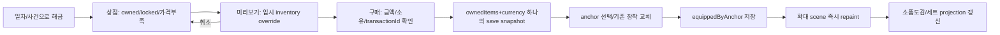

# 성장·꾸미기·수집·15일 포인트 경제

설계 [D]. 가격과 해금은 [기준 데이터](data/planning_contract.json). 기존 XP/P/6도구/3장식은 전부 보존한다. 새로운 보상은 플레이를 편하게 만들거나 공간에 남아야 한다.

## 성장과 실제 조작 변화

XP는 본업1건15, 하루60,15일900. 기본 칭호: XP0 새싹 / 80 익숙한 주무관 / 240 도구 사용자 / 480 업무 설계자 / 720 조율하는 동료 / 900 팀의 해결사. 실제 법정 승진 기간을 묘사하지 않는 **게임 칭호**다. 옛 버전의 XP/80 level 및 직급명은 이력 카드에 남기고 새 칭호는 같은 XP에서 재계산한다. D5 첫 주 수료와 D15 엔딩은 난도와 무관하다.

숙련4분야 `review/deduction/automation/coordination`: 관련 task 완료마다+1경험, 하/중/상/보조완료 동일. Lv1=0, Lv2=3, Lv3=8, Lv4=15(정보 표시용). 도구 해금은 일차/해당 튜토리얼 경험이 기준이며 숙련도 숫자만을 또 올려야 진행되는 게이트를 추가하지 않는다. compare/sort/memory/sequence/route의 legacy 통계는 그대로 보존, 숙련은 기록에서 재계산 가능한 projection.

|ID|도구|P|해금|유형|조작 효과|범위|
|---|---|---|---|---|---|---|
|guide|대조 가이드|45|D1|compare|같은 항목 교차 강조|MVP|
|memo|전화 메모장|45|D1|memory|통화 후 핵심 1칸 유지|MVP|
|clean|자료 정리 도구|60|D2|sort|명백한 조건 불일치 흐리게 표시|MVP|
|directory|부서 연락망|50|D2|route|무관 부서 1곳 제외|MVP|
|preview|실행 미리보기|60|D2|sequence|감점 없이 단계별 실행|MVP|
|auto|반복 업무 매크로|120|D4|sort|튜토리얼 취합 2건 후 익숙한 워밍업 하루 1건 처리|MVP|
|trace|동선 추적지|70|D6|conveyor|한 서류의 레일 궤적 표시|Beta|
|rulebook|규정 색인|70|D7|rules|충돌한 상위 조건과 적용 순서 강조|Beta|
|boundary|경계값 카드|80|D8|macro|경계 입력 1개 제안; 테스트 횟수 소비 없음|Beta|
|reply|회신 바로가기|90|D10|approval|다음 날 선택 협조 회신 1턴 단축; 필수 해는 도구 없이 존재|Beta|


도구 상태 `locked / available / owned / unavailableForTask / ready / used`. 소유 후 task별 사용 제한/효과를 UI에 표시한다. 기본 힌트3단계는 도구 없이도 무료; 도구는 지속 비교선/빠른 로그/한칸 메모처럼 **조작을 줄이는 기능**이다. trace는 기본 검증 로그와 달리 편집 중에도 한문서를 골라 따라볼 수 있다. rulebook은 규칙 텍스트 접근을 유료화하지 않고 적용 순서를 지속 강조한다. boundary는 무료 힌트를 잠그지 않고 입력 실험 한회를 절약한다.

auto 조건: 현재 sort 2건 경험+day4(기존사용자는 소유상태 그대로), 하루1회 **이미 익힌 워밍업 sort**만. 대표 본편·새 조작·선택 서고를 자동 완료하지 않는다. 사용 사실을 원장에 저장, 보조/자동 기록 분리. 회신 바로가기는 선택 협조의1턴을0으로 줄일 뿐 본편 일정 문제의 가상 달력을 바꾸지 않는다. 순수 외형 소품은 효율 보너스가 없다.

## 구역 장착 anchors

원본 furniture/충돌/방향과 별도의 로컬 데이터. `anchorId,furnitureId,u,v,layer,allowedTags,exclusiveGroup,visibleInOverview,detailSpriteId`를 사용한다. 그림이 커져도 collision을 늘리지 않는다. 자유 배치/가구 이동은 MVP에서 제외한다.

|anchorId|기준 물품 / (u,v) / layer|장착/확대에서 보이는 위치|
|---|---|---|
|desk.plant|o12 /(.10,.18)/tabletop|화분/고양이 조각 중1개, overview는 작은초록점|
|desk.mug|o12 /(.72,.20)/tabletop|머그1개, 확대 커피컵24px 원본픽셀|
|desk.stationery|o12 /(.83,.42)/tabletop|메모꽂이/별클립 중1개|
|desk.lamp|o12 /(.05,.65)/behind|스탠드, 책상 외곽을 가려도 footprint 그대로|
|desk.chair|o12 /(.50,.05)/seat|원본down 착석 위치 의자커버|
|desk.monitor|o12 /(.48,.24)/screen|PC 화면 테마, 실제 문제값은HTML|
|desk.stamp|o12 /(.88,.72)/tool|손잡이 외형, 퍼즐 도장 sprite와 같은색|
|colleagues.memo|o6 /(.8,.2)/tabletop|관계 사건 메모, 판매소품 없어도 이벤트decal|
|approval.tray|o7 /(.25,.55)/tabletop|결재함 라벨, NPC석 확대에서 보임|
|service.poster|o2 /(.5,.5)/paper|포스터, 게시판 원본 크기 유지|
|service.badge|o24 /(.85,.20)/counter|협조배지/안내표|
|records.label|o31 /(.5,.55)/front|서고 완료 연도라벨 이벤트|
|records.bookend|o18 /(.80,.50)/front|책받침|
|meeting.coaster|o21 /(.20,.40)/tabletop|컵받침|
|meeting.mat|o21 /(.50,.50)/tabletop|회의매트|
|rest.coffee|o28 /(.5,.5)/front|탕비트레이|
|rest.cushion|o25 /(.5,.5)/seat|첫 대기 의자 쿠션|
|rest.calendar|o45 /(.5,.5)/front|냉장고 달력(휴식 확대)|

`desktop detail`은새가구가아닌anchorchild. 기본소품스프라이트16~24px, 정수2배 확대32~48px로 식별. seat/behind는NPC보다 먼저,tabletop은책상이후,작업중손은도구위에 그린다. `allowedTags`맞지않는아이템장착은reason. 화분과고양이는같은slot이라소유둘다가능하지만장착하나는선택. 세트는색테마/도감테두리만, 효율강화 없음.

## 소품18종·MVP6

|ID|소품|P|해금|장착anchor|범위|
|---|---|---|---|---|---|
|decor_plant|작은 화분|35|D1|desk.plant|MVP|
|decor_mug|내 이름 머그컵|40|D2|desk.mug|MVP|
|decor_note|메모 꽂이|25|D3|desk.stationery|MVP|
|decor_coaster|점심 컵받침|25|D4|meeting.coaster|MVP|
|decor_poster|정시퇴근 포스터|45|D5|service.poster|MVP|
|decor_stamp|녹색 도장 손잡이|45|D6|desk.stamp|MVP|
|decor_clip|별 클립|30|D7|desk.stationery|Beta|
|decor_monitor|숲 모니터 테마|35|D8|desk.monitor|Beta|
|decor_bookend|기록관 책받침|40|D9|records.bookend|Beta|
|decor_tray|나무 결재함 라벨|40|D10|approval.tray|Beta|
|decor_lamp|노란 스탠드|40|D11|desk.lamp|Beta|
|decor_mat|회의 테이블 매트|35|D12|meeting.mat|Beta|
|decor_badge|협조 배지|35|D13|service.badge|Beta|
|decor_cover|의자 커버|45|D14|desk.chair|Beta|
|decor_calendar|금일중 달력|40|D15|rest.calendar|Beta|
|decor_cat|사무실 고양이 조각|100|D5|desk.plant|Beta|
|decor_coffee|탕비 트레이|45|D6|rest.coffee|Beta|
|decor_cushion|대기석 쿠션|35|D10|rest.cushion|Beta|


첫6종 MVP, 이후순차제작. D1~15의 소품은 상점해금이며 일차 당 새로운 무료아이템을18개 지급하는 경제가 아니다. 기본포인트로 전부 살 수 있도록 조정했다. 고양이는 살아 움직이는 또다른AI가 아닌 기존 cat장식의 **조각/외형**으로 초기에보존, 자율반려동물 시스템은 보류한다.

획득→저장→장착→화면:



한 버튼이 `구매 후 장착`이면 한 트랜잭션으로 처리한다. 구매와장착을다르게선택해도모두owned/equipped분리. preview는원장/저장변경0, 구매실패는preview유지+부족P숫자. 더블탭/재실행에서중복구매·차감0. 저장실패일때메모리에는반영하고‘저장실패,백업필요’표시; 실패를숨긴두번째구매로차감하지않음. 다른장식으로교체시이전아이템소유삭제하지않음.

## 포인트 경제

유료재화/광고/하트없음. 시작30,본업4×20=80,퇴근15=95P/일. D15총수입(시작포함)1455. 도구10 합계690,소품18 합계735,모두구매해도잔액30. 최적화/상난도 추가P없음. 주간수료/엔딩도별도P를몰래넣지않음. 선택서고는focus만,타과는1회배지·편의효과가주보상이고기본경제에포함하지않음.

아래는 한 가지 구매 예시이며 강제순서가 아니다. 사용자는 소품을 먼저 사도 모든 본업은 도구없이 풀 수 있다. 반복모드에서새로운day/task만기본P, 같은task/기록재생은0. 도감/업적는P가아닌외형/일화로중복파밍을줄인다.

|일|시작잔액|수입|구매 예시|지출|결산잔액|
|---|---|---|---|---|---|
|1|30|95|대조 가이드, 전화 메모장, 작은 화분|125|0|
|2|0|95|자료 정리 도구|60|35|
|3|35|95|부서 연락망, 실행 미리보기|110|20|
|4|20|95|내 이름 머그컵, 메모 꽂이, 점심 컵받침|90|25|
|5|25|95|반복 업무 매크로|120|0|
|6|0|95|동선 추적지|70|25|
|7|25|95|규정 색인, 정시퇴근 포스터|115|5|
|8|5|95|경계값 카드|80|20|
|9|20|95|녹색 도장 손잡이, 별 클립, 숲 모니터 테마|110|5|
|10|5|95|회신 바로가기|90|10|
|11|10|95|기록관 책받침, 나무 결재함 라벨|80|25|
|12|25|95|노란 스탠드, 회의 테이블 매트, 탕비 트레이|120|0|
|13|0|95|협조 배지, 대기석 쿠션|70|25|
|14|25|95|의자 커버|45|75|
|15|75|95|금일중 달력, 사무실 고양이 조각|140|30|


구매목록 전부는 마지막날30P여유로완성된다. D8경계값80처럼 큰소비를실수로필수로만들지않음. 신규소품을늘릴때15일첫완성기준총가격≤1425를우선고려; 이를넘기면외형후속컬렉션으로명시하고짧은반복몇일을강요하지않는무료사건획득을검토한다. 구조적으로모든반복보상을차단할필요는없지만새taskId없는재완료는0이다.

집중력100/본업-8(최소20)/커피하루1회+20/서고하루1회+10. 난도/스토리잠금에사용하지않으며 피로수치는표정/추천휴식 정보. 하루4건만으로68까지라커피구매/휴식강제를만들지않음. 둘을100때쓰면‘지금은충분해요’로자원을소모하지않는다.

## 도감5분류·데이터

|분류/ID 접두|내용·해금|실제 플레이 연결|
|---|---|---|
|업무 `work.*`|유형13,최초완료day/난도/힌트최고/보조별기록/변형|기록에서연습열기(보상0),처리근거/대표장치보기|
|인물 `person.*`|주요9명,관계0~3,일화/다음날회신|구역으로이동/사건대화재열람|
|소품 `item.*`|소유18/미보유/세트/장착anchor|‘배치보기’누르면해당구역확대+item강조|
|부서 `dept.*`|생활보장과+후속11부서,스탬프/퍼즐기록|청사지도연결,미설치부서준비중(완료율분모제외)|
|사건·업적 `event.* / ach.*`|15핵심사건/12콜백/업적18|소식/영수증재생,아직못본조건사후힌트|

```json
{"id":"work.conveyor","category":"work","title":"원본은 남고 사본은 간다",
 "unlock":{"kind":"completedType","type":"conveyor"},"firstSeenDay":6,
 "records":{"easy":{"cleared":1,"assisted":0,"hintMax":1,"best":{"parts":5,"ticks":12}}},
 "links":{"zoneId":"desk","objectId":"o12","practiceType":"conveyor"}}
```

기본content정의와save진행을분리. `firstSeenAt`은게임내day와campaignId,실시간날짜는선택메타. 최고기록에는stageId/seed/contentVersion/난도/usedHints/assisted를넣는다. 숨김항목은처음실루엣+‘복사기에남은종이를확인해보세요’처럼안내,해당날이후힌트구체화. 못찾은소식은도감의‘지난날일화’로얻을수있고회차노가다필수아님.

## 업적18개

|ID|이름/조건|보상/잠김 방지|
|---|---|---|
|ach.first_day|첫출근: D1네건/보조포함|사건스탬프|
|ach.week|첫주수료: D5결산|수료증외형|
|ach.end15|금일중제출: D15결산|달력엔딩decal|
|ach.unit|단위확인: compare1완료|단위메모도감|
|ach.approved|최종은상태값: sort1완료|승인표시라벨|
|ach.memo|한줄메모: memo도구사용|전화일화|
|ach.tools|도구는동료: 도구3소유|책상도감테두리|
|ach.first_decor|초록한칸: 첫장식장착|꾸미기스탬프|
|ach.switch|내자리취향: 같은slot2장식교체|미리보기테두리|
|ach.copy|원본도살아있다: conveyor복사해법완료|복사라인일화|
|ach.revise|공지는읽고고친다: rules상위규칙지켜완료|게시판일화|
|ach.boundary|100도포함: macro경계값문제완료|100카드외형|
|ach.owner|주인에게한장: owner1완료|단비인물일화|
|ach.calendar|출장도일정: approval1완료|일정스탬프|
|ach.archive|밀고돌리기: archive1선택완료|서고라벨(회복과별개1회)|
|ach.budget|돈은칸으로: budget1완료|분기눈금테두리|
|ach.brief|한장의기준: brief1완료|보고서집게외형|
|ach.coffee|정시퇴근: 본업4후그날종료(속도무관)|퇴근스탬프|

보조완료도유형별업적달성,도구/해법특징은정답보기witness와연습에서다시체험해획득가능. 어려움무힌트최적화는별도기록메달로표시하고18업적100%분모에넣지않는다. 업적보상decal은판매18소품과다른무료비충돌레이어이며경제합계에가격을넣지않는다.

## 최소 UI/검수

```text
성장: [검토/추리/자동화/조율] → 도구카드(효과/가격/조건) → [구매]
내책상: 큰scene preview → [화분slot/머그slot/문구slot…] → [소유/상점] → [장착/취소]
기록: [업무/인물/소품/부서/사건] → 2열카드 → 상세(기록/단서/장소로이동)
```

320은카드1열,상점가격/구매48px,preview상의anchor는겹치면목록sheet. 소유목록의아이콘만보는구성으로끝내지않고장착후다시구역화면에서보여준다. back는preview취소후이전선택anchor유지. 저장복원후owned+equipped일치,unknownitem격리/placeholder,missinganchor는소유보존후미장착. 테스트:부족P/더블구매/기존cat변환/교체후미소유없음/preview취소무변경/18전부총액/난도별동일보상/힌트보조동일해금/도감재완료보상0. 
