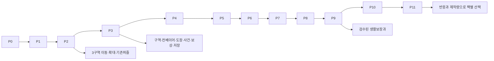

# 단계별 로드맵과 TASK 실행 계약

> **구현 순서 개정 v1.1 (2026-10-11)**: 사용자 요청에 따라 신규 퍼즐을 먼저 독립적으로 플레이 가능하게 만든다. 현재 로드맵은 [PUZZLE_FIRST_V1_1](PUZZLE_FIRST_V1_1.md), 의존성은 [tasks_puzzle_first_v1_1.json](tasks_puzzle_first_v1_1.json)의 PF0~PF6이다. 아래 P0~P11와 tasks.json은 v1.0 이전 순서로 보존한다. 기술 구현 범위와 시험 계약의 참고 자료이며 현재 실행 선행 관계로 사용하지 않는다.

96개 TASK는 전부 `planned`다. 이번 원본 시험과 계획 검증은 구현 TASK 완료가 아니다. 우선순위P0/P1/P2는 필수/중요/후속, 마일스톤P0~P11과 구분한다. S/M/L은 상대 변경·검증량이며 기간 약속이 아니다.

P0 기준 게임과 진단증거 → P1 기존5종 호환 → P2 맵3구역 → P3 대표 한판 → P4 첫5일 → P5 A27문제 → P6 10일/도구10/소품6 → P7 총54문제 → P8 신규72문제/15일/소품18 → P9 검수 베타 → P10 4부서(각6레벨) → P11 개별 선택팩 순서로 체험 빌드를 만든다. P0에서도 기존 기준 게임을 사본으로 체험할 수 있게 한다.

한 TASK는 한 논리 변경과 필요한 시험으로 마친다. L 규모가 크면 같은 입출력 계약의 하위 PATCH로 나누고 상위 DoD는 마지막에 통과한다. 선행 DoD → 관련 문서/fixture → 작은 변경 → 자동 시험 → 수동 QA → 새 dist 빌드/증거 → DoD 순서다. 실패·미검증을 기록하고 원본 HTML은 덮어쓰지 않는다. 실제 Android 접근 불가면 해당 게이트는 미검증으로 남는다.

의존성은 [tasks.json](tasks.json)이 기준이고 [tasks.csv](tasks.csv)는 표 형식이다. 수정할 모듈 경로는 미래 산출물이며 지금 존재한다는 뜻이 아니다. TASK의 자동 시험 문구는 향후 실제 assertion 계약이다. 이번 실행한 검사는 [10](10_TEST_PLAN_AND_ACCEPTANCE.md)의 현황 표에만 기록한다.

## P0 · 현황 진단·동결 (6 TASK)

### P0-01 · 원본 동결·해시·읽기전용 기준

|항목|실행 계약|
|---|---|
|우선순위/상태/상대량|P0 / planned / S|
|목적|목표: 원본 동결·해시·읽기전용 기준. 산출: 원본manifest·백업·수정제외목록과복구지침 확보.|
|사전 조건|개발계획 승인 후 구현 착수|
|수정 모듈|docs/evidence/source_manifest.json / tests/fixtures/baseline-manifest.json|
|입력|4개 HTML·배치JSON·생성소스|
|구현|SHA256/byte/경로 기록. 원본 사본은 별도 backups/<hash>/에 보존하고 원본을 빌드출력 경로에서 제외. 사용자 저장은 읽기전용/시험키 분리.|
|산출물|원본manifest·백업·수정제외목록과복구지침 확보|
|자동 시험|원본 SHA256 일치; HTML 인라인core와 sourcecore 동일 여부|
|수동 QA|사본으로 열리는지 확인→게임 원본 날짜/크기/해시 재확인|
|실패/예외|경로/인코딩/해시차이면 정지하고 원본/사본 구분. 임의 재빌드 금지.|
|완료 조건|원본manifest·백업·수정제외목록과복구지침 확보|
|다음 의존 TASK|P0-02, P0-03|

### P0-02 · 기존 규칙·UI 현황 재현

|항목|실행 계약|
|---|---|
|우선순위/상태/상대량|P0 / planned / M|
|목적|목표: 기존 규칙·UI 현황 재현. 산출: 현황 PASS/FAIL/미검증 표와 증거 저장.|
|사전 조건|P0-01|
|수정 모듈|tests/fixtures/legacy / docs/evidence/runtime-audit.md|
|입력|기존test_game.js/실행HTML/기존 저장키|
|구현|실제 inline 규칙 추출. 1200변형 검사. 시험키 사본에서5유형/하루4/퇴근/장식/복원. 코드존재와실행통과 구분. 이사 후 규칙 시험은 baseline 픽셀아트 HTML에서 직접 추출한 core와 시험 core의 동일성을 먼저 확인한다.|
|산출물|현황 PASS/FAIL/미검증 표와 증거 저장|
|자동 시험|정오답·중복claim·5일XP300/P505/day6; 추출규칙 동일|
|수동 QA|320/390: 첫출근→4건→퇴근→다음날→구매→reload;백업파일UI도확인|
|실패/예외|불가환경은미검증/대체방법 명시, 사용자save를시험에쓰지않음|
|완료 조건|현황 PASS/FAIL/미검증 표와 증거 저장|
|다음 의존 TASK|P0-04, P0-06|

### P0-03 · 자료 충돌·원본배치 검증

|항목|실행 계약|
|---|---|
|우선순위/상태/상대량|P0 / planned / S|
|목적|목표: 자료 충돌·원본배치 검증. 산출: 자료별 근거·충돌표·원본맵 동결.|
|사전 조건|P0-01|
|수정 모듈|docs/01_SOURCE_AUDIT_AND_DECISIONS.md / content/office/layout.private.v1.json|
|입력|첨부3문서·원본JSON·공식참고URL|
|구현|const layout JSON추출/구조동일 검사. 46 footprint/방향/원본order 유지. 8본편/11타과 제목추출,자료주장/확정 구분.|
|산출물|자료별 근거·충돌표·원본맵 동결|
|자동 시험|cols14/rows21/items46/outside0/overlap0; 제목8/11누락0|
|수동 QA|SVG와JSON의내자리/창문/과장/3계장/서고 위치 대조|
|실패/예외|캡처/붙임번호 미식별은unknown; 추정완료표기금지|
|완료 조건|자료별 근거·충돌표·원본맵 동결|
|다음 의존 TASK|P0-04|

### P0-04 · 기준 ID·일차·보상 계약 확정

|항목|실행 계약|
|---|---|
|우선순위/상태/상대량|P0 / planned / S|
|목적|목표: 기준 ID·일차·보상 계약 확정. 산출: 단일 기준JSON과 변경기록, 새로운비용/방향결정 없음.|
|사전 조건|P0-02, P0-03|
|수정 모듈|content/story/days.v1.json / content/catalogs / docs/data/planning_contract.json|
|입력|이번계획 7zone/13type/15days/10tools/18decor|
|구현|기준ID·가격·해금·본업4건·보상95P/일을 문서와 대조한다. 미래 유형이 미등록이면 같은 숙련 계열의 기존 퍼즐로 대체하고 사건 문구도 바꾼다. NPC MVP는5명, 베타9명이다.|
|산출물|단일 기준JSON과 변경기록, 새로운비용/방향결정 없음|
|자동 시험|알려지지 않은ID0, 일별4건, 가격합1425/수입1455/잔액30, 18업적 도달.|
|수동 QA|D6~12 소개·선택서고·보조완료 경로를 읽어 동일 해금을 확인한다.|
|실패/예외|충돌하는 문서와 기준 데이터를 함께 수정한 뒤 계획 검증을 다시 실행한다.|
|완료 조건|단일 기준JSON과 변경기록, 새로운비용/방향결정 없음|
|다음 의존 TASK|P0-05, P0-06|

### P0-05 · 개발 도구·새출력 경로 준비

|항목|실행 계약|
|---|---|
|우선순위/상태/상대량|P0 / planned / S|
|목적|목표: 개발 도구·새출력 경로 준비. 산출: 명령scripts와lockfile/새dist경로 실행 가능.|
|사전 조건|P0-04|
|수정 모듈|package.json / package-lock.json / tools/serve.mjs / tools/build-html.mjs|
|입력|설치Node/npm/브라우저 기능탐지|
|구현|ESM+esbuild+Node test/선택Playwright선정. src/content/dist 새경로. dev loopback. 원본HTML 재생성 명령과출력차단.|
|산출물|명령scripts와lockfile/새dist경로 실행 가능|
|자동 시험|node/npm확인; 빈 shell bundle offline로드; 외부URL0|
|수동 QA|개발서버 시작/중지→새dist파일 열기→원본불변|
|실패/예외|설치못하면기존Node검사/CUA수동. 엔진전면재작성하지않음|
|완료 조건|명령scripts와lockfile/새dist경로 실행 가능|
|다음 의존 TASK|P1-01|

### P0-06 · v1 골든 픽스처·기대값

|항목|실행 계약|
|---|---|
|우선순위/상태/상대량|P0 / planned / S|
|목적|목표: v1 골든 픽스처·기대값. 산출: 최소11종 fixture와 보존 필드 기대값 확보.|
|사전 조건|P0-02, P0-04|
|수정 모듈|tests/fixtures/v1/*.json / tests/fixtures/v1/expected.json|
|입력|GameCore.blank/생성된 가상플레이 기록|
|구현|fresh/partial/4완료퇴근전/day6/day27/모든도구/plant+cat/hardstarted/wrong/손상/future fixture. 개인정보 실제save 사용 금지.|
|산출물|최소11종 fixture와 보존 필드 기대값 확보|
|자동 시험|v1정상fixtures 원본validator통과, malformed거절,수치snapshot동일|
|수동 QA|각fixture의화면요약/현재업무난도/일차를읽어기대값대조|
|실패/예외|records→coins재계산금지;틀린fixture는근거고쳐재생성|
|완료 조건|최소11종 fixture와 보존 필드 기대값 확보|
|다음 의존 TASK|P1-01, P1-06|

## P1 · 규칙·데이터·저장 (8 TASK)

### P1-01 · 순수 legacy 규칙 모듈 추출

|항목|실행 계약|
|---|---|
|우선순위/상태/상대량|P0 / planned / M|
|목적|목표: 순수 legacy 규칙 모듈 추출. 산출: 동일 결과를내는독립모듈과골든검사.|
|사전 조건|P0-05, P0-06|
|수정 모듈|src/core/legacy-rules.js / tests/unit/legacy.test.mjs|
|입력|인라인 GameCore/기존1200검사|
|구현|DOM없는generate/evaluate/sequence adapter 추출. seed/수치/판정변경0. 기존타입id 그대로.|
|산출물|동일 결과를내는독립모듈과골든검사|
|자동 시험|1200변형/교환필터/5일/소유/purchase/validate 동일|
|수동 QA|하루유형5개를동일 입력으로원본과대조|
|실패/예외|추출에서규칙변경발견시legacy원문으로회귀|
|완료 조건|동일 결과를내는독립모듈과골든검사|
|다음 의존 TASK|P1-02|

### P1-02 · Task·Stage·Registry·Pack 스키마

|항목|실행 계약|
|---|---|
|우선순위/상태/상대량|P0 / planned / M|
|목적|목표: Task·Stage·Registry·Pack 스키마. 산출: 기존5종을새Task model로시작/평가.|
|사전 조건|P1-01|
|수정 모듈|src/puzzles/registry.js / src/core/state.js / src/core/task-planner.js|
|입력|05/07/08계약 및 13type|
|구현|Task.type, Stage.type, registry.type을 같은 ID로 사용한다. 첫 진입에서 taskId·stageId·seed·difficulty·contentVersion을 고정한다. task status는 locked/available/waiting/started/suspended/evaluating/completed, 보조 여부는 결과 assisted 필드다. 부서팩은 namespaced stage를 등록한다.|
|산출물|기존5종을새Task model로시작/평가|
|자동 시험|중복 등록 거절, 미등록 필수문제 대체, 현재 난도 고정, 다음 신규 task 난도 적용, 미래 save 버전 거절.|
|수동 QA|설정을 바꿔 현재 문제 불변과 다음 문제 변경을 확인한다.|
|실패/예외|카탈로그 결손은 기존 퍼즐 대체, 미래 저장은 원문 보존/읽기 전용 처리.|
|완료 조건|기존5종을새Task model로시작/평가|
|다음 의존 TASK|P1-03, P1-07|

### P1-03 · Session reducer·중단/결과 계약

|항목|실행 계약|
|---|---|
|우선순위/상태/상대량|P0 / planned / M|
|목적|목표: Session reducer·중단/결과 계약. 산출: 세션조작이DOM과무관하며 UI는action만발행.|
|사전 조건|P1-02|
|수정 모듈|src/app/session.js / src/ui/router.js / src/puzzles/common/draft.js|
|입력|상태전이/Task모델|
|구현|available/started/suspended/evaluating/completed 전이,screen/dayPhase 분리. active task1/optional draft1,invalid/incomplete 구분,async token.|
|산출물|세션조작이DOM과무관하며 UI는action만발행|
|자동 시험|허용전이외거절/불완전오답0/닫기초안복원/동시제출guard|
|수동 QA|문제열기→편집→닫기→재열기→검증→제출|
|실패/예외|evaluation error는초안유지/재실행;새게임reset자동금지|
|완료 조건|세션조작이DOM과무관하며 UI는action만발행|
|다음 의존 TASK|P1-04, P2-07|

### P1-04 · 보상·결산·구매 원장

|항목|실행 계약|
|---|---|
|우선순위/상태/상대량|P0 / planned / M|
|목적|목표: 보상·결산·구매 원장. 산출: idempotent거래가모든보상진입점에적용.|
|사전 조건|P1-03|
|수정 모듈|src/core/reward-ledger.js / src/progression/economy.js|
|입력|reward+task/day/purchaseId|
|구현|task결과+XP15/P20/도감이벤트한snapshot. completedclaim반환은증분0,day95기준,invalid금전변경0.|
|산출물|idempotent거래가모든보상진입점에적용|
|자동 시험|더블submit/reload/replay/dayclose/purchase 각각1회;15일총1455|
|수동 QA|완료버튼연속누름→복귀→다시열기→잔액비교|
|실패/예외|claim경합은기존결과반환,부분증분rollback|
|완료 조건|idempotent거래가모든보상진입점에적용|
|다음 의존 TASK|P1-05, P1-07, P3-07|

### P1-05 · SaveRepository 저장실패·pending 복구

|항목|실행 계약|
|---|---|
|우선순위/상태/상대량|P0 / planned / M|
|목적|목표: SaveRepository 저장실패·pending 복구. 산출: 오류별안내와정상본복구,한번의저장에원장/재화같음.|
|사전 조건|P1-04|
|수정 모듈|src/persistence/repository.js / src/persistence/validation.js|
|입력|v2shape/가상storage adapter|
|구현|main/pending/lastGood 전체snapshot프로토콜. 메모리fallback/지속경고/export. strict필드/프로토타입키거절.|
|산출물|오류별안내와정상본복구,한번의저장에원장/재화같음|
|자동 시험|read/write throw/quota/손상/pending revision/lastGood/unknownfuture tests|
|수동 QA|storage거절시험→플레이가능/경고→백업→복구선택|
|실패/예외|원본key삭제없음,자동초기화없음. 실패하더라도메모리원장유지|
|완료 조건|오류별안내와정상본복구,한번의저장에원장/재화같음|
|다음 의존 TASK|P1-06, P4-06|

### P1-06 · v1→v2 마이그레이션·bridge

|항목|실행 계약|
|---|---|
|우선순위/상태/상대량|P0 / planned / L|
|목적|목표: v1→v2 마이그레이션·bridge. 산출: legacy snapshot불변/기존진행손실0/과거보상중복0.|
|사전 조건|P1-05, P0-06|
|수정 모듈|src/persistence/migrate-v1-v2.js / tests/integration/migration.test.mjs|
|입력|v1 fixtures/08필드매핑|
|구현|11종 v1 픽스처로 이름·XP·P·도구·장식·기록·시작 난도를 보존한다. 현재 legacy4건을 마친 뒤 old.day≤5는 다음날, old.day>5는 새D6으로 연결한다. 화분/고양이는 둘 다 소유하되 같은anchor에는 하나만 장착한다.|
|산출물|legacy snapshot불변/기존진행손실0/과거보상중복0|
|자동 시험|11픽스처 필드 보존, 입력 불변, 결정적 변환, 실패 롤백, 4건완료/퇴근전 보너스1회, D27 연결.|
|수동 QA|D6/D27 가져오기→현재업무 완료→새D6 예고와 잔액 대조.|
|실패/예외|원문 보존과 이전 HTML 복귀. 알 수 없는 기록을 임의 삭제하지 않는다.|
|완료 조건|legacy snapshot불변/기존진행손실0/과거보상중복0|
|다음 의존 TASK|P1-08|

### P1-07 · Inventory·Codex·Narrative 최소 계약

|항목|실행 계약|
|---|---|
|우선순위/상태/상대량|P0 / planned / S|
|목적|목표: Inventory·Codex·Narrative 최소 계약. 산출: 확장데이터를위한작은pure모듈/빈상태UI 계약.|
|사전 조건|P1-02, P1-04|
|수정 모듈|src/progression/inventory.js / src/progression/codex.js / src/narrative/events.js|
|입력|owned/equipped/onceKey/도감5분류|
|구현|최소owned/equip/codex projection/eventonce 구조. 판정기가P지급못함. 미등록item/pack은orphans.|
|산출물|확장데이터를위한작은pure모듈/빈상태UI 계약|
|자동 시험|미보유장착거절/코덱스projection재구성/event중복0/unknown보관|
|수동 QA|legacy장식2개동시소유→slot선택→업무도감기록읽기|
|실패/예외|missinganchor은 미장착보관,조건부일화missing은 fallback|
|완료 조건|확장데이터를위한작은pure모듈/빈상태UI 계약|
|다음 의존 TASK|P1-08, P3-08|

### P1-08 · P1 체험 빌드·호환 게이트

|항목|실행 계약|
|---|---|
|우선순위/상태/상대량|P0 / planned / M|
|목적|목표: P1 체험 빌드·호환 게이트. 산출: 기존게임동작을새모듈/저장으로재현한빌드.|
|사전 조건|P1-06, P1-07|
|수정 모듈|src/app/main.js / tools/build-html.mjs / tests/e2e/legacy.spec.js|
|입력|새session/legacyview/원본baseline|
|구현|기존사무실UI어댑터+5종+v2저장으로새dist 체험빌드. 시각변경은아직최소.|
|산출물|기존게임동작을새모듈/저장으로재현한빌드|
|자동 시험|기존1200/5일캠페인/마이그레이션/오프라인bundle PASS|
|수동 QA|새게임·기존가져오기→4업무→퇴근→reload→백업|
|실패/예외|게이트실패시P2착수안함/원본baseline유지|
|완료 조건|기존게임동작을새모듈/저장으로재현한빌드|
|다음 의존 TASK|P2-01|

## P2 · 맵·카메라 (10 TASK)

### P2-01 · 원본 맵 로더·object ID·anchors

|항목|실행 계약|
|---|---|
|우선순위/상태/상대량|P0 / planned / S|
|목적|목표: 원본 맵 로더·object ID·anchors. 산출: 원본동일로딩,renderer와collision 공통map참조.|
|사전 조건|P1-08|
|수정 모듈|src/world/map.js / content/office/layout.private.v1.json / content/office/anchors.v1.json|
|입력|46원본 items/7구역|
|구현|oN생성/방향·크기 유지, T24world변환/anchor분리. sourceHash검사.|
|산출물|원본동일로딩,renderer와collision 공통map참조|
|자동 시험|46동일/139blocked/겹침0/영역밖0/anchorbound|
|수동 QA|내자리/창문/과장/계장3/출입문 위치 SVG와대조|
|실패/예외|map검증 실패시safe원본사본로딩/잘못그림으로배포금지|
|완료 조건|원본동일로딩,renderer와collision 공통map참조|
|다음 의존 TASK|P2-02, P2-03|

### P2-02 · 충돌격자·접근점·BFS

|항목|실행 계약|
|---|---|
|우선순위/상태/상대량|P0 / planned / M|
|목적|목표: 충돌격자·접근점·BFS. 산출: 최단path/실패reason/접근후보map 확보.|
|사전 조건|P2-01|
|수정 모듈|src/world/collision.js / src/world/pathfinding.js / content/office/zones.v1.json|
|입력|155freecells/o별perimeter|
|구현|원본46개 footprint를 막고4방향 BFS로 시작(1,12)에서 대표접근7개와 물품 둘레 후보를 탐색한다. 동률은 북/동/남/서, 후보는 거리/y/x순이다. 발반경0.22타일, 좌석 NPC는 비충돌 연출이다.|
|산출물|최단path/실패reason/접근후보map 확보|
|자동 시험|139blocked/155free, 대표접근7개 도달, 필수물품 후보, 대각선/막힌칸0, 계장 왼쪽(10,6) 접근 거절.|
|수동 QA|o7 북측(11,5)과 row4/9/14의 좁은통로를 확인한다.|
|실패/예외|다른 접근점을 찾고 없으면 위치를 유지한 직접 업무 선택을 제공한다. 관통 이동으로 숨기지 않는다.|
|완료 조건|최단path/실패reason/접근후보map 확보|
|다음 의존 TASK|P2-06|

### P2-03 · 정확한46물품·19좌석 렌더

|항목|실행 계약|
|---|---|
|우선순위/상태/상대량|P0 / planned / M|
|목적|목표: 정확한46물품·19좌석 렌더. 산출: 가로/세로에서원본물품배열과양식유지.|
|사전 조건|P2-01|
|수정 모듈|src/render/office.js / src/render/sprites.js / assets/sprites/office|
|입력|mapSnapshot/기존sprite/방향|
|구현|fixed geometry를JSON worldrenderer로교체. furniture footprint변경없이localart;좌석방향/npc색/동쪽windows4.|
|산출물|가로/세로에서원본물품배열과양식유지|
|자동 시험|bounding/방향snapshot과원본일치/DPR1·2에서touch별도|
|수동 QA|PC와320에서동일map순서/19occupied/빈자리1 비교|
|실패/예외|assetmissingplaceholder+label, unknowntype즉시작업금지|
|완료 조건|가로/세로에서원본물품배열과양식유지|
|다음 의존 TASK|P2-04|

### P2-04 · 카메라 변환·정수endpoint·clamp

|항목|실행 계약|
|---|---|
|우선순위/상태/상대량|P0 / planned / M|
|목적|목표: 카메라 변환·정수endpoint·clamp. 산출: 모든대상보이며픽셀정수도달/텍스트16px.|
|사전 조건|P2-03|
|수정 모듈|src/world/camera.js / src/render/text-overlay.js|
|입력|04수식/5viewports/zonefocus|
|구현|월드/화면 정·역변환과 DPR 분리, 전체지도fit, 모바일2배/PC3배 정수 종료, 가장자리clamp·letterbox를 구현한다. 350ms tween 뒤 대상이 보여야 하며 회전은 새 viewport로 재계산한다.|
|산출물|모든대상보이며픽셀정수도달/텍스트16px|
|자동 시험|역변환 오차0.01CSSpx 미만, 5화면 크기, oversized clamp, 정수 종료, 가장자리 대상 가시성.|
|수동 QA|창구/과장/회의 초점, 화면회전, 주소창 높이 변화 후 같은 물품을 탭한다.|
|실패/예외|tween 취소와 입력 잠금 정리. 대상 가림은 초점 조정/업무목록. 판정기에 카메라 값 전달 금지.|
|완료 조건|모든대상보이며픽셀정수도달/텍스트16px|
|다음 의존 TASK|P2-05|

### P2-05 · 터치·7배지·겹침대상 선택

|항목|실행 계약|
|---|---|
|우선순위/상태/상대량|P0 / planned / M|
|목적|목표: 터치·7배지·겹침대상 선택. 산출: 핵심hit44/모호tap일관/스크롤오작동0.|
|사전 조건|P2-04|
|수정 모듈|src/world/hit-test.js / src/ui/zone-actions.js|
|입력|inversecamera/object/zonepolygons|
|구현|DOM→realfootprint→44확장후보→zone 우선. 후보복수는sheet. 전체map7badge48,zone큰소품버튼.|
|산출물|핵심hit44/모호tap일관/스크롤오작동0|
|자동 시험|좌표inverse/겹침ties/8pxscroll취소/label방해 없음/키보드동일action|
|수동 QA|320에서전화/서류구분, 2후보sheet, 확대후objecttap|
|실패/예외|터치오차는대상선택창,잘못퍼즐자동시작금지|
|완료 조건|핵심hit44/모호tap일관/스크롤오작동0|
|다음 의존 TASK|P2-06|

### P2-06 · 자동 이동·최신탭·중단

|항목|실행 계약|
|---|---|
|우선순위/상태/상대량|P0 / planned / M|
|목적|목표: 자동 이동·최신탭·중단. 산출: 장애물회피walk/도착줌/입력잠금일관성.|
|사전 조건|P2-02, P2-05|
|수정 모듈|src/world/movement.js / src/app/session.js|
|입력|BFS route/camera target/reducedmotion|
|구현|tile120ms, 긴경로2초압축, 마지막안전칸, latesttarget만, transitionToken. arrival뒤줌, callback1회.|
|산출물|장애물회피walk/도착줌/입력잠금일관성|
|자동 시험|재탭/취소/hidden/회전/오류/없는대상/중복callback/경로blocked0|
|수동 QA|창구→회의 긴걷기, 중간다른구역tap, back, 동작줄이기|
|실패/예외|300ms전환오류시다른접근/업무선택. reachable즉시이동만허용|
|완료 조건|장애물회피walk/도착줌/입력잠금일관성|
|다음 의존 TASK|P2-07|

### P2-07 · 전체↔구역↔작업대↔결과↔복귀

|항목|실행 계약|
|---|---|
|우선순위/상태/상대량|P0 / planned / M|
|목적|목표: 전체↔구역↔작업대↔결과↔복귀. 산출: 끝까지연결된1구역사이클/5종어댑터호환.|
|사전 조건|P2-06, P1-03|
|수정 모듈|src/ui/router.js / src/ui/workbench.js / src/app/session.js|
|입력|screenstates/lastzone/5legacytype|
|구현|compare를 독립 작업대로 연결한다. 전체→이동→구역→작업대→결과→같은구역을 reducer/history로 구성한다. 뒤로는 초안을 저장하고 결과는 보상을 다시 지급하지 않는다.|
|산출물|끝까지연결된1구역사이클/5종어댑터호환|
|자동 시험|화면 허용전이, 결과 claim1회, lastzone/lastSafeCell 복원, 초안 재열기, history 중복0.|
|수동 QA|내자리 서류→제출→같은구역→전체→퇴근, 뒤로3회와 reload 후 위치 대조.|
|실패/예외|history 미지원은 화면 뒤로 버튼. 작업대/메뉴 중복 겹침과 자동 초기화 금지.|
|완료 조건|끝까지연결된1구역사이클/5종어댑터호환|
|다음 의존 TASK|P2-08|

### P2-08 · 내자리·창구·결재3구역 상세UI

|항목|실행 계약|
|---|---|
|우선순위/상태/상대량|P0 / planned / M|
|목적|목표: 내자리·창구·결재3구역 상세UI. 산출: 3구역의가독성/소품/NPC/action 세부화.|
|사전 조건|P2-07|
|수정 모듈|src/ui/zone-actions.js / content/office/zones.v1.json / src/render/text-overlay.js|
|입력|04상세3wireframe/approval4subfocus|
|구현|phone/papers/PC/inbox localanchors;창구NPC/게시판전환;간부4석targetsubfocus. 나머지4zone도선택/목록제공.|
|산출물|3구역의가독성/소품/NPC/action 세부화|
|자동 시험|원본ownership중복0/targetfocus/ready-wait-done/actions valid|
|수동 QA|3203구역큰버튼/과장↔계장3전환/선택기억|
|실패/예외|미등록action은준비중;전체zonebox맞춤으로tiny화금지|
|완료 조건|3구역의가독성/소품/NPC/action 세부화|
|다음 의존 TASK|P2-09|

### P2-09 · 작은화면·큰글씨·동작줄이기

|항목|실행 계약|
|---|---|
|우선순위/상태/상대량|P0 / planned / M|
|목적|목표: 작은화면·큰글씨·동작줄이기. 산출: 320/390필수조작성공/안전영역겹침0.|
|사전 조건|P2-08|
|수정 모듈|src/ui/styles/layout.css / src/ui/settings.js|
|입력|320/360/390/412/1280;text16/18/20|
|구현|safe24+env, dvhfallback, DOMtext/48button, 분류탭/중간스크롤, reducedmotion 즉시endpoint. 접근성label/focus.|
|산출물|320/390필수조작성공/안전영역겹침0|
|자동 시험|모든viewport페이지overflow0/actionvisible/콘트라스트/hiddeninput focus|
|수동 QA|5크기둘러보기, 글씨20, OS동작줄이기, touchpan|
|실패/예외|미지원CSS는단순height/resize, 컨트롤내부scroll fallback|
|완료 조건|320/390필수조작성공/안전영역겹침0|
|다음 의존 TASK|P2-10|

### P2-10 · P2 맵 연결 회귀 게이트

|항목|실행 계약|
|---|---|
|우선순위/상태/상대량|P0 / planned / M|
|목적|목표: P2 맵 연결 회귀 게이트. 산출: 기존업무흐름안깨지는탭→이동→확대빌드.|
|사전 조건|P2-09|
|수정 모듈|tests/e2e/map-cycle.spec.js / docs/evidence/P2|
|입력|3zones/전체7/legacy5/v2|
|구현|1일4건+커피+꾸미기+도감+퇴근+reload 맵흐름. 원본byte동일시험.|
|산출물|기존업무흐름안깨지는탭→이동→확대빌드|
|자동 시험|map/BFS/camera/hit/reward/migration/5day/오프라인 PASS|
|수동 QA|실제가능Android먼저 행spotcheck, 데스크톱5viewport, back/rotation|
|실패/예외|Android불가면미검증표시/게이트조건남김;실패수정후P3|
|완료 조건|기존업무흐름안깨지는탭→이동→확대빌드|
|다음 의존 TASK|P3-01|

## P3 · 핵심 퍼즐 슬라이스 (9 TASK)

### P3-01 · 컨베이어 schema·하1레벨

|항목|실행 계약|
|---|---|
|우선순위/상태/상대량|P0 / planned / S|
|목적|목표: 컨베이어 schema·하1레벨. 산출: 하대표1개와finitefield계약.|
|사전 조건|P2-10|
|수정 모듈|src/puzzles/conveyor/schema.js / content/stages/conveyor/easy/e01.json|
|입력|05 e01/장치필드/목표bag|
|구현|board/device/predicate/sink/root/stamp schema. witness/미완성draft. 정답좌표고정검사안함.|
|산출물|하대표1개와finitefield계약|
|자동 시험|stagebounds/deviceID/목표수/유효witnessschema/invalid level거절|
|수동 QA|IN→도장→OUT 규칙을10초읽고설명가능|
|실패/예외|missinggoalstage등록거절/보조해법누락시출시불가|
|완료 조건|하대표1개와finitefield계약|
|다음 의존 TASK|P3-02|

### P3-02 · 레일·분기·도장 simulator

|항목|실행 계약|
|---|---|
|우선순위/상태/상대량|P0 / planned / M|
|목적|목표: 레일·분기·도장 simulator. 산출: rails/branch/stamp순수평가결과와trace.|
|사전 조건|P3-01|
|수정 모듈|src/puzzles/conveyor/rules.js / tests/unit/conveyor.test.mjs|
|입력|documents/devicegrid/tick300|
|구현|deterministic tick/선행입력순차/분기truefalse/도장set/출력bag. 빈칸/루프/범위reason.|
|산출물|rails/branch/stamp순수평가결과와trace|
|자동 시험|e01/n01witness;잘못sink/순환/duplicate/noexit/경계predicate|
|수동 QA|한tick로그로문서가이동하는이유확인|
|실패/예외|300tick중단/trace저장/draft유지|
|완료 조건|rails/branch/stamp순수평가결과와trace|
|다음 의존 TASK|P3-03, P3-04|

### P3-03 · 복사·금액경계·다중출력

|항목|실행 계약|
|---|---|
|우선순위/상태/상대량|P0 / planned / M|
|목적|목표: 복사·금액경계·다중출력. 산출: 상대표해법과어떤결과동일여도valid판정.|
|사전 조건|P3-02|
|수정 모듈|src/puzzles/conveyor/rules.js / tests/unit/conveyor-copy.test.mjs|
|입력|h01A100B50/원본·사본|
|구현|root원본1/copy1 cap/requiredstamps/토큰16. 사본과원본역할, 100boss 조건. bag multiplicity 비교.|
|산출물|상대표해법과어떤결과동일여도valid판정|
|자동 시험|h01valid/99·100·101/원본손실/copy폭발/extraStamp/2동등설계|
|수동 QA|한rootcopy둘로나뉘어함별도착/도장오류설명|
|실패/예외|token상한/illegalcopy중지, 원본증식허용금지|
|완료 조건|상대표해법과어떤결과동일여도valid판정|
|다음 의존 TASK|P3-05|

### P3-04 · 공통 GridBoard·편집·undo

|항목|실행 계약|
|---|---|
|우선순위/상태/상대량|P0 / planned / M|
|목적|목표: 공통 GridBoard·편집·undo. 산출: 마우스/터치/키보드모두풀수있는editor.|
|사전 조건|P3-02|
|수정 모듈|src/puzzles/common/grid-board.js / src/puzzles/common/undo.js / src/puzzles/conveyor/view.js|
|입력|5×4/7×5/8×6/320작업 영역|
|구현|부품 선택→칸 탭→회전/삭제를 필수 입력으로 하고 키보드와 드래그를 보조한다. 최근50undo/redo, 내부pan/zoom과 편집 없는 전체 미리보기를 제공한다.|
|산출물|마우스/터치/키보드모두풀수있는editor|
|자동 시험|배치/삭제 undo, 회전, 좌표불변, pointercancel, 새 편집 시 redo 분기 폐기.|
|수동 QA|320px 하 난도44px칸과 상 난도 내부 이동, 키보드로 같은 해법을 완성한다.|
|실패/예외|불법칸은 변경을 거절하고 사유 표시. 페이지 가로 넘침0, scroll이 submit으로 해석되지 않게 한다.|
|완료 조건|마우스/터치/키보드모두풀수있는editor|
|다음 의존 TASK|P3-05|

### P3-05 · 9고정레벨·난도·해법 증명

|항목|실행 계약|
|---|---|
|우선순위/상태/상대량|P0 / planned / L|
|목적|목표: 9고정레벨·난도·해법 증명. 산출: 9검수stage+풀이+최적화기록규칙.|
|사전 조건|P3-03, P3-04|
|수정 모듈|content/stages/conveyor / tools/solvers/conveyor.mjs / tests/content/conveyor.test.mjs|
|입력|3변형후보/하중상각 3|
|구현|하/중/상 각3개, 총9개 고정 문제를 제작하고 실제 simulator로 witness를 검증한다. 최소2레벨은 다른 배치2개도 valid여야 한다. 상 최적화는 별도 연구실 기록이다.|
|산출물|9검수stage+풀이+최적화기록규칙|
|자동 시험|9witness, 최소2복수해 레벨, 경계/상한 매트릭스, seed 재현, 초안 복원.|
|수동 QA|각난도1레벨과 최초10초 안내, 60~120초 목표를 표본 점검한다.|
|실패/예외|긴판은 장치수 축소/연구실 분리. 해 없는 레벨 등록 금지.|
|완료 조건|9검수stage+풀이+최적화기록규칙|
|다음 의존 TASK|P3-06|

### P3-06 · 힌트3·단계실행·검증피드백

|항목|실행 계약|
|---|---|
|우선순위/상태/상대량|P0 / planned / M|
|목적|목표: 힌트3·단계실행·검증피드백. 산출: 실패이유를읽고복구가능, 힌트스택완성.|
|사전 조건|P3-05|
|수정 모듈|src/puzzles/conveyor/view.js / src/puzzles/conveyor/hints.js|
|입력|reason.targets/trace/witness|
|구현|막힘→한root경로→유효예배치. 무료힌트/보조완료/검증감점0/submit잘못1. 숫자DOM.|
|산출물|실패이유를읽고복구가능, 힌트스택완성|
|자동 시험|incomplete오답0/hintundo/assist60/XP동일/trace로그상한|
|수동 QA|틀린분기제출→근거→수정→힌트3→보조완료|
|실패/예외|판정error은 재실행/기존초안, 정답없다고사용자탓안함|
|완료 조건|실패이유를읽고복구가능, 힌트스택완성|
|다음 의존 TASK|P3-07|

### P3-07 · 도장·제출·결과 연출

|항목|실행 계약|
|---|---|
|우선순위/상태/상대량|P0 / planned / S|
|목적|목표: 도장·제출·결과 연출. 산출: 효과음/장식/실문자근거와안전한finish.|
|사전 조건|P3-06, P1-04|
|수정 모듈|src/render/effects.js / src/render/audio.js / src/ui/result.js|
|입력|valid/assisted/claimTransaction|
|구현|claimcommit후0.8초stamp→서류함→결과. skip/off즉시, 새판정과무관한시각피드백. 잠금cleanup.|
|산출물|효과음/장식/실문자근거와안전한finish|
|자동 시험|더블submit/중간reload/모션off/무음/연출cancel claim1|
|수동 QA|도장보임→P20/XP15→같은구역, 연출중back|
|실패/예외|효과error이면즉시결과, 포인트중복0|
|완료 조건|효과음/장식/실문자근거와안전한finish|
|다음 의존 TASK|P3-08|

### P3-08 · 짧은 사건·장식·도감·slice save

|항목|실행 계약|
|---|---|
|우선순위/상태/상대량|P0 / planned / M|
|목적|목표: 짧은 사건·장식·도감·slice save. 산출: 한구역·퍼즐·이야기·보상·저장이연결된slice.|
|사전 조건|P3-07, P1-07|
|수정 모듈|src/narrative/events.js / src/progression/codex.js / src/ui/zone-actions.js|
|입력|npc_sora/st_conveyor/decor_stamp/v2|
|구현|development slice는1과제focus/가상save. 소라1줄/도장handle상점해금/업무도감갱신, 선택zone/초안영구저장. 전체15일완료인척안함.|
|산출물|한구역·퍼즐·이야기·보상·저장이연결된slice|
|자동 시험|onceevent/보상claim/장착preview/save복원/codex1갱신|
|수동 QA|한zone→conveyor→도장→사건→소품구매장착→reload→zone|
|실패/예외|savefail경고/백업, catalogmissingplaceholder|
|완료 조건|한구역·퍼즐·이야기·보상·저장이연결된slice|
|다음 의존 TASK|P3-09|

### P3-09 · P3 세로슬라이스 재미·모바일 게이트

|항목|실행 계약|
|---|---|
|우선순위/상태/상대량|P0 / planned / M|
|목적|목표: P3 세로슬라이스 재미·모바일 게이트. 산출: 플레이가능slice와기록된개선/통과판정.|
|사전 조건|P3-08|
|수정 모듈|tests/e2e/conveyor-cycle.spec.js / docs/evidence/P3-playtest.md|
|입력|9stage/모바일5뷰/새플레이어표본|
|구현|자동stage/P2회귀/oldsave/하중상/assisted/새로고침. 3~5명규칙발견/한판더/막힌원인기록. Android불가구분.|
|산출물|플레이가능slice와기록된개선/통과판정|
|자동 시험|9모든 정답+비유효+복수답/scene일관/중복claim/noNetwork|
|수동 QA|첫입력10초, 중단복원, 320기본조작, 실기주소scheme|
|실패/예외|재미미달시장치줄이고다시표본, schema결함부터수정|
|완료 조건|플레이가능slice와기록된개선/통과판정|
|다음 의존 TASK|P4-01|

## P4 · 첫주 완성 (7 TASK)

### P4-01 · 첫주5종을새장소에연결

|항목|실행 계약|
|---|---|
|우선순위/상태/상대량|P0 / planned / M|
|목적|목표: 첫주5종을새장소에연결. 산출: 첫주4건/퇴근에5유형전부연결.|
|사전 조건|P3-09|
|수정 모듈|src/puzzles/legacy views / content/story/days.v1.json|
|입력|D1~5기존DAY_PLANS|
|구현|compare/memory/sort/sequence/route 독립작업대 및object대응. 원본seed/판정유지,새조작tutorial하루최대1.|
|산출물|첫주4건/퇴근에5유형전부연결|
|자동 시험|D1~5 20task/3난도각경로/워밍업성공|
|수동 QA|5유형touch로정상/틀림/assist/뒤로|
|실패/예외|새type안넣은날도4건보장|
|완료 조건|첫주4건/퇴근에5유형전부연결|
|다음 의존 TASK|P4-02|

### P4-02 · 출근소식·건너뛰기·기사

|항목|실행 계약|
|---|---|
|우선순위/상태/상대량|P0 / planned / S|
|목적|목표: 출근소식·건너뛰기·기사. 산출: 첫주소식과전날결과출력.|
|사전 조건|P4-01|
|수정 모듈|src/ui/bulletin.js / content/story/events.v1.json|
|입력|15일사건중1~5/어제결과|
|구현|기사1/규칙1/내일연결; skip과읽기의효과동일, 도감다시보기.|
|산출물|첫주소식과전날결과출력|
|자동 시험|reloadonce/skip공통flags/기본variant|
|수동 QA|10초소식읽기→skip→퍼즐규칙재열람|
|실패/예외|기사missingdefault, 법령없는가상규칙|
|완료 조건|첫주소식과전날결과출력|
|다음 의존 TASK|P4-03|

### P4-03 · 업무함·회신대기·연속선택

|항목|실행 계약|
|---|---|
|우선순위/상태/상대량|P0 / planned / M|
|목적|목표: 업무함·회신대기·연속선택. 산출: 본업가로막지않는순서선택/상태UI.|
|사전 조건|P4-02|
|수정 모듈|src/core/task-planner.js / src/ui/queue.js|
|입력|본업4/선택협조/urgent/waiting|
|구현|waiting최대1, 다른1완료후ready, 유일남은waiting무료회신, 같은zone연속업무.|
|산출물|본업가로막지않는순서선택/상태UI|
|자동 시험|deadlock0/미등록types대체/required4/대기순서|
|수동 QA|본업세건완료후waiting만남음→회신→퇴근|
|실패/예외|외부대기없이공개fallback, 기한은가상게임표시|
|완료 조건|본업가로막지않는순서선택/상태UI|
|다음 의존 TASK|P4-04|

### P4-04 · 근무기록·일차결산·다음날

|항목|실행 계약|
|---|---|
|우선순위/상태/상대량|P0 / planned / S|
|목적|목표: 근무기록·일차결산·다음날. 산출: 첫주수료/다음날지속루프.|
|사전 조건|P4-03|
|수정 모듈|src/ui/summary.js / src/app/session.js|
|입력|4완료/dayClose ledger/storyrecap|
|구현|처리4줄/획득/장식/동료1줄/내일예고, dayphase=summary복구. next버튼과claim분리.|
|산출물|첫주수료/다음날지속루프|
|자동 시험|더블endDay/summaryreload/day++ once/focusreset|
|수동 QA|퇴근도중reload→영수증→다음날→본업4|
|실패/예외|lastGood일차복구, 중복bonus0|
|완료 조건|첫주수료/다음날지속루프|
|다음 의존 TASK|P4-05|

### P4-05 · NPC5명·튜토리얼·재열람

|항목|실행 계약|
|---|---|
|우선순위/상태/상대량|P0 / planned / M|
|목적|목표: NPC5명·튜토리얼·재열람. 산출: 작은동료사건과tutorial로첫주완주.|
|사전 조건|P4-04|
|수정 모듈|content/story/npcs.v1.json / src/ui/dialogue.js / assets/sprites/npc|
|입력|소라재훈미루단비한솔/9후속후보|
|구현|초상팔레트5/한줄대사, 첫조작10초 안내, 관계scene조건, skip동일해금.|
|산출물|작은동료사건과tutorial로첫주완주|
|자동 시험|조건분기기본0missing/NPC자리valid/skipprogress|
|수동 QA|처음출근/최종/전화/점심/수료대사확인|
|실패/예외|실명/실제번호없는지수동검수|
|완료 조건|작은동료사건과tutorial로첫주완주|
|다음 의존 TASK|P4-06|

### P4-06 · 설정·백업 UI·오류복구

|항목|실행 계약|
|---|---|
|우선순위/상태/상대량|P0 / planned / M|
|목적|목표: 설정·백업 UI·오류복구. 산출: 모바일에서읽고진행을보관할수있음.|
|사전 조건|P4-05, P1-05|
|수정 모듈|src/ui/settings.js / src/persistence/backup.js|
|입력|난도/sound/motion/textsize/JSONFile|
|구현|export/import미리보기/취소/새게임확인, 텍스트fallback, 현재seedfreeze. 폴백feature탐지.|
|산출물|모바일에서읽고진행을보관할수있음|
|자동 시험|손상/4MBlimit/future/프로토타입키/export-import동일|
|수동 QA|소리off/글씨20/JSON교환/취소/저장거절|
|실패/예외|다운로드불가copy-text, reset전backup권장|
|완료 조건|모바일에서읽고진행을보관할수있음|
|다음 의존 TASK|P4-07|

### P4-07 · 첫주완성 빌드 게이트

|항목|실행 계약|
|---|---|
|우선순위/상태/상대량|P0 / planned / M|
|목적|목표: 첫주완성 빌드 게이트. 산출: 5일체험빌드와P5출제준비.|
|사전 조건|P4-06|
|수정 모듈|tests/integration/week1.test.mjs / tests/e2e/week1.spec.js|
|입력|첫주모든경로/v1fixtures|
|구현|5일하중상/보조캠페인, 텍스트/구역/메뉴/소식통합검수. 정상새save/옛save비교.|
|산출물|5일체험빌드와P5출제준비|
|자동 시험|20task각 3난도/마이그레이션/회신deadlock0/claim일관|
|수동 QA|실기가능폰에서5일완주/가독성/backup|
|실패/예외|미검증기기는릴리스검수잔여로표시|
|완료 조건|5일체험빌드와P5출제준비|
|다음 의존 TASK|P5-01|

## P5 · A군 (5 TASK)

### P5-01 · 규정 AST·우선순위 판정

|항목|실행 계약|
|---|---|
|우선순위/상태/상대량|P0 / planned / M|
|목적|목표: 규정 AST·우선순위 판정. 산출: 규정pure판정/유한solver 계약.|
|사전 조건|P4-07|
|수정 모듈|src/puzzles/rules/{schema,rules}.js / tests/unit/rules.test.mjs|
|입력|05rules3예제/유한한 카드|
|구현|allowedAST/locked/highpriority/write conflict/모든case 평가, eval금지.|
|산출물|규정pure판정/유한solver 계약|
|자동 시험|AND/OR동등한 식/locked변조/100boundary/conflict/무해stage거절|
|수동 QA|각사례적용근거를읽고설명가능|
|실패/예외|syntax/incomplete변별, reasonrule필드|
|완료 조건|규정pure판정/유한solver 계약|
|다음 의존 TASK|P5-02|

### P5-02 · 규정 작업대·9레벨·힌트

|항목|실행 계약|
|---|---|
|우선순위/상태/상대량|P0 / planned / M|
|목적|목표: 규정 작업대·9레벨·힌트. 산출: 9검수규정레벨/모바일터치작업대.|
|사전 조건|P5-01|
|수정 모듈|src/puzzles/rules/view.js / content/stages/rules / tools/solvers/rules.mjs|
|입력|하중상3개씩|
|구현|슬롯선택/카드/사례tab/undo/3힌트, finite열거sol존재. 한국어가상규칙안내.|
|산출물|9검수규정레벨/모바일터치작업대|
|자동 시험|9witness/OR교환/모바일samejudge/locked시각 표시|
|수동 QA|320 rules한판→틀린case확인→수정/보조|
|실패/예외|정답없는stage등록안함/recipe문장모호함없음|
|완료 조건|9검수규정레벨/모바일터치작업대|
|다음 의존 TASK|P5-03|

### P5-03 · 매크로 VM·경계테스트

|항목|실행 계약|
|---|---|
|우선순위/상태/상대량|P0 / planned / L|
|목적|목표: 매크로 VM·경계테스트. 산출: VM결과기반판정/무한실행0.|
|사전 조건|P5-02|
|수정 모듈|src/puzzles/macro/{schema,rules}.js / tests/unit/macro.test.mjs|
|입력|receive/filter/dedup/sum/submit/GE/foreach|
|구현|유한한 블록12/input20/step256, trace, hiddenedge동일 규칙. 반복중첩/임의goto제외.|
|산출물|VM결과기반판정/무한실행0|
|자동 시험|empty/0/99/100/101/중복 payload/type/stepcap/동등순서|
|수동 QA|블록한단계데이터전후/실패입력확인|
|실패/예외|유형오류/loop중지초안유지|
|완료 조건|VM결과기반판정/무한실행0|
|다음 의존 TASK|P5-04|

### P5-04 · 매크로 editor·debug·9레벨

|항목|실행 계약|
|---|---|
|우선순위/상태/상대량|P0 / planned / L|
|목적|목표: 매크로 editor·debug·9레벨. 산출: 9고정macro/직접설계와debug모드.|
|사전 조건|P5-03|
|수정 모듈|src/puzzles/macro/view.js / content/stages/macro / tools/solvers/macro.mjs|
|입력|05대표3/공개·경계입력|
|구현|추가/↑↓/삭제/한단계/로그tab, 3회test점수와본업재도전분리, 9reference.|
|산출물|9고정macro/직접설계와debug모드|
|자동 시험|9witness/hiddenfail입력노출/undo/reload/keyboard|
|수동 QA|320백서없이직선→경계버그까지풀기|
|실패/예외|복잡입력은연구실, 실무코드입력금지|
|완료 조건|9고정macro/직접설계와debug모드|
|다음 의존 TASK|P5-05|

### P5-05 · A군27레벨·D6~8 편성 게이트

|항목|실행 계약|
|---|---|
|우선순위/상태/상대량|P0 / planned / M|
|목적|목표: A군27레벨·D6~8 편성 게이트. 산출: A체험빌드/27레벨검수.|
|사전 조건|P5-04|
|수정 모듈|content/story/days.v1.json / tests/integration/group-a.test.mjs|
|입력|conveyor/rules/macro 각9|
|구현|day6/7/8해금, 첫소개/도구연결, 이전types2+신규1기본. 낮은난도동일 핵심 보상.|
|산출물|A체험빌드/27레벨검수|
|자동 시험|27witness/하중상/보조전체 해금/v1bridge/N일저장|
|수동 QA|D6~8연속플레이/6~10분목표측정|
|실패/예외|시간초과워밍업축소/상최적화분리|
|완료 조건|A체험빌드/27레벨검수|
|다음 의존 TASK|P6-01|

## P6 · 성장·스토리·수집 (10 TASK)

### P6-01 · v2→v3 콘텐츠·팩·도감 마이그레이션

|항목|실행 계약|
|---|---|
|우선순위/상태/상대량|P0 / planned / M|
|목적|목표: v2→v3 콘텐츠·팩·도감 마이그레이션. 산출: v3바닥구조/단계저장안전 .|
|사전 조건|P5-05|
|수정 모듈|src/persistence/migrate-v2-v3.js / tests/fixtures/v2|
|입력|v2사용자진행/draft/owned|
|구현|추가필드packProgress/codex/achievements/callbacks/returnContext/orphans만, v2이름유지. v1→2→3연결.|
|산출물|v3바닥구조/단계저장안전 |
|자동 시험|모든보존/oldtype미확인저장/ futureversion/rollback|
|수동 QA|P5저장가져오기→D8초안 그대로→다음날|
|실패/예외|부서결손메인fallback, 원문삭제금지|
|완료 조건|v3바닥구조/단계저장안전 |
|다음 의존 TASK|P6-02|

### P6-02 · 1~10일 스토리·선택·NPC9 계약

|항목|실행 계약|
|---|---|
|우선순위/상태/상대량|P0 / planned / M|
|목적|목표: 1~10일 스토리·선택·NPC9 계약. 산출: 2막까지연속사건/분기progressblock0.|
|사전 조건|P6-01|
|수정 모듈|content/story/events.v1.json / src/narrative/events.js|
|입력|03표/choice.final,lunch,coop|
|구현|15일 스키마와 주요NPC9 메타데이터, 첫10일 텍스트를 작성한다. P4는 소라/재훈/미루/단비/한솔5명, P6~P8은9명으로 확장한다. 한 화면3문장/선택2개, skip도 같은 기본 효과다.|
|산출물|2막까지연속사건/분기progressblock0|
|자동 시험|조건부 사건 기본variant, once, 관계0~3, 결제 선택0, 하루 방문자1~2명 상한.|
|수동 QA|첫출근→서식변경→반려의 말투·연결을 읽는다.|
|실패/예외|실제인물 재현과 복지대상자 희화화는 가상 절차 농담으로 수정한다.|
|완료 조건|2막까지연속사건/분기progressblock0|
|다음 의존 TASK|P6-03|

### P6-03 · 내일 결과·콜백12·중복방지

|항목|실행 계약|
|---|---|
|우선순위/상태/상대량|P0 / planned / M|
|목적|목표: 내일 결과·콜백12·중복방지. 산출: 내일이실제로달라지는12경로.|
|사전 조건|P6-02|
|수정 모듈|src/narrative/callbacks.js / content/story/callbacks.json|
|입력|03callback12/onceKey|
|구현|발행/정렬/전달/도감보관. skip/보조/새campaign/repeat에서지속, cap동일 일3접기.|
|산출물|내일이실제로달라지는12경로|
|자동 시험|12callback direct/assist/skip;reload중복0/엔딩후전달|
|수동 QA|소식지전일기사/동료/책상decal 실제변화|
|실패/예외|과다기사접기/flag누락기본variant|
|완료 조건|내일이실제로달라지는12경로|
|다음 의존 TASK|P6-04|

### P6-04 · 숙련4·도구10 조작효과

|항목|실행 계약|
|---|---|
|우선순위/상태/상대량|P0 / planned / M|
|목적|목표: 숙련4·도구10 조작효과. 산출: 10도구유의미한 효과/legacy소유보존.|
|사전 조건|P6-03|
|수정 모듈|src/progression/skills.js / content/catalogs/tools.json / src/ui/growth.js|
|입력|06도구10/price690|
|구현|legacy6보존/new4효과구현, 도구없이해존재, hard동일 진행, auto하루1워밍업만.|
|산출물|10도구유의미한 효과/legacy소유보존|
|자동 시험|최종15일XP900(미완성10일 빌드는XP600)/threshold/auto1/trace/rulebook/boundary/reply불변|
|수동 QA|가격/효과전후/PC블록미리보기/힌트무료|
|실패/예외|도구결손기본힌트/실수복구무료|
|완료 조건|10도구유의미한 효과/legacy소유보존|
|다음 의존 TASK|P6-05|

### P6-05 · 15일 경제·구매 원자성

|항목|실행 계약|
|---|---|
|우선순위/상태/상대량|P0 / planned / S|
|목적|목표: 15일 경제·구매 원자성. 산출: 15일기본경제검사와상품상태.|
|사전 조건|P6-04|
|수정 모듈|src/progression/economy.js / content/catalogs/decor.json|
|입력|수입1455/총가격1425/잔액30|
|구현|현재지급기준/가격/구매transaction/노파밍. 추천구매장부자동생성, 필수도구없음.|
|산출물|15일기본경제검사와상품상태|
|자동 시험|15일ledger잔액30/가격부족/중복/assist동일 수입/preview무변경|
|수동 QA|추천장부로모든품목구매가능/난도3동일 소득|
|실패/예외|높은가격로lock불가, 아이템추가총합검토|
|완료 조건|15일기본경제검사와상품상태|
|다음 의존 TASK|P6-06|

### P6-06 · anchors·소유/장착·MVP6 아트

|항목|실행 계약|
|---|---|
|우선순위/상태/상대량|P0 / planned / M|
|목적|목표: anchors·소유/장착·MVP6 아트. 산출: 6실제로보이는장식장착/모든18데이터준비.|
|사전 조건|P6-05|
|수정 모듈|content/office/anchors.v1.json / src/progression/inventory.js / src/render/office.js|
|입력|06anchor18/first6sprite|
|구현|별도localanchors/옛3convert/6장식스프라이트/scene반영. furniturecollision불변.|
|산출물|6실제로보이는장식장착/모든18데이터준비|
|자동 시험|owned/equip/duplicate/freeconvert/anchorbound/점유 영역같음|
|수동 QA|화분/머그/메모/컵받침/포스터/도장handle확대서보기|
|실패/예외|missinganchor는소유유지미장착/placeholder|
|완료 조건|6실제로보이는장식장착/모든18데이터준비|
|다음 의존 TASK|P6-07|

### P6-07 · 상점·구역미리보기·교체

|항목|실행 계약|
|---|---|
|우선순위/상태/상대량|P0 / planned / M|
|목적|목표: 상점·구역미리보기·교체. 산출: 아이콘목록이아닌실제공간꾸미기.|
|사전 조건|P6-06|
|수정 모듈|src/ui/shop.js / src/ui/decor-preview.js|
|입력|owned/locked/balance/anchor|
|구현|previewoverride저장0, 구매/장착/취소, 미보유상태, 소품도감배치보기.|
|산출물|아이콘목록이아닌실제공간꾸미기|
|자동 시험|preview취소/차감1/교체이전 소유/부족P/reload장착|
|수동 QA|320scenepreview에서anchor→아이템→장착→zone복귀|
|실패/예외|버튼즉시disabled/거래실패원인/저장경고|
|완료 조건|아이콘목록이아닌실제공간꾸미기|
|다음 의존 TASK|P6-08|

### P6-08 · 도감5·기록·숨김힌트

|항목|실행 계약|
|---|---|
|우선순위/상태/상대량|P0 / planned / M|
|목적|목표: 도감5·기록·숨김힌트. 산출: 5분류모두실제플레이데이터와연결.|
|사전 조건|P6-07|
|수정 모듈|src/progression/codex.js / src/ui/codex.js|
|입력|work/person/item/dept/event5분류|
|구현|statprojection/초기빈상태/미보유실루엣/다시연습보상0/배치보기, 미설치 팩분모제외.|
|산출물|5분류모두실제플레이데이터와연결|
|자동 시험|projection재계산/최고난도별/unknownpack/extrainputescape|
|수동 QA|각분류→카드→장소/연습→back목록복원|
|실패/예외|missingasset placeholder/metadatafallback|
|완료 조건|5분류모두실제플레이데이터와연결|
|다음 의존 TASK|P6-09|

### P6-09 · 업적18·무료외형·재열람

|항목|실행 계약|
|---|---|
|우선순위/상태/상대량|P0 / planned / M|
|목적|목표: 업적18·무료외형·재열람. 산출: 100%수집에hard/반복노가다필수0.|
|사전 조건|P6-08|
|수정 모듈|content/catalogs/achievements.json / src/progression/achievements.js|
|입력|06업적18/아트decal공유|
|구현|uniqueevent 기준한번, 보조경로동일, 고급메달별도, 숨김사후힌트.|
|산출물|100%수집에hard/반복노가다필수0|
|자동 시험|18달성가능/난도3/보조/중복reward0|
|수동 QA|못찾은일화도감재열람→업적얻기|
|실패/예외|조작특징없는assist는연습에서무료경험가능|
|완료 조건|100%수집에hard/반복노가다필수0|
|다음 의존 TASK|P6-10|

### P6-10 · 10일 통합 성장 게이트

|항목|실행 계약|
|---|---|
|우선순위/상태/상대량|P0 / planned / M|
|목적|목표: 10일 통합 성장 게이트. 산출: 서사2막과실제성장체험빌드.|
|사전 조건|P6-09|
|수정 모듈|tests/integration/ten-days.test.mjs / tests/e2e/collections.spec.js|
|입력|D1~10/A27/소품6/도구10/v3|
|구현|기사→업무→성장→장착→도감→퇴근→복원. 아직B미등록은워밍업대체.|
|산출물|서사2막과실제성장체험빌드|
|자동 시험|직접/보조/legacy각10일/경제/콜백/장착/백업|
|수동 QA|10일동료변화/소품보임/320작업연결|
|실패/예외|미구현유형와이어만띄우지않음, 대체명확|
|완료 조건|서사2막과실제성장체험빌드|
|다음 의존 TASK|P7-01|

## P7 · B군 (7 TASK)

### P7-01 · 단서 constraints·유일성 solver

|항목|실행 계약|
|---|---|
|우선순위/상태/상대량|P0 / planned / M|
|목적|목표: 단서 constraints·유일성 solver. 산출: owner 독립판정기·solver·오류근거.|
|사전 조건|P6-10|
|수정 모듈|src/puzzles/owner/rules.js / tools/solvers/owner.mjs / tests/unit/owner.test.mjs|
|입력|05 owner 하중상예제/Stage계약|
|구현|인물·서류 일대일 배정과 모든 관계 단서를 검사한다. 유일해 본편은3!~5! 열거로 해1개, 복수해 도전은 anySatisfying 정책을 명시한다.|
|산출물|owner 독립판정기·solver·오류근거|
|자동 시험|e01/n01/h01 유일성, 중복/미배정, 모순 단서 거절, 이름·정렬 불변.|
|수동 QA|단서 문장과 논리 조건·풀이를 대조한다.|
|실패/예외|모순/다의 단서를 고친 뒤 다시 열거. 답 없는 문제는 등록 금지.|
|완료 조건|owner 독립판정기·solver·오류근거|
|다음 의존 TASK|P7-02|

### P7-02 · owner 작업대·9고정레벨·NPC

|항목|실행 계약|
|---|---|
|우선순위/상태/상대량|P0 / planned / M|
|목적|목표: owner 작업대·9고정레벨·NPC. 산출: owner 9검수레벨/실제작업대/저장연결.|
|사전 조건|P7-01|
|수정 모듈|src/puzzles/owner/view.js / content/stages/owner / tests/content/owner.test.mjs|
|입력|05 owner controls/힌트/9stage|
|구현|터치/키보드·3힌트·draft·undo·9레벨+NPC상호작용. day9/10해금+도감+스토리.|
|산출물|owner 9검수레벨/실제작업대/저장연결|
|자동 시험|9witness/320판정동일/중단복원/보조기록/선택파밍guard|
|수동 QA|320/390 owner 직접완료/틀림/힌트/뒤로/서고skip퇴근|
|실패/예외|긴 판최적화별도/정답불명문장수정|
|완료 조건|owner 9검수레벨/실제작업대/저장연결|
|다음 의존 TASK|P7-03|

### P7-03 · 일정 DAG·용량·가능시간 판정

|항목|실행 계약|
|---|---|
|우선순위/상태/상대량|P0 / planned / L|
|목적|목표: 일정 DAG·용량·가능시간 판정. 산출: approval 독립판정기·solver·오류근거.|
|사전 조건|P7-02|
|수정 모듈|src/puzzles/approval/rules.js / tools/solvers/approval.mjs / tests/unit/approval.test.mjs|
|입력|05 approval 하중상예제/Stage계약|
|구현|단계각1회·담당자 가능일·담당자별 일용량·선행DAG·다음날간격·마감을 순수 검사한다. 달력 판정과 사무실 이동연출을 분리한다.|
|산출물|approval 독립판정기·solver·오류근거|
|자동 시험|3대표 일정, 월chief/화boss와 화chief/수boss 복수해, 순환/중복/용량/출장 위반 거절.|
|수동 QA|요일별 이유와 담당자별 용량을 손으로 대조한다.|
|실패/예외|불가능 일정 등록 금지. 회신 대기는 마지막 본업 무료 확인으로 해소한다.|
|완료 조건|approval 독립판정기·solver·오류근거|
|다음 의존 TASK|P7-04|

### P7-04 · approval 작업대·9고정레벨·NPC

|항목|실행 계약|
|---|---|
|우선순위/상태/상대량|P0 / planned / M|
|목적|목표: approval 작업대·9고정레벨·NPC. 산출: approval 9검수레벨/실제작업대/저장연결.|
|사전 조건|P7-03|
|수정 모듈|src/puzzles/approval/view.js / content/stages/approval / tests/content/approval.test.mjs|
|입력|05 approval controls/힌트/9stage|
|구현|터치/키보드·3힌트·draft·undo·9레벨+NPC상호작용. day9/10해금+도감+스토리.|
|산출물|approval 9검수레벨/실제작업대/저장연결|
|자동 시험|9witness/320판정동일/중단복원/보조기록/선택파밍guard|
|수동 QA|320/390 approval 직접완료/틀림/힌트/뒤로/서고skip퇴근|
|실패/예외|긴 판최적화별도/정답불명문장수정|
|완료 조건|approval 9검수레벨/실제작업대/저장연결|
|다음 의존 TASK|P7-05|

### P7-05 · push·goal·deadlock·undo 판정

|항목|실행 계약|
|---|---|
|우선순위/상태/상대량|P0 / planned / M|
|목적|목표: push·goal·deadlock·undo 판정. 산출: archive 독립판정기·solver·오류근거.|
|사전 조건|P7-04|
|수정 모듈|src/puzzles/archive/rules.js / tools/solvers/archive.mjs / tests/unit/archive.test.mjs|
|입력|05 archive 하중상예제/Stage계약|
|구현|벽·상자·플레이어와 연도별 목표를 검사한다. 한 번에 상자1개만 밀고 당기기는 금지한다. undo는 상자·플레이어를 함께 되돌린다. 코너 막힘은 복구 힌트다.|
|산출물|archive 독립판정기·solver·오류근거|
|자동 시험|3대표 이동열, 최소밀기 BFS, 겹침/벽/연도위반, undo, 막힘복구, 선택업무 퇴근 불변.|
|수동 QA|하/중/상 witness를 따라가며 상자 위치를 대조한다.|
|실패/예외|선택서고는 skip 가능. 막힘은 undo/reset, 일일 회복 중복0.|
|완료 조건|archive 독립판정기·solver·오류근거|
|다음 의존 TASK|P7-06|

### P7-06 · archive 작업대·9고정레벨·NPC

|항목|실행 계약|
|---|---|
|우선순위/상태/상대량|P0 / planned / M|
|목적|목표: archive 작업대·9고정레벨·NPC. 산출: archive 9검수레벨/실제작업대/저장연결.|
|사전 조건|P7-05|
|수정 모듈|src/puzzles/archive/view.js / content/stages/archive / tests/content/archive.test.mjs|
|입력|05 archive controls/힌트/9stage|
|구현|터치/키보드·3힌트·draft·undo·9레벨+NPC상호작용. 선택서고본업불포함/회복1회.|
|산출물|archive 9검수레벨/실제작업대/저장연결|
|자동 시험|9witness/320판정동일/중단복원/보조기록/선택파밍guard|
|수동 QA|320/390 archive 직접완료/틀림/힌트/뒤로/서고skip퇴근|
|실패/예외|긴 판최적화별도/정답불명문장수정|
|완료 조건|archive 9검수레벨/실제작업대/저장연결|
|다음 의존 TASK|P7-07|

### P7-07 · B군54레벨·선택서고 게이트

|항목|실행 계약|
|---|---|
|우선순위/상태/상대량|P0 / planned / M|
|목적|목표: B군54레벨·선택서고 게이트. 산출: A+B8? 유형6+선택archive 총6유형새퍼즐 빌드.|
|사전 조건|P7-06|
|수정 모듈|tests/integration/group-b.test.mjs / content/story/days.v1.json|
|입력|A27+B27/15일중D1~10|
|구현|owner/approval일9/10로대체, archive6후선택. NPC/가구새 아트필요최소.|
|산출물|A+B8? 유형6+선택archive 총6유형새퍼즐 빌드|
|자동 시험|54witness/서고미완료퇴근/2막events/oldsave draft|
|수동 QA|D9서류추리→동료/ D10일정→결재석→복귀|
|실패/예외|부품중복토대오류수정,타과선행추가안함|
|완료 조건|A+B8? 유형6+선택archive 총6유형새퍼즐 빌드|
|다음 의존 TASK|P8-01|

## P8 · C군·생활보장과 베타 (7 TASK)

### P8-01 · 예산 semantic block·한도 판정

|항목|실행 계약|
|---|---|
|우선순위/상태/상대량|P0 / planned / M|
|목적|목표: 예산 semantic block·한도 판정. 산출: 예산공간규칙/해검증.|
|사전 조건|P7-07|
|수정 모듈|src/puzzles/budget/rules.js / tools/solvers/budget.mjs|
|입력|기간×금액/월분기/선행|
|구현|회전/줄삭제금지,window/월합/Qsum/dep/겹침판정. 유효배치candidate CSP.|
|산출물|예산공간규칙/해검증|
|자동 시험|3witness/분기3-4/금액semantic/월0·13/다중placement|
|수동 QA|예제금액합산과board칸색일대일 대조|
|실패/예외|추상돈단위공개/불가능정답등록거절|
|완료 조건|예산공간규칙/해검증|
|다음 의존 TASK|P8-02|

### P8-02 · 예산 편집·분기탭·9레벨

|항목|실행 계약|
|---|---|
|우선순위/상태/상대량|P0 / planned / M|
|목적|목표: 예산 편집·분기탭·9레벨. 산출: 9예산level/모바일semanticediting.|
|사전 조건|P8-01|
|수정 모듈|src/puzzles/budget/view.js / content/stages/budget|
|입력|320months12/44cell/3hint|
|구현|연간overview/분기편집tab, 사업선택/놓기/제거, 월한도텍스트, 9레벨.|
|산출물|9예산level/모바일semanticediting|
|자동 시험|9valid/최소2복수배치/폰트size불변/undo/resize|
|수동 QA|320월12끝사업이동/합계/제출/중단복원|
|실패/예외|과대board내부pan, 필수시간초과연구실|
|완료 조건|9예산level/모바일semanticediting|
|다음 의존 TASK|P8-03|

### P8-03 · 보고 사실·recipe·분량 판정

|항목|실행 계약|
|---|---|
|우선순위/상태/상대량|P0 / planned / M|
|목적|목표: 보고 사실·recipe·분량 판정. 산출: 보고제약판정/유효요약solver.|
|사전 조건|P8-02|
|수정 모듈|src/puzzles/brief/rules.js / tools/solvers/brief.mjs|
|입력|factvalue/polarity/provenance/cost|
|구현|requiredcoverage/허용된recipe/consume/순서, font영향 없음. subsetrecipeorder유한한 검증.|
|산출물|보고제약판정/유효요약solver|
|자동 시험|3witness/두요약/falsekeyword/duplicate source/overcost/order|
|수동 QA|문장뜻이factid/value와맞는지콘텐츠검수|
|실패/예외|애매문장교체, AI/외부API사용하지 않음|
|완료 조건|보고제약판정/유효요약solver|
|다음 의존 TASK|P8-04|

### P8-04 · 한장 작업대·9레벨·프린트

|항목|실행 계약|
|---|---|
|우선순위/상태/상대량|P0 / planned / M|
|목적|목표: 한장 작업대·9레벨·프린트. 산출: 9검수보고문제/실제프린트완료.|
|사전 조건|P8-03|
|수정 모듈|src/puzzles/brief/view.js / content/stages/brief / src/render/effects.js|
|입력|원문/보고탭/카드cost/과장초상|
|구현|선택/합치기/분해/순서, 고정cost/필수facts, 9레벨/출력0.8s.|
|산출물|9검수보고문제/실제프린트완료|
|자동 시험|9valid/recipeundo/20px동일판정/두해법/draft보관|
|수동 QA|320원문읽기→2카드합치기→분량→제출|
|실패/예외|어휘불명reason수정, freeText금지|
|완료 조건|9검수보고문제/실제프린트완료|
|다음 의존 TASK|P8-05|

### P8-05 · 3막·15일 엔딩·반복모드

|항목|실행 계약|
|---|---|
|우선순위/상태/상대량|P0 / planned / M|
|목적|목표: 3막·15일 엔딩·반복모드. 산출: 15일전막과엔딩후체험.|
|사전 조건|P8-04|
|수정 모듈|content/story/days.v1.json / content/story/events.v1.json / src/core/task-planner.js|
|입력|03 day11~15/callback12/엔딩3|
|구현|budgetD11/briefD12, 협조D13이야기/미설치 팩대체, D15건조한유머, repeat/campaign새  namespace/옛Inventory 유지.|
|산출물|15일전막과엔딩후체험|
|자동 시험|15dayrequired4/모든3난도/assist/엔딩이후callback/claim분리|
|수동 QA|D11~15연속/엔딩→반복→스토리재생보상0|
|실패/예외|스토리새회차메인기록덮지않음/extra긴 업무분리|
|완료 조건|15일전막과엔딩후체험|
|다음 의존 TASK|P8-06|

### P8-06 · 소품18·NPC9·픽셀 세부 마감

|항목|실행 계약|
|---|---|
|우선순위/상태/상대량|P0 / planned / M|
|목적|목표: 소품18·NPC9·픽셀 세부 마감. 산출: 베타의각소품/인물식별가능/라이선스기록.|
|사전 조건|P8-05|
|수정 모듈|assets/sprites / content/catalogs / src/render/office.js|
|입력|06전체18/03NPC9/21가구types|
|구현|후속소품12제작/전체NPC팔레트/표정2/핸드오프. 각장식zone실제로보임, 정수pixel/textoverlay.|
|산출물|베타의각소품/인물식별가능/라이선스기록|
|자동 시험|18소유장착/9NPC자리/점유 영역불변/assetmanifest|
|수동 QA|부착anchor전부scene/320·390고양이장식교체/움직임off|
|실패/예외|자산크면공유palettes+placeholder, 타사그림안씀|
|완료 조건|베타의각소품/인물식별가능/라이선스기록|
|다음 의존 TASK|P8-07|

### P8-07 · 생활보장과 베타72레벨 게이트

|항목|실행 계약|
|---|---|
|우선순위/상태/상대량|P0 / planned / L|
|목적|목표: 생활보장과 베타72레벨 게이트. 산출: 15일베타체험가능/8새 종성공과저장회귀.|
|사전 조건|P8-06|
|수정 모듈|tests/integration/campaign15.test.mjs / tests/content/all-stages.test.mjs|
|입력|8종72+legacy5/15일/전체시스템|
|구현|직접/보조/자동/legacybridge캠페인, 하루6~10분/가격합1425/수입1455측정, 모든13type연결.|
|산출물|15일베타체험가능/8새 종성공과저장회귀|
|자동 시험|72witness/15days×3난도/잔액30/claim/저장/콜백/door통합|
|수동 QA|새플레이어전체막가독성/지루함/긴애니메이션기록|
|실패/예외|플레이시간초과필수레벨축소/별도연구실, 않음 가능level제외|
|완료 조건|15일베타체험가능/8새 종성공과저장회귀|
|다음 의존 TASK|P9-01|

## P9 · 안정화 (6 TASK)

### P9-01 · 실제 Android file/content·저장 QA

|항목|실행 계약|
|---|---|
|우선순위/상태/상대량|P0 / planned / M|
|목적|목표: 실제 Android file/content·저장 QA. 산출: 실기PASS/FAIL/미검증문서와재현경로.|
|사전 조건|P8-07|
|수정 모듈|docs/evidence/android-matrix.md / tests/manual/android.md|
|입력|삼성브라우저버전/Android/HTML/JSON|
|구현|모바일실기주소scheme/재open/이름변경/오프라인/브라우저데이터/backup/import/back/회전. 가상testsave만.|
|산출물|실기PASS/FAIL/미검증문서와재현경로|
|자동 시험|웹자동동일cycle보조, 저장거절/네트워크0모의 시험|
|수동 QA|Samsung실기5개화면→퍼즐→저장→파일다시 열기→JSON복원|
|실패/예외|로컬실행불가가현실이면정적웹안구체화해사용자최종배포결정|
|완료 조건|실기PASS/FAIL/미검증문서와재현경로|
|다음 의존 TASK|P9-02|

### P9-02 · 반응형·접근성·오래된기능 폴백

|항목|실행 계약|
|---|---|
|우선순위/상태/상대량|P0 / planned / M|
|목적|목표: 반응형·접근성·오래된기능 폴백. 산출: 좁은화면과낮은 기능에서치명오류0.|
|사전 조건|P9-01|
|수정 모듈|tests/e2e/responsive.spec.js / src/ui/styles / src/app/feature-detect.js|
|입력|5viewports/textsize20/lowfeatures|
|구현|핵심button>=44/contrast4.5/DOM읽기/keyboard/DPR/OSsafe/touchcancel/functionfallback.|
|산출물|좁은화면과낮은 기능에서치명오류0|
|자동 시험|5screens overflow0/mapping동일/설정2배/보조완료|
|수동 QA|320/390실기손가락 조작/주소창/큰글씨/무음·motionoff|
|실패/예외|못읽는UI스케일이아닌탭/페이지구조개선|
|완료 조건|좁은화면과낮은 기능에서치명오류0|
|다음 의존 TASK|P9-03|

### P9-03 · 저장·초안·보상·회귀 릴리스 시험

|항목|실행 계약|
|---|---|
|우선순위/상태/상대량|P0 / planned / L|
|목적|목표: 저장·초안·보상·회귀 릴리스 시험. 산출: 호환/복구/끝일까지release blockers0.|
|사전 조건|P9-02|
|수정 모듈|tests/integration / tests/e2e/recovery.spec.js|
|입력|모든v1/v2/v3픽스처/72stage|
|구현|working/evaluating/result/summary/menu 단계중reload/back/닫기/다른파일, 복원/ledger/unknownpack.|
|산출물|호환/복구/끝일까지release blockers0|
|자동 시험|중복claim0/진행손실0/초안seed난도동일/손상roll회|
|수동 QA|대표8종중단→export→다른testnamespace import→계속|
|실패/예외|migrationFAIL시release중지, 원본backups유지|
|완료 조건|호환/복구/끝일까지release blockers0|
|다음 의존 TASK|P9-04|

### P9-04 · 성능·재미·균형 측정 수정

|항목|실행 계약|
|---|---|
|우선순위/상태/상대량|P0 / planned / M|
|목적|목표: 성능·재미·균형 측정 수정. 산출: 측정기록/수정이유/목표통과또는근거있는제한.|
|사전 조건|P9-03|
|수정 모듈|src/render / content/stages / docs/evidence/beta-playtest.md|
|입력|프레임/입력delay/하루시간/스킵률|
|구현|2MB/1MBsave/64MB/2초startup/100msinput목표. 문제반복/도구체감/한판더, 최적화서사비율.|
|산출물|측정기록/수정이유/목표통과또는근거있는제한|
|자동 시험|trace/tokencaps/assetweight/숨김rAF/cycle20회memory|
|수동 QA|3~5명플레이/이동2.5초/피로지루함/하루10분초과확인|
|실패/예외|장치/필수판축소, 애니단축, renderer부터profiler수정|
|완료 조건|측정기록/수정이유/목표통과또는근거있는제한|
|다음 의존 TASK|P9-05|

### P9-05 · 개인정보·저작권·공개맵 검수

|항목|실행 계약|
|---|---|
|우선순위/상태/상대량|P0 / planned / M|
|목적|목표: 개인정보·저작권·공개맵 검수. 산출: 공개가능아트/데이터와privacy체크기록.|
|사전 조건|P9-04|
|수정 모듈|assets/licenses.json / content/office/layout.public.v1.json / docs/release-notes.md|
|입력|사람가명/민원가상/원본mapprivate|
|구현|실제이름/번호/민감문서없음 검수, 타사assets잔존0, publicmap 필요변형alias/다시BFS. 외부공유승인은별도.|
|산출물|공개가능아트/데이터와privacy체크기록|
|자동 시험|remoteURL/privatefield/license/bounds/assets경로검사|
|수동 QA|자산/대사전문읽기, 공개맵현실유사정보검토|
|실패/예외|민감정보발견삭제/가상대체, 개인원본손대지않음|
|완료 조건|공개가능아트/데이터와privacy체크기록|
|다음 의존 TASK|P9-06|

### P9-06 · 최종오프라인 번들·베타 배포 게이트

|항목|실행 계약|
|---|---|
|우선순위/상태/상대량|P0 / planned / M|
|목적|목표: 최종오프라인 번들·베타 배포 게이트. 산출: 생활보장과베타릴리스검수통과/타과착수가능.|
|사전 조건|P9-05|
|수정 모듈|tools/build-html.mjs / dist / docs/release-notes.md|
|입력|P9QA결과/lockfile/contenthash|
|구현|새한HTML/정적웹variant선택준비, network0/원본SHAunchanged/버전/백업이동안내. 사용자배포형태변경승인은구체적인 결과후.|
|산출물|생활보장과베타릴리스검수통과/타과착수가능|
|자동 시험|all tests/offline다시 열기/bundleURL0/reproducibleSHA/크기|
|수동 QA|인터넷끄고HTML→15일대표save/backup/restore|
|실패/예외|localFAIL명확표시/미검증을PASS로표기금지|
|완료 조건|생활보장과베타릴리스검수통과/타과착수가능|
|다음 의존 TASK|P10-01|

## P10 · 타과1차 (6 TASK)

### P10-01 · 부서팩 등록·청사지도·returnContext

|항목|실행 계약|
|---|---|
|우선순위/상태/상대량|P0 / planned / M|
|목적|목표: 부서팩 등록·청사지도·returnContext. 산출: 등록기반팩동선/저장 contract.|
|사전 조건|P9-06|
|수정 모듈|src/puzzles/registry.js / src/ui/building-map.js / src/core/task-planner.js|
|입력|07DepartmentPack/empty샘플|
|구현|packvalidator/namespacedstage/codex/효과enum, 등록만으로선택협조/복귀. core/save부서if0.|
|산출물|등록기반팩동선/저장 contract|
|자동 시험|unknownpack저장/minversion/dependency/type판정/미설치 팩분모제외|
|수동 QA|생활보장과요청→청사→부서→취소→같은zone|
|실패/예외|결손pack은 비활성/주업무영향0|
|완료 조건|등록기반팩동선/저장 contract|
|다음 의존 TASK|P10-02|

### P10-02 · 자원순환 샘플팩·6레벨

|항목|실행 계약|
|---|---|
|우선순위/상태/상대량|P0 / planned / L|
|목적|목표: 자원순환 샘플팩·6레벨. 산출: 샘플팩1개로메인계약작동 증명.|
|사전 조건|P10-01|
|수정 모듈|src/puzzles/sort_bins / content/departments/recycling / tools/solvers/sort-bins.mjs|
|입력|sorting+라벨변환/07예제|
|구현|stacktop/같은색/cap/제거대, 각난도2고정, sharedGridUI/힌트/undo/witness. 배지1회.|
|산출물|샘플팩1개로메인계약작동 증명|
|자동 시험|6witness/오염/라벨/부족공간/역출제solver/claim|
|수동 QA|3201개팩만설치빌드에서청사/퍼즐/도감/보상/저장/복귀|
|실패/예외|불가능자동stage사용금지/같은request반복0|
|완료 조건|샘플팩1개로메인계약작동 증명|
|다음 의존 TASK|P10-03|

### P10-03 · 관로팩·보호/허가·6레벨

|항목|실행 계약|
|---|---|
|우선순위/상태/상대량|P0 / planned / M|
|목적|목표: 관로팩·보호/허가·6레벨. 산출: 관로선택협조팩/복수route허용.|
|사전 조건|P10-02|
|수정 모듈|src/puzzles/connect_paths / content/departments/waterworks|
|입력|07경로예제/허가2|
|구현|색path/4adjacent/no-cross/protected/permit, solver/모바일칸tapdrag둘 다 . 6stage.|
|산출물|관로선택협조팩/복수route허용|
|자동 시험|6witness/교차/보호/허가계수/undo/대체경로|
|수동 QA|320path그리기→오류cell→다시route→도감|
|실패/예외|허가는최종draft기준/잘못gesture차감0|
|완료 조건|관로선택협조팩/복수route허용|
|다음 의존 TASK|P10-04|

### P10-04 · 견인팩·우선구역·6레벨

|항목|실행 계약|
|---|---|
|우선순위/상태/상대량|P0 / planned / M|
|목적|목표: 견인팩·우선구역·6레벨. 산출: 견인순서팩/파밍0.|
|사전 조건|P10-03|
|수정 모듈|src/puzzles/arrow_exit / content/departments/traffic|
|입력|07차량 예제/exitray/priority|
|구현|blockingray/차량 방향/소방로≤2turn, 해법 순서역출제, 6stage.|
|산출물|견인순서팩/파밍0|
|자동 시험|6witness/blockcycle거절/first2/undo/동등 순서|
|수동 QA|잘못막힌차tap→사유→B/A정리→복귀|
|실패/예외|실제단속법령재현안함/미해결본업퇴근가능|
|완료 조건|견인순서팩/파밍0|
|다음 의존 TASK|P10-05|

### P10-05 · 지적도팩·유일성·6레벨

|항목|실행 계약|
|---|---|
|우선순위/상태/상대량|P0 / planned / M|
|목적|목표: 지적도팩·유일성·6레벨. 산출: 지적도논리팩/도감수집연결.|
|사전 조건|P10-04|
|수정 모듈|src/puzzles/nonogram / content/departments/land|
|입력|row/colrun/5x5diamond|
|구현|fill/empty/unknown toggles, runs판정/unique solver, 측량freehint/가상지도piece. 6stage.|
|산출물|지적도논리팩/도감수집연결|
|자동 시험|6unique/두해stage거절/rowcolrun/폰트동일 판정|
|수동 QA|320기호/숫자확인→채움/제외→완성지도|
|실패/예외|찍기필수문제제외/힌트무료|
|완료 조건|지적도논리팩/도감수집연결|
|다음 의존 TASK|P10-06|

### P10-06 · 타과1차4팩·기본회귀 게이트

|항목|실행 계약|
|---|---|
|우선순위/상태/상대량|P0 / planned / L|
|목적|목표: 타과1차4팩·기본회귀 게이트. 산출: 생활보장과회귀통과한4팩체험빌드.|
|사전 조건|P10-05|
|수정 모듈|tests/integration/packs.test.mjs / tests/e2e/cooperation.spec.js|
|입력|4팩24stage/life_support72|
|구현|각팩1회/미완료/삭제/재등록/draft/returnContext/배지/일closure. 새맵은가상.|
|산출물|생활보장과회귀통과한4팩체험빌드|
|자동 시험|24witness/core새if0/save수정0/main퇴근/우호도unique|
|수동 QA|4부서전부/1팩만/팩없는옛파일이동restore|
|실패/예외|orphans보관/미등록준비중/일일1권장|
|완료 조건|생활보장과회귀통과한4팩체험빌드|
|다음 의존 TASK|P11-01|

## P11 · 선택 확장 (15 TASK)

### P11-01 · 2·3차 선택 게이트·제작량 확인

|항목|실행 계약|
|---|---|
|우선순위/상태/상대량|P1 / planned / S|
|목적|목표: 2·3차 선택 게이트·제작량 확인. 산출: 착수/보류사유와reusable범위명시.|
|사전 조건|P10-06|
|수정 모듈|docs/evidence/pack-priority-review.md|
|입력|실제협조플레이/문제제작비용/화면측정|
|구현|disaster/it먼저 재사용, records/culture다음 , river/parks/building마지막. 3차는개별필요성/아트비용검수.|
|산출물|착수/보류사유와reusable범위명시|
|자동 시험|반응기록/미검증표시/각 의존성완비|
|수동 QA|사용자가다시하고싶은종류/분기비용리뷰|
|실패/예외|재미/비용실패는보류시제품만/자동전체11추가금지|
|완료 조건|착수/보류사유와reusable범위명시|
|다음 의존 TASK|P11-02|

### P11-02 · disaster 규칙/재사용 어댑터

|항목|실행 계약|
|---|---|
|우선순위/상태/상대량|P1 / planned / M|
|목적|목표: disaster 규칙/재사용 어댑터. 산출: disaster 독립판정과샘플유효해.|
|사전 조건|P11-01|
|수정 모듈|src/puzzles/archive/rules.js / tests/unit/archive.test.mjs|
|입력|07 disaster예제/기존shared계약|
|구현|archive 밀기와 연도별 출고목표 규칙을 별도 데이터/순수 모듈로 구현한다. 기존 결과·힌트·undo 계약을 재사용한다.|
|산출물|disaster 독립판정과샘플유효해|
|자동 시험|07의 대표 witness, 불가능 조건, 고유 제약 경계, undo와 실행 상한. 부서별 조건을 실제 assert로 작성한다.|
|수동 QA|화면 규칙·판정 근거·해법의 의미를 대조한다. 다른 부서 모듈 없이 실행한다.|
|실패/예외|해 없는 문제는 등록 금지. 실제 물리 대신 유한 DAG/칸 모델, 오류 시 초안 보존.|
|완료 조건|disaster 독립판정과샘플유효해|
|다음 의존 TASK|P11-03|

### P11-03 · disaster 작업대·팩·6고정레벨

|항목|실행 계약|
|---|---|
|우선순위/상태/상대량|P1 / planned / M|
|목적|목표: disaster 작업대·팩·6고정레벨. 산출: disaster 선택부서팩체험빌드/검수기록.|
|사전 조건|P11-02|
|수정 모듈|src/puzzles/archive/view.js / content/departments/disaster / tests/content/disaster.test.mjs|
|입력|disaster왕복/6문제/부서배지|
|구현|하/중/상 각2개(총6개), 문제별3단계힌트·모바일 조작·초안을 연결한다. 부서도감/외형/returnContext를 등록하고 본업 복귀를 보장한다.|
|산출물|disaster 선택부서팩체험빌드/검수기록|
|자동 시험|6개 witness, 단독 팩 등록, claim1회, 초안 복원, 반복 보상0, 같은 본업 구역 복귀.|
|수동 QA|320/390px에서 disaster 완료·오류·중단·뒤로·본업복귀·퇴근을 확인한다.|
|실패/예외|화면/아트 비용이 게이트를 넘으면 단순 자산으로 재검수한다. 미검수 팩은 준비중이며 본업을 막지 않는다.|
|완료 조건|disaster 선택부서팩체험빌드/검수기록|
|다음 의존 TASK|P11-04|

### P11-04 · it 규칙/재사용 어댑터

|항목|실행 계약|
|---|---|
|우선순위/상태/상대량|P1 / planned / M|
|목적|목표: it 규칙/재사용 어댑터. 산출: it 독립판정과샘플유효해.|
|사전 조건|P11-03|
|수정 모듈|src/puzzles/macro/rules.js / tests/unit/macro.test.mjs|
|입력|07 it예제/기존shared계약|
|구현|macro VM과 경계검증 규칙을 별도 데이터/순수 모듈로 구현한다. 기존 결과·힌트·undo 계약을 재사용한다.|
|산출물|it 독립판정과샘플유효해|
|자동 시험|07의 대표 witness, 불가능 조건, 고유 제약 경계, undo와 실행 상한. 부서별 조건을 실제 assert로 작성한다.|
|수동 QA|화면 규칙·판정 근거·해법의 의미를 대조한다. 다른 부서 모듈 없이 실행한다.|
|실패/예외|해 없는 문제는 등록 금지. 실제 물리 대신 유한 DAG/칸 모델, 오류 시 초안 보존.|
|완료 조건|it 독립판정과샘플유효해|
|다음 의존 TASK|P11-05|

### P11-05 · it 작업대·팩·6고정레벨

|항목|실행 계약|
|---|---|
|우선순위/상태/상대량|P1 / planned / M|
|목적|목표: it 작업대·팩·6고정레벨. 산출: it 선택부서팩체험빌드/검수기록.|
|사전 조건|P11-04|
|수정 모듈|src/puzzles/macro/view.js / content/departments/it / tests/content/it.test.mjs|
|입력|it왕복/6문제/부서배지|
|구현|하/중/상 각2개(총6개), 문제별3단계힌트·모바일 조작·초안을 연결한다. 부서도감/외형/returnContext를 등록하고 본업 복귀를 보장한다.|
|산출물|it 선택부서팩체험빌드/검수기록|
|자동 시험|6개 witness, 단독 팩 등록, claim1회, 초안 복원, 반복 보상0, 같은 본업 구역 복귀.|
|수동 QA|320/390px에서 it 완료·오류·중단·뒤로·본업복귀·퇴근을 확인한다.|
|실패/예외|화면/아트 비용이 게이트를 넘으면 단순 자산으로 재검수한다. 미검수 팩은 준비중이며 본업을 막지 않는다.|
|완료 조건|it 선택부서팩체험빌드/검수기록|
|다음 의존 TASK|P11-06|

### P11-06 · records 규칙/재사용 어댑터

|항목|실행 계약|
|---|---|
|우선순위/상태/상대량|P1 / planned / M|
|목적|목표: records 규칙/재사용 어댑터. 산출: records 독립판정과샘플유효해.|
|사전 조건|P11-05|
|수정 모듈|src/puzzles/triple_stack/rules.js / tests/unit/triple_stack.test.mjs|
|입력|07 records예제/기존shared계약|
|구현|가려짐 DAG, tray7칸, 같은분류3개, 영구금고 규칙을 별도 데이터/순수 모듈로 구현한다. 기존 결과·힌트·undo 계약을 재사용한다.|
|산출물|records 독립판정과샘플유효해|
|자동 시험|07의 대표 witness, 불가능 조건, 고유 제약 경계, undo와 실행 상한. 부서별 조건을 실제 assert로 작성한다.|
|수동 QA|화면 규칙·판정 근거·해법의 의미를 대조한다. 다른 부서 모듈 없이 실행한다.|
|실패/예외|해 없는 문제는 등록 금지. 실제 물리 대신 유한 DAG/칸 모델, 오류 시 초안 보존.|
|완료 조건|records 독립판정과샘플유효해|
|다음 의존 TASK|P11-07|

### P11-07 · records 작업대·팩·6고정레벨

|항목|실행 계약|
|---|---|
|우선순위/상태/상대량|P1 / planned / M|
|목적|목표: records 작업대·팩·6고정레벨. 산출: records 선택부서팩체험빌드/검수기록.|
|사전 조건|P11-06|
|수정 모듈|src/puzzles/triple_stack/view.js / content/departments/records / tests/content/records.test.mjs|
|입력|records왕복/6문제/부서배지|
|구현|하/중/상 각2개(총6개), 문제별3단계힌트·모바일 조작·초안을 연결한다. 부서도감/외형/returnContext를 등록하고 본업 복귀를 보장한다.|
|산출물|records 선택부서팩체험빌드/검수기록|
|자동 시험|6개 witness, 단독 팩 등록, claim1회, 초안 복원, 반복 보상0, 같은 본업 구역 복귀.|
|수동 QA|320/390px에서 records 완료·오류·중단·뒤로·본업복귀·퇴근을 확인한다.|
|실패/예외|화면/아트 비용이 게이트를 넘으면 단순 자산으로 재검수한다. 미검수 팩은 준비중이며 본업을 막지 않는다.|
|완료 조건|records 선택부서팩체험빌드/검수기록|
|다음 의존 TASK|P11-08|

### P11-08 · culture 규칙/재사용 어댑터

|항목|실행 계약|
|---|---|
|우선순위/상태/상대량|P1 / planned / M|
|목적|목표: culture 규칙/재사용 어댑터. 산출: culture 독립판정과샘플유효해.|
|사전 조건|P11-07|
|수정 모듈|src/puzzles/booth_blocks/rules.js / tests/unit/booth_blocks.test.mjs|
|입력|07 culture예제/기존shared계약|
|구현|부스 배치와 통로 floodfill, 소화기 인접 규칙을 별도 데이터/순수 모듈로 구현한다. 기존 결과·힌트·undo 계약을 재사용한다.|
|산출물|culture 독립판정과샘플유효해|
|자동 시험|07의 대표 witness, 불가능 조건, 고유 제약 경계, undo와 실행 상한. 부서별 조건을 실제 assert로 작성한다.|
|수동 QA|화면 규칙·판정 근거·해법의 의미를 대조한다. 다른 부서 모듈 없이 실행한다.|
|실패/예외|해 없는 문제는 등록 금지. 실제 물리 대신 유한 DAG/칸 모델, 오류 시 초안 보존.|
|완료 조건|culture 독립판정과샘플유효해|
|다음 의존 TASK|P11-09|

### P11-09 · culture 작업대·팩·6고정레벨

|항목|실행 계약|
|---|---|
|우선순위/상태/상대량|P1 / planned / M|
|목적|목표: culture 작업대·팩·6고정레벨. 산출: culture 선택부서팩체험빌드/검수기록.|
|사전 조건|P11-08|
|수정 모듈|src/puzzles/booth_blocks/view.js / content/departments/culture / tests/content/culture.test.mjs|
|입력|culture왕복/6문제/부서배지|
|구현|하/중/상 각2개(총6개), 문제별3단계힌트·모바일 조작·초안을 연결한다. 부서도감/외형/returnContext를 등록하고 본업 복귀를 보장한다.|
|산출물|culture 선택부서팩체험빌드/검수기록|
|자동 시험|6개 witness, 단독 팩 등록, claim1회, 초안 복원, 반복 보상0, 같은 본업 구역 복귀.|
|수동 QA|320/390px에서 culture 완료·오류·중단·뒤로·본업복귀·퇴근을 확인한다.|
|실패/예외|화면/아트 비용이 게이트를 넘으면 단순 자산으로 재검수한다. 미검수 팩은 준비중이며 본업을 막지 않는다.|
|완료 조건|culture 선택부서팩체험빌드/검수기록|
|다음 의존 TASK|P11-10|

### P11-10 · river 규칙/재사용 어댑터

|항목|실행 계약|
|---|---|
|우선순위/상태/상대량|P2 / planned / L|
|목적|목표: river 규칙/재사용 어댑터. 산출: river 독립판정과샘플유효해.|
|사전 조건|P11-09|
|수정 모듈|src/puzzles/water_cells/rules.js / tests/unit/water_cells.test.mjs|
|입력|07 river예제/기존shared계약|
|구현|정수 물량 보존과 수문/유수지 용량, 최대64tick 규칙을 별도 데이터/순수 모듈로 구현한다. 기존 결과·힌트·undo 계약을 재사용한다.|
|산출물|river 독립판정과샘플유효해|
|자동 시험|07의 대표 witness, 불가능 조건, 고유 제약 경계, undo와 실행 상한. 부서별 조건을 실제 assert로 작성한다.|
|수동 QA|화면 규칙·판정 근거·해법의 의미를 대조한다. 다른 부서 모듈 없이 실행한다.|
|실패/예외|해 없는 문제는 등록 금지. 실제 물리 대신 유한 DAG/칸 모델, 오류 시 초안 보존.|
|완료 조건|river 독립판정과샘플유효해|
|다음 의존 TASK|P11-11|

### P11-11 · river 작업대·팩·6고정레벨

|항목|실행 계약|
|---|---|
|우선순위/상태/상대량|P2 / planned / M|
|목적|목표: river 작업대·팩·6고정레벨. 산출: river 선택부서팩체험빌드/검수기록.|
|사전 조건|P11-10|
|수정 모듈|src/puzzles/water_cells/view.js / content/departments/river / tests/content/river.test.mjs|
|입력|river왕복/6문제/부서배지|
|구현|하/중/상 각2개(총6개), 문제별3단계힌트·모바일 조작·초안을 연결한다. 부서도감/외형/returnContext를 등록하고 본업 복귀를 보장한다.|
|산출물|river 선택부서팩체험빌드/검수기록|
|자동 시험|6개 witness, 단독 팩 등록, claim1회, 초안 복원, 반복 보상0, 같은 본업 구역 복귀.|
|수동 QA|320/390px에서 river 완료·오류·중단·뒤로·본업복귀·퇴근을 확인한다.|
|실패/예외|화면/아트 비용이 게이트를 넘으면 단순 자산으로 재검수한다. 미검수 팩은 준비중이며 본업을 막지 않는다.|
|완료 조건|river 선택부서팩체험빌드/검수기록|
|다음 의존 TASK|P11-12|

### P11-12 · parks 규칙/재사용 어댑터

|항목|실행 계약|
|---|---|
|우선순위/상태/상대량|P2 / planned / L|
|목적|목표: parks 규칙/재사용 어댑터. 산출: parks 독립판정과샘플유효해.|
|사전 조건|P11-11|
|수정 모듈|src/puzzles/screw_layers/rules.js / tests/unit/screw_layers.test.mjs|
|입력|07 parks예제/기존shared계약|
|구현|판자 DAG, 접근나사, 안전고정 선행 규칙을 별도 데이터/순수 모듈로 구현한다. 기존 결과·힌트·undo 계약을 재사용한다.|
|산출물|parks 독립판정과샘플유효해|
|자동 시험|07의 대표 witness, 불가능 조건, 고유 제약 경계, undo와 실행 상한. 부서별 조건을 실제 assert로 작성한다.|
|수동 QA|화면 규칙·판정 근거·해법의 의미를 대조한다. 다른 부서 모듈 없이 실행한다.|
|실패/예외|해 없는 문제는 등록 금지. 실제 물리 대신 유한 DAG/칸 모델, 오류 시 초안 보존.|
|완료 조건|parks 독립판정과샘플유효해|
|다음 의존 TASK|P11-13|

### P11-13 · parks 작업대·팩·6고정레벨

|항목|실행 계약|
|---|---|
|우선순위/상태/상대량|P2 / planned / M|
|목적|목표: parks 작업대·팩·6고정레벨. 산출: parks 선택부서팩체험빌드/검수기록.|
|사전 조건|P11-12|
|수정 모듈|src/puzzles/screw_layers/view.js / content/departments/parks / tests/content/parks.test.mjs|
|입력|parks왕복/6문제/부서배지|
|구현|하/중/상 각2개(총6개), 문제별3단계힌트·모바일 조작·초안을 연결한다. 부서도감/외형/returnContext를 등록하고 본업 복귀를 보장한다.|
|산출물|parks 선택부서팩체험빌드/검수기록|
|자동 시험|6개 witness, 단독 팩 등록, claim1회, 초안 복원, 반복 보상0, 같은 본업 구역 복귀.|
|수동 QA|320/390px에서 parks 완료·오류·중단·뒤로·본업복귀·퇴근을 확인한다.|
|실패/예외|화면/아트 비용이 게이트를 넘으면 단순 자산으로 재검수한다. 미검수 팩은 준비중이며 본업을 막지 않는다.|
|완료 조건|parks 선택부서팩체험빌드/검수기록|
|다음 의존 TASK|P11-14|

### P11-14 · building 규칙/재사용 어댑터

|항목|실행 계약|
|---|---|
|우선순위/상태/상대량|P2 / planned / L|
|목적|목표: building 규칙/재사용 어댑터. 산출: building 독립판정과샘플유효해.|
|사전 조건|P11-13|
|수정 모듈|src/puzzles/hazard_check/rules.js / tests/unit/hazard_check.test.mjs|
|입력|07 building예제/기존shared계약|
|구현|선언형 위험 hotspot과 이상없음 점검표 규칙을 별도 데이터/순수 모듈로 구현한다. 기존 결과·힌트·undo 계약을 재사용한다.|
|산출물|building 독립판정과샘플유효해|
|자동 시험|07의 대표 witness, 불가능 조건, 고유 제약 경계, undo와 실행 상한. 부서별 조건을 실제 assert로 작성한다.|
|수동 QA|화면 규칙·판정 근거·해법의 의미를 대조한다. 다른 부서 모듈 없이 실행한다.|
|실패/예외|해 없는 문제는 등록 금지. 실제 물리 대신 유한 DAG/칸 모델, 오류 시 초안 보존.|
|완료 조건|building 독립판정과샘플유효해|
|다음 의존 TASK|P11-15|

### P11-15 · building 작업대·팩·6고정레벨

|항목|실행 계약|
|---|---|
|우선순위/상태/상대량|P2 / planned / M|
|목적|목표: building 작업대·팩·6고정레벨. 산출: building 선택부서팩체험빌드/검수기록.|
|사전 조건|P11-14|
|수정 모듈|src/puzzles/hazard_check/view.js / content/departments/building / tests/content/building.test.mjs|
|입력|building왕복/6문제/부서배지|
|구현|하/중/상 각2개(총6개), 문제별3단계힌트·모바일 조작·초안을 연결한다. 부서도감/외형/returnContext를 등록하고 본업 복귀를 보장한다.|
|산출물|building 선택부서팩체험빌드/검수기록|
|자동 시험|6개 witness, 단독 팩 등록, claim1회, 초안 복원, 반복 보상0, 같은 본업 구역 복귀.|
|수동 QA|320/390px에서 building 완료·오류·중단·뒤로·본업복귀·퇴근을 확인한다.|
|실패/예외|화면/아트 비용이 게이트를 넘으면 단순 자산으로 재검수한다. 미검수 팩은 준비중이며 본업을 막지 않는다.|
|완료 조건|building 선택부서팩체험빌드/검수기록|
|다음 의존 TASK|개별팩/전체 릴리스 검수|

