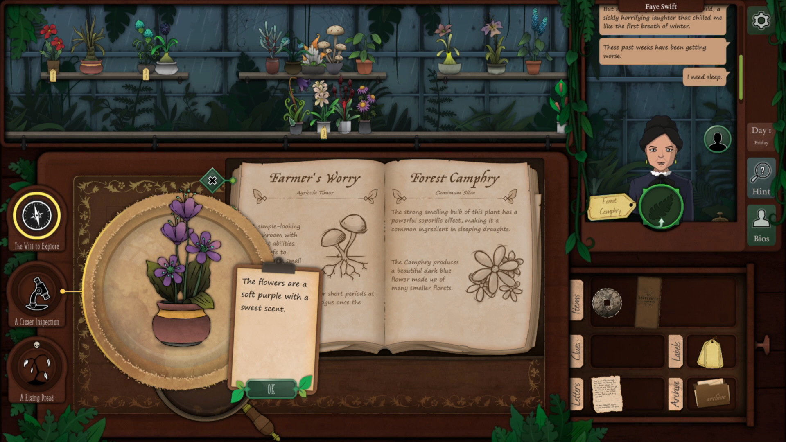
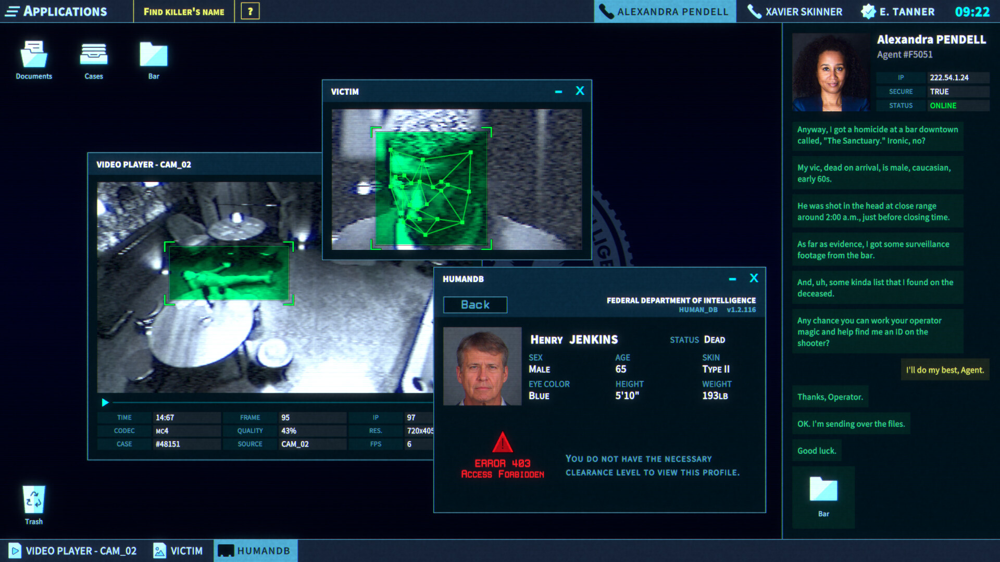
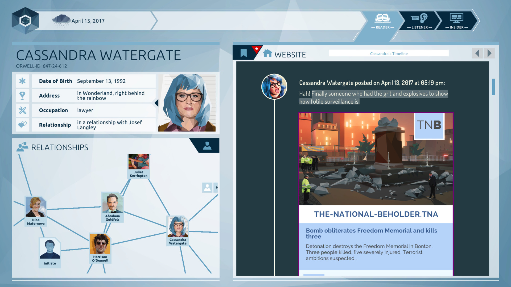
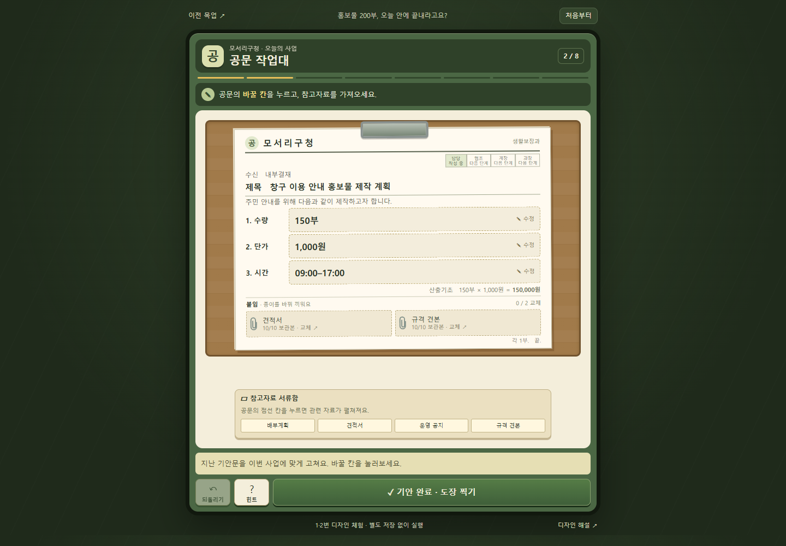
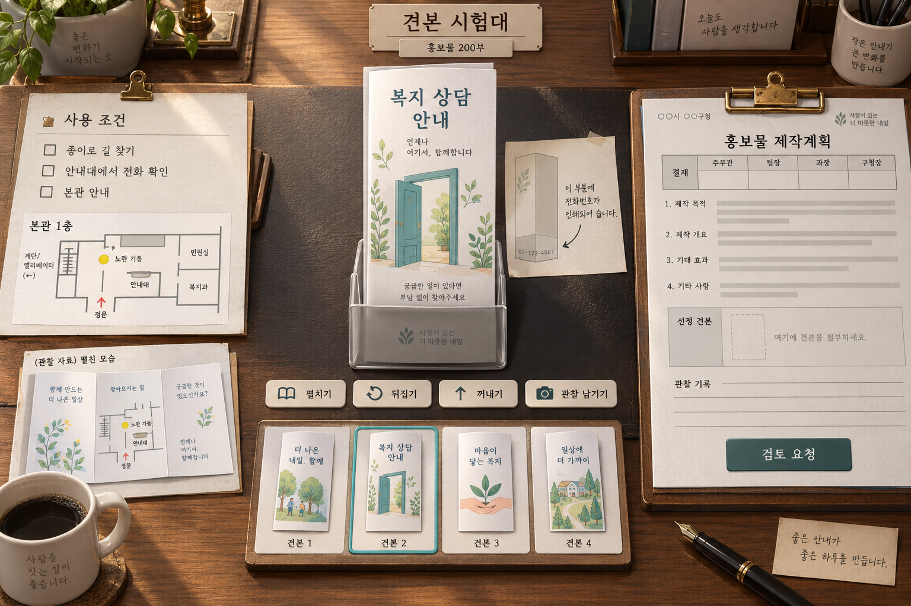
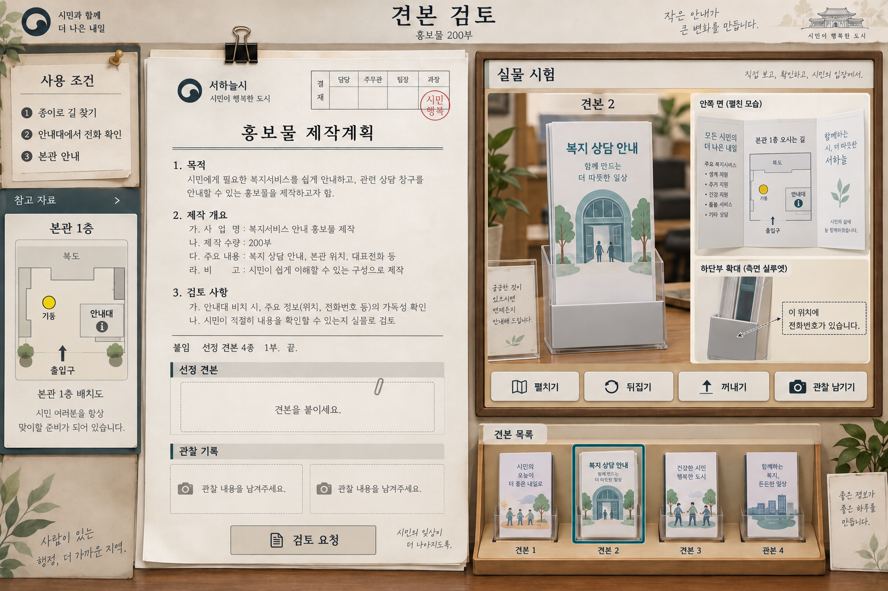

# A 견본 식별 상세 기획 — 안내대에 놓으면 달라지는 홍보물

작성일: 2026-10-11 · 상태: 첫 문제 기본 규칙과 공문 중심 UI 선택 완료. 추가 난이도·상태·저장 등 구현 전 전체 계획 작성 완료. 구현·사용자 플레이 검증 미착수.

첫 공문 상황은 「홍보물 200부, 오늘 안에 끝내라고요?」다. A에서 플레이어는 네 개의 완성 견본을 펼치고 접고 안내대에 넣어 본 뒤, 실제 사용 조건을 충족하는 하나를 골라 제작계획 공문에 붙인다. 예산 배분·가격 계산·공문 문구 조합은 이번 A에 넣지 않는다. 기존 E01 화면과 퍼즐 로직을 계승하지 않는다.

## 1. 사용자 선택과 이번 제안의 구분

사용자가 선택하고 이해 확인까지 마친 범위는 실물 시험 중심, 한 사건에서 핵심 발견 2~3개, 책상 중심·공문 중심 UI 비교, 정적 시안 이미지와 플레이 표다. 두 시안을 본 뒤 공문 중심을 기본 UI로 선택했다. 코딩과 HTML 프로토타입은 만들지 않는다.

사용자는 첫 문제의 견본 네 개·사용 조건 세 개·관찰 기록 두 장을 기본 규칙으로 삼아 전체 계획을 완성하도록 했다. 입문과 도전을 모두 구현하며 진행에 따라 난이도를 변화시킨다. 추가 명세는 [구현 전 전체 명세](A_구현전_전체명세.md), 실행·검증 기준은 [구현 준비 계획](A_구현준비계획.md)에 있다. 견본 번호는 설명용이며 UI 치수·비율·폰트는 아직 승인된 수치가 아니다.

## 2. 한 문장 규칙과 재미의 목표

**겉보기에는 모두 쓸 만한 네 견본을 실제 환경에서 시험해, 종이 안내·본관 동선·안내대에서의 전화번호 가독성을 모두 갖춘 하나를 찾아라.**

플레이의 중심은 보기 좋은 문서를 고르는 취향 평가가 아니다. 펼치면 무엇이 나오고, 안내대에 넣으면 무엇이 가려지고, 안내 그림이 실제 장소와 어떻게 다른지 알아내는 관찰이다. 모든 후보가 한두 조건을 충족하므로 처음에는 그럴듯하다. 실물 시험이 자신의 첫 추측을 바꾸는 순간을 만든다.

기대하는 세 발견은 다음과 같다.

1. 안내 그림처럼 보이는 부분을 펼쳤더니 QR만 있다. 스마트폰 없이 길을 찾을 자료가 없다.
2. 손에 들면 보이던 전화번호가 안내대의 앞턱 뒤로 사라진다. 인쇄된 내용과 실제 비치 상태가 다르다.
3. 지도와 전화번호가 모두 있어도 지도의 접수창구 위치가 본관 안내도와 다르다. 특징 하나만 보고 고를 수 없다.

이 세 가지를 경험하거나 예측해 적합한 견본을 찾는다. 세 오답을 모두 확인해야만 완료되는 구조는 아니다. 좋은 견본을 일찍 찾고 그 이유를 입증해도 인정한다.

## 3. 시작 상황과 실제 제공 자료

### 시작 대사와 목표

짧은 요청 메모를 한 장 보여 준다.

> 오늘 제작할 복지 상담 안내 홍보물 200부입니다. 네 견본 중 본관 안내대에서 쓸 하나를 골라 주세요. 스마트폰 없이도 접수창구를 찾을 수 있어야 하고, 안내대에 꽂힌 상태에서 전화번호가 보여야 합니다.

메모 아래에는 `종이로 길 찾기 / 본관 안내 / 안내대에서 전화 확인` 세 조건을 짧게 고정해 둔다. 이 조건은 진행 중 바뀌지 않는다. 시간제한은 첫 문제에 두지 않는다. 200부는 제작 상황의 정보이며 수량 계산 문제가 아니다.

### 자료 구성

| 자료 | 플레이어에게 실제로 보이는 내용 | 어디에 쓰는가 |
| --- | --- | --- |
| 요청 메모 1장 | 위 요청과 세 사용 조건 | 판단해야 할 목표를 언제든 다시 확인 |
| 본관 1층 안내도 1장 | 아래쪽 입구, 중앙의 노란 기둥, 오른쪽 접수창구, 왼쪽 계단. 안내 경로는 입구에서 기둥을 지나 오른쪽 접수창구로 이어짐 | 견본 안쪽 종이 지도의 장소와 동선을 대조 |
| 견본 4개 | 같은 용도·같은 크기의 완성된 3단 접지 홍보물. 앞면, 뒷면, 펼친 안쪽을 볼 수 있음 | 지도 유무·지도 내용·전화번호 위치를 조사 |
| 실제 사용 안내대 1개 | 앞턱이 불투명하며 종이 아래 부분을 가림. 바닥에 완전히 넣어 쓰는 형태 | 비치한 상태의 전화번호 가독성을 확인 |
| 제작계획 공문 초안 1장 | 제목·결재란·번호식 본문·선정 견본 붙임 영역·관찰 기록 영역 | 조사 결과를 업무 결론으로 남김 |

안내도는 처음부터 제공한다. 옛 지도·변경 메모·여러 담당자의 상반된 지시를 추가하지 않는다. 기준은 하나이며 숨은 행정 지식이 필요하지 않다. 전화번호 자체는 모든 견본에서 같은 게임용 예시 번호를 사용한다. 숫자를 암기하거나 한 자리 오류를 찾는 문제가 아니다.

### 지도 그림의 구체적인 차이

기준 안내도와 견본 지도는 모두 입구를 아래에 놓은 같은 방향의 평면 그림으로 그린다. 지도의 방향 회전이나 그림 축척 차이를 추측해야 하는 부담은 피한다.

- 기준 본관: 입구 아래, 노란 기둥 가운데, 접수창구 오른쪽, 계단 왼쪽.
- 잘못된 지도: 입구 아래, 기둥 가운데, 접수창구 왼쪽, 계단 오른쪽. 옆 건물의 배치다.
- 판단에 필요한 표식은 입구·기둥·접수창구다. 작은 글씨 속에 결정적인 차이를 숨기지 않는다.
- 견본 3의 지도 제목은 다른 견본과 같은 `찾아오시는 길`이다. `오답`, `구버전`, `별관용`이라는 답을 알려 주는 표시는 붙이지 않는다.

이는 의도적인 자료 오류다. 플레이어가 지도와 기준 안내도를 대조하면 차이를 설명할 수 있다. 종이 색·고급스러운 표지·견본 번호로 정답을 예측하지 못하도록 네 견본의 완성도와 표시를 동등하게 둔다.

## 4. 견본별 정답 구조

아래 표는 제작자용 명세다. 플레이어에게 처음부터 결과표로 보여 주지 않는다.

| 견본 | 펼친 안쪽 | 안내대에 넣었을 때 앞면 | 충족하는 조건 | 부적합 사유 |
| --- | --- | --- | --- | --- |
| 1 | 길 안내는 QR만 있고 종이 지도가 없음 | 전화번호가 앞턱 위에 보여 읽을 수 있음 | 전화 확인 | 스마트폰 없이 본관 접수창구를 찾을 종이 안내가 없음 |
| 2 | 기준 본관과 일치하는 종이 지도 | 전화번호가 종이 아래에 있어 앞턱에 완전히 가림 | 종이 안내·본관 동선 | 비치 상태에서 전화번호를 확인할 수 없음 |
| 3 | 종이 지도는 있지만 접수창구와 계단 위치가 다른 건물의 배치 | 전화번호가 앞턱 위에 보여 읽을 수 있음 | 종이 안내·전화 확인 | 본관 동선과 불일치 |
| 4 | 기준 본관과 일치하는 종이 지도 | 전화번호가 앞턱 위에 보여 읽을 수 있음 | 세 조건 모두 | 적합 |

견본 1의 QR 목적지는 문제 풀이에 사용하지 않는다. 인터넷이나 스마트폰으로 QR을 읽어야 하는 조작을 요구하지 않는다. 종이에 길을 찾을 정보가 없다는 사실이 판단 대상이다.

### 실물 모델의 제안 치수

게임 세계의 시험 조건을 분명히 하기 위한 제안이며 화면 픽셀 치수와 다르다. 접힌 종이 높이 210mm, 안내대 앞턱 높이 40mm, 견본 2 전화번호 인쇄 영역은 하단에서 15~25mm, 다른 견본은 55~65mm로 둔다. 종이를 끝까지 꽂으면 견본 2만 번호 영역 전체가 가려진다. 이 값은 아직 사용자 승인 수치가 아니며 향후 실물 화면에서 가독성과 숨김 범위를 검증한다.

사용 조건은 글자가 똑바로 선 정상 방향으로 끝까지 꽂은 상태다. 시험 버튼은 그 상태로 자동 배치한다. 거꾸로 꽂기·조금만 꽂기·앞턱 바꾸기는 조작으로 제공하지 않으며 숨은 실패 조건으로 검사하지 않는다. 안내대 옆 메모에 정상 비치 조건을 먼저 공개한다. 도달 불가능한 상태가 저장 자료에 있으면 복원 오류로 처리한다. 견본은 제작할 안을 고르기 위한 완성품이며 인쇄를 편집하지 않는다.

## 5. 조작과 관찰의 관계

주요 조작은 클릭·탭으로 모두 가능하게 계획한다. 드래그는 사물을 움직이는 감각을 더하는 선택 입력이다. 작은 곳을 정확히 찍거나 끌어야 정답이 되는 퍼즐을 만들지 않는다.

| 조작 | 화면에서 일어나는 일 | 판단에 보태는 정보 |
| --- | --- | --- |
| 견본 선택 | 선택한 한 장이 시험 영역에 크게 놓임. 번호와 선택 테두리만 표시 | 지금 보고 있는 견본을 구별 |
| 펼치기·접기 | 접지 면이 펼쳐지며 실제 안쪽 인쇄가 나타남 | 종이 지도인지 QR인지, 지도에서 어디로 안내하는지 발견 |
| 뒤집기 | 접힌 상태는 앞·뒷면, 펼친 상태는 안쪽·바깥쪽 전환. 현재 면 표시 | 전화번호의 위치와 인쇄 면 확인. 모든 면 조사 자체를 필수로 만들지 않음 |
| 안내대에 넣기·꺼내기 | 접힌 견본을 정상 방향으로 끝까지 넣고, 앞턱이 하단을 실제로 가림. 꺼내면 가렸던 내용이 다시 나타남 | 손에 들었을 때와 비치했을 때의 차이 발견 |
| 안내도와 나란히 보기 | 안쪽 지도와 본관 안내도를 같은 방향으로 나란히 놓음 | 기둥·접수창구·계단의 관계를 직접 비교 |
| 관찰 남기기 | 현재 시험 장면을 견본 번호·관찰 종류와 함께 작은 기록으로 보관 | 기억에 의존하지 않고 후보 비교·근거 제출 |
| 보류·후보에서 빼기 | 플레이어가 견본에 작은 종이 탭을 붙임. 언제든 해제 가능 | 자신의 가설을 정리. 게임은 이 표시를 정답 판정하지 않음 |
| 공문에 붙이기 | 고른 견본과 관찰 기록을 붙임 영역에 넣음. 클릭 선택 후 붙임 영역 클릭도 가능 | 관찰 결과를 자신의 업무 결론으로 제출 |

`펼치기`는 그냥 설명창을 여는 버튼이 아니다. 종이가 펼쳐지는 모습과 인쇄 영역 자체가 조사 결과다. `안내대 시험`도 녹색·빨간색 결과창을 띄우지 않는다. 사물이 실제로 가리는 모습을 보고 플레이어가 조건을 판단한다.

안내대에 있는 견본에서 `펼치기`를 누르면 먼저 종이를 꺼내고 펼치는 연결 동작을 한다. 펼친 견본에서 `안내대에 넣기`를 누르면 접고 넣는다. 불필요한 접기·꺼내기 버튼 순서 맞추기를 강제하지 않는다. 동작 전후 상태는 짧은 애니메이션과 `펼친 안쪽 / 접힌 앞면 / 안내대 비치` 표기로 분명히 보여 준다.

관찰 기록은 정답을 알아서 판정하는 배지가 아니다. `견본 2 · 안내대 정면`처럼 대상과 장면을 표시한다. 모든 면과 도구를 열어야 기록할 수 있다는 조건을 두지 않는다. 모든 견본이 모든 시험을 할 수 있으며 맞는 후보만 도구가 작동하도록 제한하지 않는다.

### 제출할 관찰 기록 두 장

1. **지도 대조 기록:** 선택 견본의 펼친 안쪽과 기준 본관 안내도를 나란히 둔 장면. 종이 지도가 존재하고 그 지도 내용이 기준 장소와 일치함을 한 장에서 보여 준다.
2. **안내대 기록:** 선택 견본을 정상 방향으로 끝까지 넣은 정면 장면. 앞면 전화번호를 읽을 수 있음을 보여 준다.

사진을 남길 때 `맞습니다`를 따로 고르는 정답 버튼은 두지 않는다. 찍은 장면을 그대로 기록하고 제출 전에 확대해서 다시 볼 수 있게 한다. 잘못된 지도·가려진 번호도 관찰 기록으로 남길 수 있으며, 기록이 있다는 이유로 적합 판정을 주지 않는다.

## 6. 실제 플레이 사례

다음은 그럴듯한 오답에서 출발하는 한 경로다. 안내 순서나 의무 수행 목록은 아니다.

| 순서 | 본 자료 → 한 행동 | 화면에서 발견하는 것 | 판단과 재미의 역할 |
| --- | --- | --- | --- |
| 시작 | 요청 메모와 네 견본을 봄 → 견본 2 선택 | 표지도 보기 좋고 전화번호도 인쇄되어 있음 | 일단 쓸 만해 보이는 후보를 자기가 고름 |
| 조사 1 | 견본 2 → 펼치고 본관 안내도와 나란히 놓음 | 종이 지도가 있고 접수창구 위치도 일치 | 첫 가설을 뒷받침하는 발견 |
| 실험 1 | 견본 2 → 안내대에 넣음 | 전화번호가 불투명 앞턱 뒤로 가려짐 | ‘아, 인쇄되어 있어도 꽂으면 못 보는구나’라는 가설 수정 |
| 비교 1 | 견본 1 → 펼침 | 찾아오는 길 대신 QR만 있음 | ‘전화번호 위치만 좋으면 되는 게 아니구나’ |
| 비교 2 | 견본 3 → 펼쳐 기준 안내도와 대조 | 접수창구가 왼쪽으로 안내됨. 본관 기준은 오른쪽 | 보기 좋은 지도도 내용을 확인해야 함을 발견 |
| 확인 | 견본 4 → 지도 대조 후 안내대 시험 | 종이 길 안내와 본관 배치가 맞고, 비치 상태에서 전화번호도 보임 | 세 발견이 하나의 선택으로 모이는 만족감 |
| 제출 | 견본 4와 지도 대조·안내대 기록 두 장 → 공문에 붙임 | 선정 견본과 근거가 실제 공문에 붙어 문서가 완성됨 | 조사가 업무 결과로 남음 |
| 완료 | 검토 요청 | 선정 사유를 짚는 짧은 메모, 선정 견본 클립 고정, 검토란 도장 | 자신의 판단이 인정되는 마무리 |

처음부터 견본 4를 선택했다면 두 시험과 기록만으로 완료할 수 있다. 오답 방문 횟수·반려 횟수·자료를 읽은 순서를 성공 요건으로 쓰지 않는다. 이 경로도 관찰을 통해 조건을 확인했으면 정당한 해결이다.

### 단순 버튼 순회와 구별되는 지점

- 종이를 펼친 결과가 후보마다 다르고, 안내대가 번호를 가리는 결과도 다르다.
- 기능이 실행됐다는 사실보다 드러난 내용을 해석해야 한다.
- 후보 표시·기록·최종 선택은 플레이어가 정한다. 사용 조건별 자동 통과 체크를 조사 중 제공하지 않는다.
- 모든 시험을 반복하지 않고 자신의 가설에 필요한 시험을 고를 수 있다.
- 첫 문제는 유한한 네 후보이므로 제출을 반복해 답을 알아낼 가능성은 있다. 벌점이나 강제 대기로 이를 막지 않는다. 재미 검증에서는 사용자가 왜 고르는지 설명하는지 확인한다. 이후 문제 확장은 조건·사물·도면을 실제로 바꾸는 방식으로 별도 설계한다.

## 7. 판정과 수정 조건

판정은 견본 번호 자체가 아니라 견본의 인쇄 내용과 안내대 비치 결과, 제출 근거의 관계에 둔다. 이번 예시에서는 견본 4가 유일한 적합 후보다.

### 완료 조건

다음 조건을 모두 만족하면 A의 선정 검토를 완료한다.

- 하나의 견본이 공문의 선정 견본 영역에 들어 있다.
- 그 견본에 스마트폰 없이 길을 찾을 수 있는 인쇄 지도가 있다.
- 그 지도에서 입구·기둥·접수창구의 동선이 제공된 본관 안내도와 일치한다.
- 정상 비치 상태에서 앞면 전화번호 인쇄 영역 전체가 앞턱 위에 있고, 화면에서도 읽을 수 있다.
- 지도 대조 기록과 안내대 기록이 각각 그 선정 견본의 실제 관찰 장면이다. 다른 견본의 사진이나 다른 비치 상태를 근거로 붙이지 않았다.

전화번호를 복사해서 본문에 쓰는 것으로 안내대 조건을 대신 충족할 수 없다. 관찰 기록 두 장을 붙이는 것이 업무 근거이며, 별도의 3개 체크박스나 정답 문구 선택을 중복 요구하지 않는다.

### 실패·미완료의 구별

| 제출 상태 | 반응 | 플레이어가 할 수정 |
| --- | --- | --- |
| 견본을 붙이지 않음 | 붙임 위치에 `선정할 견본을 붙여 주세요` | 한 견본 선택 |
| 적합 여부와 별개로 관찰 기록 누락 | 해당 기록 자리에 `확인한 모습을 남겨 주세요` | 필요한 시험 장면을 기록·첨부 |
| 견본 1 제출 | 선정 견본 안쪽 위치에 `스마트폰 없이 길을 찾을 안내가 필요합니다` | 종이 안내가 있는 후보 조사 |
| 견본 2 제출 | 안내대 기록 위치에 `비치한 상태에서 전화번호를 확인하기 어렵습니다` | 번호 위치가 다른 후보 조사 |
| 견본 3 제출 | 지도 대조 기록 위치에 `이 지도는 본관 접수창구 위치와 다릅니다` | 기준 안내도와 다시 비교 |
| 견본 4에 견본 2의 기록을 붙임 | 해당 기록에 `선정 견본과 관찰 대상이 다릅니다` | 같은 견본의 기록으로 교체 |
| 도달 불가능한 시험 상태의 복원 자료 | 정상 플레이의 반려로 처리하지 않고 재시험 가능 상태로 복원 | 공개 조건의 정상 시험으로 기록 |
| 적합한 견본과 두 근거 제출 | `종이 안내·본관 동선·비치 상태의 전화 확인이 가능합니다` | A 완료 |

오류는 위치에 붙는 짧은 빨간 메모로 보여 준다. 견본·관찰·초안을 보존하고 문제가 있는 부분만 고칠 수 있다. 선정을 바꿔도 기존 기록을 몰래 지우지 않는다. 대상이 다른 기록에는 번호 차이를 표시하고 새 견본 기록으로 교체할 수 있게 한다. 정상 방향 안내는 시험 전에 공개하여 제출 후 처음 등장하는 숨은 조건이 되지 않게 한다.

누락된 근거가 있으면 먼저 그 위치를 알려 주며 정답 견본 번호를 말하지 않는다. 실질적 오류가 여러 개면 관련 조건을 짧게 함께 보여 줄 수 있다. 반려 문구를 얻으려고 제출을 반복하는 것이 주요 조사 수단이 되는지 체험에서 확인한다.

## 8. 공문이 맡는 역할

A에서 공문은 관찰 결과의 결론과 붙임을 담는다. 제목은 `복지 상담 안내 홍보물 제작계획`, 번호식 본문에는 제작 목적·수량 200부·선정 사유와 붙임을 표시한다. 실제 공문의 형식을 참고한 게임용 문서다.

본문 초안 예시:

> 1. 본관 방문자의 복지 상담 안내를 위하여 홍보물 200부를 제작하고자 합니다.  
> 2. 본관 동선 안내와 안내대 비치 상태를 확인하여 붙임 견본을 선정하고자 합니다.  
> 붙임  1. 선정 견본 1부.  2. 실물 확인 자료 2매.  끝.

핵심 조작은 견본과 근거를 붙이는 것이다. 본문의 문구 조합·예산·집행·담당자 지정은 이번 A에서 별도 정답으로 검사하지 않는다. 선정한 실물과 기록이 문서에 실제로 나타나며, 완료 후 펼쳐 다시 볼 수 있다. 문서 전체의 결재 완료와 A의 선정 검토 완료를 혼동하지 않도록 도장은 `선정 검토` 칸에만 찍는다. 후속 B·C에서는 제작계획과 지시를 각각 따로 설계한다.

## 9. 참고 게임 구현 방식과 UI를 반영하는 방법

아래의 실제 게임 설명은 공식 자료·개발자 설명·공개 화면에 근거한다. A에 반영하는 방식은 이번 설계의 해석과 제안이다. 화면 에셋이나 판정 로직을 복제하지 않는다. 다른 두 규칙의 상세 계획에도 같은 대응표를 넣도록 상위 계획에 기록했다.

| 참고작의 실제 방식·UI | A에 가져올 원리 | A의 구체적인 조작·UI | A 자체의 판정·확인할 효과 |
| --- | --- | --- | --- |
| Strange Horticulture: 식물을 관찰하고 책의 설명·그림과 비교한다. 가까이 관찰하는 정보에는 냄새·감촉도 있다. 개발자는 결정적 특징의 종류와 후보를 반복 조정했다고 설명한다. 공개 화면에는 식물·펼친 도감·의뢰가 함께 보인다. | 물건을 조사한 특징이 선택의 이유가 되는 식별. 참고자료를 왕복해 기억하지 않도록 함께 표시 | 식물 대신 완성 견본, 책 대신 본관 안내도. 펼친 인쇄 면·안내대 가림을 실제로 관찰하고 기준 그림을 옆에 둠. 책상안의 주된 참고 | 종이 지도·본관 동선·비치 가독성의 자체 조건. 단서를 발견한 사용자가 후보 변경 이유를 말하는지 확인 |
| The Operator: 공식 설명에는 영상·사진 분석기, 데이터베이스, 화학 분석기 등 도구를 사용해 새로운 단서를 얻고 사건을 진행하는 방식이 있다. 공개 UI는 사건 자료와 도구 작업 영역을 구분한다. | 도구 선택이 새 정보를 드러내는 조사 행동이 되도록 구성 | A에는 펼침·실물 비치·지도 비교의 작은 도구만 둠. 공문안은 문서와 시험 영역을 나눔. 터미널·데이터베이스 화면은 추가하지 않음 | 펼침은 인쇄 내용, 비치는 가림 결과를 드러냄. 버튼을 눌렀다는 사실을 통과 요건으로 삼지 않고 도구가 왜 필요한지 이해하는지 확인 |
| Orwell: 개발자는 추출 가능한 정보의 표시와 제출되는 주장 미리보기를 설명한다. 초기에는 모든 정보를 제출하는 행동이 나타나 맥락과 결과를 다듬었다. | 조작 가능한 대상을 명확히 하되 판단까지 자동으로 알려 주지 않기. 무엇을 제출하는지 보이게 하기 | 펼치기·시험·관찰 남기기 행동을 분명히 표시. 관찰 기록에 대상 번호·장면을 표시하고 공문에 붙인 기록을 확대해 확인 | 선택한 견본과 기록의 일치·근거의 충분성을 자체 판정. 정답색을 따라 누르거나 모든 기록을 무차별 제출하는 행동이 생기는지 확인 |

중심 참고는 Strange Horticulture다. The Operator는 도구와 화면 구분, Orwell은 조작 대상과 제출 근거의 명료성을 보조한다. 참고작의 모든 기능을 한 화면에 섞지 않는다. 식물 식별을 그대로 문서 이름 맞추기로 바꾸지도 않는다. 종이가 접히고 안내대가 가리는 사용 시험은 A를 위해 새로 정한 규칙이다.

### 참고 화면과 출처

[Strange Horticulture 개발자 설계 인터뷰](https://www.gamedeveloper.com/design/finding-right-plant-job-strange-horticulture). 위 화면에서는 관찰 대상과 펼친 참고 책이 동시에 보이는 구성을 참고한다.

[The Operator 공식 도구 설명](https://store.steampowered.com/app/1771980/The_Operator/). 자료와 분석 작업 공간을 나누는 UI 원리를 참고한다.

[Orwell 개발자 설계 회고](https://www.gamedeveloper.com/design/game-design-deep-dive-decisions-that-matter-in-i-orwell-i-). 제출되는 자료를 알아볼 수 있는 표현을 참고한다. 기존 이미지의 개별 출처는 연구 폴더의 asset_sources.json에 보존되어 있다.

## 10. 폐기 전 화면과 새 UI 두 방향

### 비교용 기존 화면

기존에 저장된 1440×1000 비교 이미지다. 이번 작업에서 새로 촬영한 현재 실행 화면은 아니다. 필드·자료 버튼·검토 버튼을 중심으로 구성했던 화면을 보여 준다. 이 배치·규칙·판정은 새 설계 기준에서 제외한다.

### 안 1 — 책상 중심

- 중앙에는 만지는 견본과 안내대를 크게 둔다. 왼쪽에 목표·본관 안내도, 아래에 네 견본, 오른쪽에 결과를 받는 공문을 둔다.
- 펼치기·안내대 시험의 움직임과 가림이 눈에 먼저 들어온다. 관찰 기록은 왼쪽 자료와 함께 보관하고 공문에 붙인다.
- 공문은 조사하는 동안 작게 보이며, 작성·제출할 때 확대해 본다. 확대 후 돌아와도 선택과 관찰을 유지한다.
- 장점: 사물을 시험하는 게임으로 바로 읽힌다. A의 주된 행동에 큰 공간을 줄 수 있다.
- 보완할 점: 공문이 작아 문서의 결론을 놓칠 수 있다. 기록을 붙일 때 공문을 확대하고 견본·근거가 들어가는 변화를 보여 준다.

### 안 2 — 공문 중심

- 중앙 왼쪽에는 큰 공문, 오른쪽에는 실물 시험 영역, 왼쪽 가장자리에는 목표·기준 안내도를 둔다.
- 선정 견본 영역은 한 후보를 넣는 빈 자리다. 네 후보의 선택 목록은 시험 영역 아래 한 곳에만 둔다.
- 견본을 시험하면서 공문과 관찰 기록 두 자리를 계속 볼 수 있다. 같은 견본 2가 안내대에 들어간 상태를 시안 1과 비교한다.
- 장점: 공문 업무와 선정·근거의 관계가 잘 드러난다.
- 보완할 점: 문서 본문이 시험보다 먼저 눈에 들어오고 자료가 좁아질 수 있다. 본문은 읽기 부담을 줄이고 안쪽 지도 대조는 넓게 펼쳐 보여 준다.

| 비교 기준 | 책상 중심 | 공문 중심 |
| --- | --- | --- |
| 첫 화면에서 주된 행동 | 종이를 만지고 시험하기 | 문서에 견본과 근거 붙이기 |
| 주된 참고 UI | Strange Horticulture의 사물·참고 책 | The Operator의 자료·작업 영역 구분 |
| 실물 차이가 보이는 공간 | 넓음 | 공문과 나눠 씀 |
| 공문이라는 콘셉트의 노출 | 옆에 놓인 결과물 | 계속 보이는 중심 문서 |
| 우선 추천 | A의 실물 시험을 중심에 두므로 추천 | 문서 중심 경험을 우선할 경우 선택 |

두 시안은 같은 문제·같은 견본 2 시험 상태를 보여 준다. UI의 차이로 게임 규칙을 바꾸지 않는다. **2026-10-11 사용자는 공문 중심 UI를 선택했다. 이후 A 화면 구체화의 기준은 공문 중심 시안이다.** 책상 중심 시안은 비교 자료로 보존한다.

선택한 구성은 공문을 중앙 왼쪽, 실물 시험을 오른쪽, 요청 조건과 기준 안내도를 왼쪽 자료 영역에 두는 방향이다. 실물 시험의 가림과 지도 차이가 잘 보이도록 견본·안내대·지도 대조를 충분히 크게 표시하는 것을 후속 설계 원칙으로 제안한다. 공문은 선정 견본과 관찰 근거를 붙이는 결과 공간이며, 읽어야 할 본문이 시험 행동을 압도하지 않도록 한다. 구체적인 픽셀 치수·폰트·세부 배치는 이번 UI 선택만으로 확정하지 않는다.

두 새 이미지는 1536×1024 정적 개념 시안이다. 생성된 일부 문구·지도·본문·장식 도장은 세부 명세와 다를 수 있다. 제작 기준은 이 문서의 조건·자료·판정이며, 시안의 도시 이름·장식 문구·로고는 채택 결정이 아니다. 공문 중심 이미지의 장식 도장은 승인·완료 상태를 의미하지 않으며 실제 계획에서는 검토 완료 전 해당 도장을 표시하지 않는다. 기존 글씨 크기·앱 비율을 그대로 유지하기로 정한 것도 아니다.

상호작용·가독성·화면 크기·모바일 배치 검증은 아직 하지 않았다. 사용자가 코딩을 하지 말라고 했으므로 HTML을 만들지 않는다. UI 방향을 선택하고 추후 구현을 요청하면 실제 지원 화면에서 크기·폰트·비율을 조정하고 승인된 값을 별도로 기록한다.

## 11. 직관성과 재미를 검증할 기준

### 구현 전 명세 검토

- 견본 표에서 세 조건을 모두 충족하는 후보는 하나뿐인가: 이번 제안은 견본 4 한 개다.
- 판정 조건이 사전 요청·자료·공개된 비치 상태에 모두 나타나는가: 지도·본관·번호·정상 비치를 사전에 공개한다.
- 인쇄 지도를 펼쳐 볼 수 있고 기준 그림과 같은 방향으로 비교할 수 있는가: 제안 규칙에 포함한다. 실제 가독성은 미검증이다.
- 관찰 대상이 다른 기록을 붙여도 성공하지 않는가: 대상과 실제 시험 상태의 일치를 요구한다.
- 모든 후보·도구 방문을 강제하는가: 강제하지 않는다.
- A가 B의 계획 추론이나 C의 지시 시뮬레이션까지 대신하는가: 이번 범위는 완성 견본의 물리적 사용 적합성이다.

### 향후 실제 체험에서 확인할 항목

| 확인할 장면 | 관찰할 질문 | 문제가 드러나면 바꿀 것 |
| --- | --- | --- |
| 처음 시작 | 목표와 첫 행동을 설명 없이 이해하는가 | 목표 메모·선택 상태·동작 버튼의 표현 |
| 펼치기 | 안쪽 인쇄가 새 정보라는 것을 알아보는가 | 확대 크기·접힘 애니메이션·지도와 QR의 구별 |
| 안내대 시험 | 번호가 가려졌다는 사실과 원인을 발견하는가 | 앞턱의 불투명도·실제 가림 범위·전화번호 가독성 |
| 지도 대조 | 지도 차이를 발견하면서도 어디부터 볼지 막히지 않는가 | 표식·방향·나란히 보는 구성 |
| 최종 선택 | 왜 이 견본인지 자기 말로 설명하는가 | 단서의 차이와 후보 구성. 설명을 더 읽히는 방식으로만 해결하지 않음 |
| 근거 첨부 | 조사와 별개로 반복 서류 작업을 한다고 느끼는가 | 기록 생성·첨부를 더 짧게 연결. 중복 확인 버튼 제거 |
| 수정 | 반려 메모가 고칠 곳을 알려 주는가 | 위치·문구·진행 보존 |
| 완료 후 | 재미있었던 순간이 실제 관찰·추측 변화였는가 | 그 발견을 강화하거나 문제 자체 재설계 |

첫 체험의 대상·절차·판단 기준은 구현 준비 계획에 제안했다. 지금은 재미가 검증됐다고 표현하지 않는다. 후보를 모두 순서대로 시험하고 버튼이 바뀔 때마다 기록하는 기계적 행동만 나타나면, 보상 애니메이션을 늘리기보다 단서·가설·시험 관계를 먼저 수정한다.

힌트는 요청할 때 단계적으로 제공한다. 1단계 `종이를 들고 볼 때와 꽂아 놓을 때가 같을까요?`, 2단계 `앞턱이 가리는 인쇄 영역을 보세요`, 지도 쪽 막힘에는 `본관 안내도의 입구·기둥·접수창구 위치를 비교해 보세요`처럼 행동 방향을 준다. 정답 견본 번호를 첫 힌트로 알려 주지 않는다.

## 12. 상태와 다음 결정

이번 산출물은 상세 규칙 제안, 플레이 사례, 판정·수정 명세, 참고 게임 반영표, 폐기 전 비교 이미지와 새 정적 시안 두 방향이다. 게임 코드·HTML·기존 에피소드 계약·본편 연결·배포는 변경하지 않았다.

사용자 선택을 바탕으로 추가 계획을 작성했다. [구현 준비 계획](A_구현준비계획.md)을 진입 문서로 사용하고 [구현 전 전체 명세](A_구현전_전체명세.md)의 난이도·조작·상태·저장·결과·제작 기준을 따른다. 구현은 별도 요청 후 진행한다. 계획 작성과 제안 수치는 실제 화면·재미 검증 완료를 뜻하지 않는다.

상위 계획: [공문 세 규칙 통합 계획](../../PROJECT_PLAN.md) · 제작 기록: [정적 UI 이미지 제작 기록](UI_이미지_제작기록.md).
