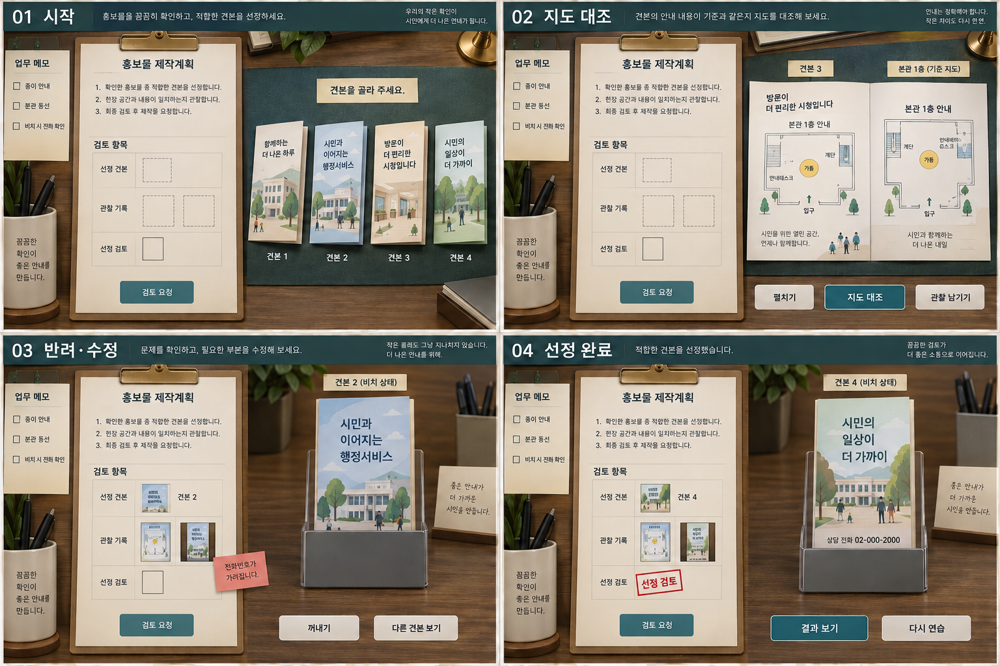
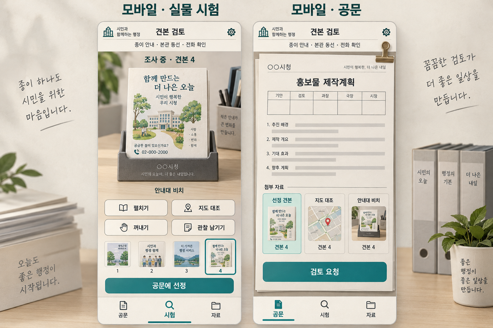
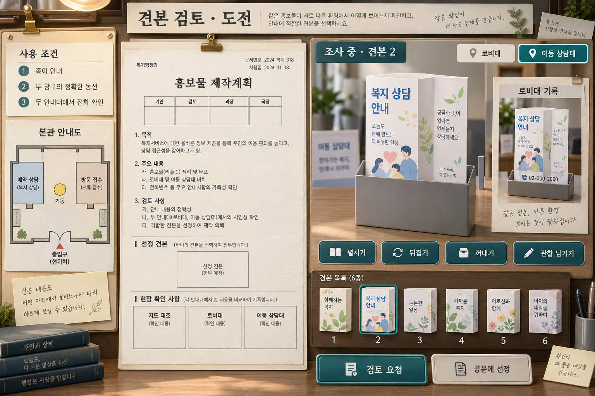

# A 견본 식별 — 구현 전 전체 명세

작성일: 2026-10-11 · 계획 문서 작성 단계. 게임 코드·HTML·본편 연결·배포·사용자 플레이 검증은 미착수다.

## 1. 기준과 문서 역할

사용자 확정 범위는 공문 중심 UI, PC·태블릿·휴대폰 모두 지원, 첫 문제의 견본 4개·조건 3개·관찰 근거 2장, 독립 A 완성과 B·C 전달 명세, 체크리스트·상태표·정적 시안이다. 입문형과 도전형을 모두 구현 대상으로 삼고 게임 진행에 따라 난이도를 변화시킨다.

[기본 문제 상세 기획](A_견본식별_상세기획.md)은 첫 문제의 요청·자료·견본 특징·플레이 사례·참고 게임 설명을 보존한다. 이 문서는 추가 콘텐츠와 구현 동작의 기준이며, 실행 순서와 인수 검증은 [구현 준비 계획](A_구현준비계획.md)에서 관리한다. 구체적인 UI 치수·시간·체험 기준은 이번에 제안한 시작값이며 사용자 승인을 받았거나 검증했다고 표현하지 않는다.

첫 A에서는 제작할 완성 견본 하나를 조사해 공문에 선정하고 실제 근거를 붙인다. 예산·가격·본문 문구 조합·NPC 행동 시뮬레이션은 별도의 정답 항목으로 넣지 않는다. 기존 게임·E01의 상태·판정·점수·퍼즐 엔진은 재활용하지 않는다.

## 2. 입문부터 도전까지의 콘텐츠

### 단계와 공개 조건

| 단계 | 후보·사용 환경·근거 | 주된 판단 | 도움 |
| --- | --- | --- | --- |
| 입문 | 기본 문제의 네 견본, 기준 지도, 앞턱 40mm 안내대 하나, 지도·비치 기록 두 장 | 종이 안내 존재·본관 동선·비치 상태 전화 가독성 | 첫 조작 안내와 요청형 힌트 |
| 중간 | 아래 H1·H2·H3·H5 네 견본, 두 창구 지도, 40mm·75mm 안내대 두 개, 기록 세 장 | 하나의 환경에서 적합한 견본이 다른 환경에서도 적합한가. 지도 모양과 창구 이름이 모두 맞는가 | 새 환경·창구만 짧게 소개 |
| 도전 | H1~H6 여섯 견본, 중간과 같은 지도·두 안내대·세 근거 | 접힌 면, 두 비치 환경, 창구 이름, 이용 가능한 입구를 함께 관찰 | 첫 힌트는 조사 방향, 추가 요청 때 구체적인 지점 |

중간 단계는 입문과 도전 사이의 학습 연결이다. 시간제한은 모든 단계에서 두지 않는다. 글씨 크기 축소, 숨은 규칙, 반려 벌점으로 난이도를 만들지 않는다. 실패해도 부분 수정과 자유 조사를 유지한다.

입문 문안은 기본 상세 기획의 요청을 사용한다. 중간·도전의 요청은 다음과 같다.

> 이번 견본은 본관 로비와 이동 상담 안내대에 함께 비치합니다. 종이 안내로 정문에서 방문 접수창구와 예약 상담창구를 각각 찾을 수 있어야 합니다. 접힌 홍보물을 두 안내대에 끝까지 꽂았을 때, 앞면의 전화번호 전체를 읽을 수 있는 견본 하나를 골라 주세요.

조건은 종이 안내·정확한 본관 동선·비치 시 전화 확인의 세 축을 유지한다. 전화 조건의 환경이 두 곳으로 늘어난다. 정상 방향·끝까지 꽂기·앞면 전체 번호를 문제 시작부터 공개한다. 중간·도전은 지도 대조 한 장, 로비대 비치 한 장, 이동 상담대 비치 한 장을 제출한다.

### 중간·도전 기준 자료

본관 안내도는 아래쪽 정문, 중앙 기둥, 오른쪽 방문 접수창구, 왼쪽 예약 상담창구, 왼쪽 위 계단을 표시한다. 왼쪽 측문은 사용 불가 글자와 폐쇄 표식이 있다. 종이 경로는 사용 가능한 정문에서 출발해야 한다. 안내대는 로비대 앞턱 40mm, 이동 상담대 75mm다. 색만으로 표식을 구별하지 않는다.

| 후보 | 지도·경로 | 전화 인쇄 | 사용 시험 | 부적합 사유 |
| --- | --- | --- | --- | --- |
| H1 | QR뿐, 인쇄 지도 없음 | 전체 번호가 앞면 하단에서 85~95mm | 두 안내대에서 보임 | 종이 안내 없음 |
| H2 | 지도·창구 이름·정문 출발이 맞음 | 전체 번호가 55~65mm | 로비대에서는 보이고 이동 상담대에서는 가림 | 두 환경 중 하나 불충족 |
| H3 | 지도 형태는 맞지만 방문 접수·예약 상담 이름을 교환 | 전체 번호가 85~95mm | 두 안내대에서 보임 | 창구별 안내 불일치 |
| H4 | 지도·경로가 맞음 | 번호의 마지막 네 자리가 접힌 다른 면으로 이어짐 | 펼친 바깥면에는 전체 번호, 접힌 앞면에서는 일부만 보임 | 접힌 상태에서 번호 전체를 확인할 수 없음 |
| H5 | 지도·창구 이름·정문 출발이 맞음 | 전체가 앞면 85~95mm | 두 안내대에서 보임 | 적합 |
| H6 | 창구·도착점은 맞으나 폐쇄된 측문에서 경로 시작 | 전체 번호가 85~95mm | 두 안내대에서 보임 | 이용 가능한 입구에서 시작하지 않음 |

H4는 숫자 오타가 아니다. 펼친 바깥면과 접힌 앞면의 차이가 단서다. 뒤집기·펼치기로 모든 인쇄 면을 조사할 수 있다. 추가 면 조사 기록을 보관할 수 있으나 적합 후보 제출에 네 번째 증빙을 요구하지 않는다. 입문·중간·도전 모두 적합 후보 한 개를 가진다.

### 진행과 재도전

독립판은 입문·중간·도전 사건을 모두 연습할 수 있게 한다. 기본 진행은 첫 입문 완료 → 다음 중간 사건 → 이후 도전 사건이다. 고유 사건의 완료가 진행을 증가시키며 같은 사건 반복 완료는 중복 증가시키지 않는다. 본편의 전체 레벨 임계치는 임의로 정하지 않고 연결 담당이 정한 사건 단계 입력을 받는다.

난이도는 문제 시작에 고정한다. 풀이 시간·반려·힌트 사용으로 진행 중 문제를 바꾸지 않는다. 연습 난이도 변경은 새 시도이며 기존 시도를 보존한다. 힌트는 보상을 삭감하지 않는다. 후보 표시 순서는 시도별로 섞되 저장해 재개 때 유지한다. 후보 내용의 무작위 생성은 첫 구현에 넣지 않는다. 정답 위치를 외우는 재플레이와 첫 관찰의 재미는 구별해 검증한다.

## 3. 자료 원본·문구·에셋

### 내용과 제작물

| 제작물 | 필요한 원본 | 표현·확인 |
| --- | --- | --- |
| 요청 메모 | 입문·중간·도전 문안, 세 조건·정상 비치 규칙 | 실제 텍스트. 현재 사건 문안만 표시 |
| 기준 지도 | 입문 1개, 중간·도전 공용 1개 | 확대 가능한 도형·표식·경로·이름 |
| 완성 견본 | 입문 4개, 중간·도전 공용 6개, 각 접힌 앞·뒤·펼친 안·밖 | 같은 인쇄 원본에서 접힘과 가림을 표현 |
| 안내대 | 40mm·75mm 두 종류 | 불투명 앞턱. 종이와 같은 배율 |
| 공문 | 제목·번호식 본문·결재 외형·선정 검토 칸·붙임 영역 | 실제 텍스트, 선정 검토 완료만 표시 |
| 관찰 카드 | 지도·비치 환경·추가 면 기록 틀 | 대상·종류·환경 캡션과 당시 장면 |
| 상태·반려 문구 | 누락·불일치·실질 오류·저장 문제 | 문구와 표시 위치가 대응 |
| 공통 그림 | 종이·클립·도장·카메라·접기·비치·도움 | 글자 라벨 병기, 장식이 단서를 가리지 않음 |
| 소리 | 펼침·삽입·기록·클립·메모·도장 | 짧고 낮은 음량. 음소거해도 결과를 이해 |

모든 견본 앞면 제목은 복지 상담 안내, 전화는 예시 번호 02-000-2000이다. 안쪽은 이용 안내·찾아오시는 길·상담 안내로 나눈다. QR 견본 문구는 찾아오시는 길은 QR에서 확인하세요다. 지도 견본은 인쇄 지도·입구·창구·경로를 담는다. QR은 스캔·외부 접속을 요구하지 않는다.

네 견본과 도전 후보의 글씨 크기·용지 품질·정보량·완성도는 동등하게 둔다. 표지 그림은 중립적인 식별 보조이며 정답만 고급스럽게 꾸미지 않는다. 숨은 구버전·별관용 라벨로 답을 알려 주지 않는다.

### 좌표와 접지 원본

지도 그림 영역은 가로·세로 0~100 기준으로 정문 (50,95), 기둥 (50,50), 접수창구 (80,55), 계단 (20,25)로 제안한다. 입문 오지도는 접수창구 (20,55), 계단 (80,25)다. 중간·도전은 방문 접수 (80,55), 예약 상담 (20,55), 측문 (0,55·사용 불가)를 추가한다. H3은 창구 이름 교환, H6은 측문 출발이다. 이는 제작 기준이며 화면 픽셀 좌표가 아니다.

종이는 접힌 면 폭 100mm·높이 210mm, 펼친 폭 300mm로 모델링한다. 정상 번호의 모든 글자 영역은 앞면 안에 들어간다. H4는 펼친 바깥면에서 앞면에 02-000-, 인접 면에 2000이 이어지는 한 번호다. 접으면 앞면에는 첫 부분만 나타난다. 글자별 인쇄 영역과 접힘·앞턱 가림 영역을 화면·기록·판정의 동일한 원본으로 사용한다.

인쇄 지도와 번호는 생성 시안에서 오려 쓰지 않는다. 정확한 정보는 새 벡터·텍스트로 제작한다. 참고작 스크린샷은 연구 자료로만 쓰며 게임 에셋은 새로 만든다. 출처·이용 조건은 에셋 목록에 기록한다. 첫 구현은 자체 종이·벡터·소리를 우선해 유료 서비스나 구매 에셋을 필수로 두지 않는다.

공문 기본 문안과 붙임은 기존 상세 기획 8절을 사용한다. 중간·도전의 붙임 자료 수는 3매로 바꾸고, 본문에는 두 비치 환경을 확인했다는 내용을 반영한다. 전체 발주·지출·결재 완료를 주장하지 않는다.

## 4. 화면·입력·접근성

### 배치 시작값

| 화면 | 배치 | 보존·확대 |
| --- | --- | --- |
| 너비 1280 이상 | 자료·공문·시험 세 영역. 1440×900 기준 좌우 24, 간격 16, 자료 224·공문 496·시험 640 | 목표·조사·선정·시험을 함께 표시 |
| 너비 900~1279 | 공문·시험 두 영역, 참고 자료 펼침. 지도 대조는 크게 확대 | 자료·확대 종료 후 초안·선택·기록 보존 |
| 너비 900 미만 | 공문·시험·자료 탭. 첫 진입은 공문 요약과 견본 시험 시작 버튼 | 목표와 조사 번호 유지, 시험에서 선정·첨부 가능 |

수치는 제안 시작값이며 승인된 시안 치수가 아니다. 휴대폰에서 펼친 종이·기준 지도를 동시에 비교할 때 좌우가 좁으면 위아래로 같은 방향·배율에 놓는다. 둘을 기억하면서 탭을 반복하도록 만들지 않는다. 세 근거는 세로로 놓으며 가로로 작게 압축하지 않는다.

현재 본편 game.css의 기본 글꼴은 Malgun Gothic·시스템 글꼴, 본문 15px/1.65다. A 제안값은 같은 글꼴 계열의 본문 16px/1.6, 문서 제목 22~24px, 보조 캡션 최소 13px, 주요 터치 영역 최소 44×44px다. 휴대폰은 기기 한국어 시스템 글꼴을 쓴다. 지도 표식과 번호는 확대해 본문 수준으로 읽혀야 한다. 이 확인은 글꼴 기준만 참고한 것이며 기존 퍼즐 로직 재활용을 뜻하지 않는다.

시각 시작값은 종이 #FFFDF3, 작업 배경 #EDE5D6, 본문 #263C3D, 선택·주요 행동 #2B6C70, 반려 메모 #A5483A다. 그림자는 사물 높이와 붙임을 구별하는 정도로 제한한다. 큰 화면의 상단 요약은 64px 높이, 시험 사물 영역은 최소 360px 높이를 시작값으로 한다. 작은 화면·짧은 화면에서는 문서를 독립 스크롤하고 사물을 확대할 수 있으며 페이지 전체를 축소해 글씨를 맞추지 않는다. 대비·글씨·터치 크기는 실제 화면 검증 대상이고 색만으로 정답·오답을 구별하지 않는다.

### 입력과 표현

- 클릭·탭만으로 모든 후보 선택·펼침·뒤집기·비치·기록·첨부·검토를 완료할 수 있다.
- 드래그는 견본·기록 첨부의 선택 입력이다. 영역 밖에 놓으면 돌아오며 삭제되지 않는다. 휴대폰에서는 세로 스크롤을 우선한다.
- 키보드는 Tab 이동, Enter/Space 실행, Escape 확대·자료 닫기를 지원한다. 닫으면 원래 포커스로 돌아온다.
- 호버 안내는 터치·포커스에서도 볼 수 있다. 선택·보류·제외는 색과 글자·테두리를 함께 쓴다.
- 화면 읽기 설명은 현재 면·지도 배치·번호 위치·가려진 부분을 설명하며 정답을 선언하지 않는다.
- 동작 줄이기 설정은 결과를 즉시 표시한다. 음소거·동작 제거 상태에서도 사물과 상태 글자로 모든 결과가 남는다.
- 제외 후보도 목록에 남겨 다시 조사할 수 있다. 탭 전환·기기 회전·확대 종료가 기록 삭제나 새 시도를 일으키지 않는다.
- 기본 풀이에 텍스트 입력·가상 키보드는 필요하지 않다. 하단 탭·검토 버튼은 기기 안전 영역을 확보한다.

### 기본 시안과 상태 시안

첫 이미지는 선택한 현재 방향이며, 다음 세 이미지는 같은 방향의 상태·화면 전환·도전 환경 제안이다. 정적 개념 이미지의 일부 글자·도형은 정확한 제작 원본이 아니다. 모바일 이미지의 지도 축소 그림은 실제 구현에서 본관 실내 안내도로 교체한다. 기본 시안의 장식 도장은 완료 상태로 사용하지 않는다. 정확한 문구·후보·근거 개수·판정은 문서 기준을 따른다. HTML은 만들지 않았으므로 실측·상호작용 검증은 후속 구현 단계에서 한다.

## 5. 상태와 버튼 동작

조사 중인 후보와 공문에 선정한 후보는 별개다. 후보를 클릭해 조사해도 공문 선정은 바뀌지 않는다. 선정은 공문에 선정 또는 붙임 동작으로만 바꾼다. 화면에는 조사 중 N과 선정 M/미선정을 따로 표시한다.

| 상태 | 행동 | 전환·보존 |
| --- | --- | --- |
| 시작 | 요청·자료 보기, 후보 선택 | 조사·선정·기록 없음. 정답 자동 선택 없음 |
| 접힌 앞면/뒷면 | 펼침·뒤집기·비치·선정·보류 | 조사 상태만 변경 |
| 펼친 안쪽/바깥쪽 | 접기·뒤집기·대조·선정 | 안·밖 인쇄 원본 구별 |
| 지도 대조 | 기준과 후보 함께 관찰·기록 | QR 후보도 대조·기록 가능, 자동 통과 표시 없음 |
| 안내대 비치 | 꺼내기·펼침·기록·환경 변경 | 펼침은 꺼낸 뒤 안쪽 펼치기, 환경 변경은 같은 후보 정상 비치 |
| 동작 전환 | 후보·화면 변경으로 취소 가능 | 기록·제출 잠시 비활성, 저장은 목표 상태. 중간 프레임 저장 없음 |
| 근거 준비 | 선정·첨부·교체·해제·재조사 | 대상 변경 때 기록 자동 삭제 없음, 번호 불일치 표시 |
| 검토 중 | 고정 제출본 보기 | 중복 제출·선정 변경 잠시 제한, 판정 즉시 결과 표시 |
| 반려 | 오류 위치 보기·후보/기록 수정 | 초안·관찰 보존, 해당 부분만 수정 |
| 완료 | 결과·붙임 보기, 다시 연습, 결과 전달 | 완료 결과 고정. 연습은 새 시도 |

안내대 시험은 정상 방향으로 끝까지 자동 비치한다. 비정상 방향·부분 삽입·안내대 크기 변경은 입력으로 제공하지 않으며 숨은 정답 실패 조건으로 쓰지 않는다. 공개 조건은 사물 시험의 의미를 알려 주는 기준이다.

제안 동작 시간은 펼침 260ms·비치 320ms·기록 표시 120ms·클립 160ms·도장 220ms다. 길게 기다리는 작업이나 타이밍 도장 게임은 없다. 전환 중 사물 행동을 반복 입력해 중복 적용하지 않는다. 후보 변경·탭 이동은 전환을 끝 상태로 정리한 뒤 수행한다. 저장에는 안정된 목표 상태만 남긴다.

본문·선정·근거 수정은 초안 버전을 바꾼다. 과거 반려는 해당 자리에서 수정됨·재검토 필요로 표시하고, 새로운 적합 판정은 검토 요청 때만 한다. 조사 화면은 적합 조건 자동 체크를 하지 않는다.

처음 조작 안내는 후보 선택 → 펼치기/시험 버튼 위치 → 기록과 붙임의 의미만 소개하고 정답 경로를 강제하지 않는다. 입문 첫 진입은 견본 목록을 가리키는 짧은 안내가 있으며 건너뛰기·다시 도움 보기가 가능하다. 완료한 사용자는 재연습에서 이를 반복해서 보지 않는다.

## 6. 관찰·첨부·판정

### 관찰 기록

| 항목 | 규칙 |
| --- | --- |
| 생성 | 안정된 지도 대조·정상 비치·펼친 면에서 기록. 빈 시험대는 기록하지 않음 |
| 종류 | 지도 대조, 안내대 ID별 비치, 선택적 면 조사 |
| 원본 | 대상·종류·환경·자료 버전·당시 사물 상태. 실제 화면 전체 PNG 저장 없음 |
| 반복 | 같은 대상·종류·환경·내용 버전은 기존 카드를 다시 선택, 카드가 무한히 늘지 않음 |
| 불변 | 새 후보·면·안내대를 조사해도 옛 기록의 장면이 바뀌지 않음 |
| 첨부 | 맞는 종류의 슬롯만 받음. 대상 번호 불일치는 표시하고 검토 때 검사 |
| 제거 | 붙임에서 해제해도 보관 기록 유지. 첨부된 보관 기록을 삭제하면 해당 붙임도 빠진다는 안내와 취소 선택을 제공. 삭제 실행 시 그 연결만 해제 |
| 모바일 | 기록 후 저장 알림과 첨부 선택 제공. 자동 선정·탭 이동·제출 없음 |

지도의 유무·정확성이 틀려도 기록할 수 있다. 기록이 있다는 사실을 통과로 보지 않는다. 기록 그림은 당시 장면을 축소 재현하며 현재 탭·스크롤에 영향받지 않는다. 후보를 바꾸어도 이전 자료를 몰래 교체하지 않는다.

공문 붙임은 선정 견본 한 개, 지도 기록 한 개, 사용 환경별 비치 기록이다. 입문은 두 관찰 슬롯, 중간·도전은 세 슬롯이다. 본문에 번호를 복사하거나 추가 면 사진을 넣는 것으로 비치 근거를 대신하지 않는다. 검토 버튼은 숨기지 않으며 미선정일 때 누르면 선정 위치를 안내한다.

### 판정 순서

1. 선정과 필수 종류의 근거가 있는지 검사한다. 누락이면 해당 위치를 안내한다.
2. 근거의 대상·종류·환경·자료 버전이 제출본과 일치하는지 검사한다.
3. 종이 지도와 사용 가능한 입구·필요 창구의 이름·위치·경로가 기준 자료와 맞는지 검사한다.
4. 각 필수 환경에서 접힌 앞면 전화번호의 모든 인쇄 글자 영역이 노출되는지 검사한다.
5. 모두 충족하면 해당 제출본의 선정 검토 완료와 고정 결과를 만든다.

근거 누락·대상 불일치가 있으면 아직 실질 정답 검사가 완료된 것처럼 표시하지 않는다. 판정은 화면의 조사 후보나 클릭 횟수가 아니라 공문의 선정·자료에 적용한다. 사진은 별도 자료를 위조하는 자유 업로드가 아니라 실제 관찰 상태다.

인쇄·접힘·앞턱의 물리 모델로 가림을 계산한다. 일부 글자라도 가리면 전체 번호 조건 불충족이다. 화면 해상도·배율·조작 정밀도는 답을 바꾸지 않는다. 실제 가독성은 별도 UI 검증이다. 정답 ID 비교나 유리한 색을 숨은 규칙으로 쓰지 않는다.

기존 반려 문구에 중간·도전의 이동 상담대에서는 전화번호 일부가 가려집니다 / 접힌 앞면에서 전화번호 전체를 읽기 어렵습니다 / 방문 접수와 예약 상담 표시를 다시 확인해 주세요 / 현재 사용할 수 있는 정문에서 출발하는 안내가 필요합니다를 추가한다. 각각 해당 근거·면 위치에 붙인다. 초안·사진을 유지하고 해당 부분만 교체한다.

저장 자료에서 도달 불가능한 사물 상태가 발견되면 복원 오류로 처리하고 재시험 가능 상태로 정리한다. 이를 정상 플레이의 반려 조건으로 노출하지 않는다.

### 도움과 완료

힌트는 펼침·지도·비치·근거 첨부의 주제를 고를 수 있게 한다. 첫 힌트는 어디를 시험할지, 다음 힌트는 무엇을 비교할지를 안내한다. 입문에서는 기둥·접수창구·앞턱을 구체적으로 말하고 도전에서는 두 환경·접힌 면·경로 시작점부터 짚는다. 조건은 항상 공개하며 추가 힌트 요청을 실패 횟수·시간으로 잠그지 않는다. 답 번호를 첫 힌트로 말하지 않는다.

완료는 선정 검토 칸의 도장, 견본 클립 고정, 두/세 근거 확대 보기로 마무리한다. 전체 공문 결재·발주·지출 완료를 표시하지 않는다. 결과 보기·다시 연습·다음 사건을 구분한다. 독립판은 외부 게임 재화·경험치를 지급하지 않고 완료 기록을 남긴다.

## 7. 데이터·저장·결과 전달

### 내부 자료 책임

| 데이터 | 포함할 내용 |
| --- | --- |
| 사건 | 사건 ID, 자료 버전, 난이도, 요청, 후보 목록, 요구 환경·창구·근거 종류 |
| 후보 | ID·중립 표시·접지·면별 인쇄·번호 글자 영역·지도 표식·경로 |
| 환경 | 안내대 ID·이름·앞턱·정상 배치 |
| 상태 | 조사와 선정, 후보별 접힌 앞/뒤·펼친 안/밖·대조·비치 상태와 환경·보류, 공문/시험/자료 탭, 기록·첨부, 초안 버전·검토 상태 |
| 기록 | ID·대상·종류·환경·자료 버전·불변 관찰 상태 |
| 결과 | 제출본과 판정, 완료 ID, 선정 스펙·근거 참조·충족 조건 |

표시·기록·판정이 같은 사건 자료와 사물 모델을 참조한다. 예쁜 비트맵과 별도 정답 값의 두 원본으로 관리하지 않는다. 화면 상태 변경은 한 통로에서 처리하고 판정은 입력 자료의 조건을 평가하는 독립 책임으로 둔다.

### 저장

독립 저장 영역 제안은 gong-game:life-support:leaflet-a:v1이다. 기존 본편·부서 저장을 덮거나 전체 초기화하지 않는다. 저장 내용은 형식 버전·사건/자료 버전·난이도·시도·고정 후보 순서·조사·초안·기록·첨부·반려·완료·소리/동작 설정이다. 임시 포인터 위치·호버·중간 애니메이션 프레임은 저장하지 않는다.

기록·선정·첨부·사물 상태·검토·설정의 안정된 변화에 자동 저장한다. 새로고침하면 같은 자료·후보 순서·초안·근거로 복원한다. 검토 중 재개는 고정 제출본을 재판정해 안정 상태로 정리하고 완료를 중복 전달하지 않는다. 탭·확대의 기기별 배치가 바뀌어도 동일 조사와 공문을 유지한다.

자료 버전 변경은 이전 결과를 보존하며 변경된 진행 사건의 근거를 재시험 필요로 처리한다. 손상된 항목만 안전한 상태로 복구하고 다른 사건 저장은 유지한다. 저장 불가 때 메모리에서 계속하고 진행을 저장하지 못했습니다를 짧게 알린다. 저장 오류를 정답 오류로 취급하지 않는다.

### B·C에 전달하는 완료 결과

| 항목 | 의미 |
| --- | --- |
| resultId·attemptId·caseId | 어떤 완료 결과인가, 중복 처리 방지 |
| contentVersion·draftRevision | 완료 때의 자료와 제출본 |
| difficulty | 입문·중간·도전 |
| selectedCandidateId·selectedSpec | 선정 견본, 접지·크기·지도·번호·자료 참조 |
| evidenceRefs | 대상·종류·환경별 근거 |
| satisfiedConditions | 종이 안내·동선·각 환경 가독성 |
| status | 선정 검토 완료. 발주·지출·전체 결재 완료 아님 |

반려·미완료는 완료 결과를 내보내지 않는다. 본편 소비자는 같은 resultId를 재처리하지 않는다. 이후 선정 정정 기능을 연결할 때는 새 결과 ID와 이전 결과 참조를 만들고 B·C에서 영향을 받는 제작 내용·지시를 다시 확인해야 한다. 이 문서는 전달 의미만 정하며 B·C 내부 화면·판정·본편 API를 구현하지 않는다.

시도 ID는 새 사건 시도 생성 때 한 번 만들고 저장한다. 완료 결과 ID는 그 시도와 완료 제출본 버전에 대응해 한 번 정한 뒤 저장·재사용한다. 새로고침·다시 보기·재전달로 새 완료 ID를 만들지 않는다. 연습 시도는 별도의 ID이며 기존 완료 기록을 덮지 않는다.

사건 ID는 life-support:leaflet-a-intro / life-support:leaflet-a-bridge / life-support:leaflet-a-challenge를 제안한다. 공유 ID는 프로젝트 life-support 접두어 기준을 따른다. 캠페인 해금·실제 보상·저장 API·부서 이동은 연결 담당과 최신 소스 확인 후 맞춘다. 독립 A의 구현을 이 API 확정까지 막지 않는다.

## 8. 구현 책임과 제작 순서의 기준

실행 방식은 담당 폴더의 독립 웹 퍼즐이다. 새로운 기본 HTML·CSS·브라우저 JavaScript와 벡터로 계획하고 서버·외부 서비스·프레임워크를 필수로 두지 않는다. 현재 해당 코드를 만들지 않았다.

| 책임 | 수행 | 지켜야 할 경계 |
| --- | --- | --- |
| 사건 자료 | 난이도·인쇄·지도·환경·문구 | 정답 ID가 아닌 실제 특성 |
| 장면 모델/표시 | 면·접힘·비치·대조·기록 재현 | 화면과 판정의 같은 가림 |
| 상태 변경 | 선택·사물·기록·첨부·수정·완료 | 조사/선정 분리, 기록 불변 |
| 판정 | 조건과 근거 평가, 위치별 반려 | UI 방문 횟수·난이도 변화에 의존하지 않음 |
| 화면/입력 | 문서·시험·자료·확대·탭·포커스 | 모든 입력의 같은 의미 |
| 저장/결과 | 복원·초안·완료·중복 방지 | 기존 저장 보존 |
| 도움/피드백 | 힌트·메모·소리·도장 | 자동 정답·강제 순회 없음 |

첫 문제의 관찰이 재미있는지 먼저 확인한 뒤 같은 신규 A 책임을 중간·도전에 확장한다. B·C까지 범용 엔진을 먼저 만들지 않는다. 에셋은 모든 접지 면·각 안내대·관찰 재현을 자료표와 대조한다. 하나의 인쇄 원본을 수정하면 화면·관찰·판정이 같은 변화를 보이는지 확인한다.

## 9. 참고 게임 반영과 검증할 효과

기본 상세 기획 9절의 공개 화면·출처·실제 방식과 이번 해석 구분을 유지한다.

| 참고 방식 | A의 구현 계획 | 확인할 효과 |
| --- | --- | --- |
| Strange Horticulture의 관찰·도감 비교, 여러 종류의 결정적 특징 | 실제 견본의 펼친/접힌 면·지도·앞턱을 조사, 자료를 동시에 비교. 도전의 특징을 정보량 대신 종류와 관계로 변화 | 후보를 바꾼 이유가 관찰한 특징인지 |
| The Operator의 도구를 통한 단서 획득, 자료와 분석 작업 영역 | 실물 시험과 지도 대조를 독립 도구로 표현. 공문/시험 영역과 모바일 탭으로 책임 구분 | 도구가 무엇을 드러내는지 이해하고 상태를 잃지 않는지 |
| Orwell의 조작 가능한 정보와 제출 주장 미리보기 | 기록에 대상·장면·환경 캡션, 제출 전에 근거 확대. 의미 있는 영역만 명확한 행동으로 표시 | 무차별 기록·제출 대신 선정과 근거를 연결하는지 |

실제 참고작의 기능 설명은 기존 연구와 연결한 공식·개발자 자료에 근거한다. 접힘·앞턱·두 환경의 조건과 이번 판정은 A를 위해 새로 정한다. 참고작 화면·에셋·퍼즐 로직을 복제하지 않는다.

## 10. 계획 완료·구현 후 확인할 사항

규칙·자료·난이도·상태·판정·수정·저장·입력·에셋·전달·제작 책임을 작성했다. 아직 하지 않은 것은 코드 구현·실제 화면 치수 승인·기기 조작·사용자 재미 확인·본편 연결·배포다. 실제 검증의 사례·절차·합격 기준과 실행 순서는 구현 준비 계획에 명세한다. 그 결과를 기록하기 전에는 구현 또는 재미 검증 완료로 표시하지 않는다.

이 문서는 유지할 명세다. 실제 진행·검증 결과는 담당 작업 로그에 남기고 활성 준비 계획에는 현재 상태만 유지한다.
