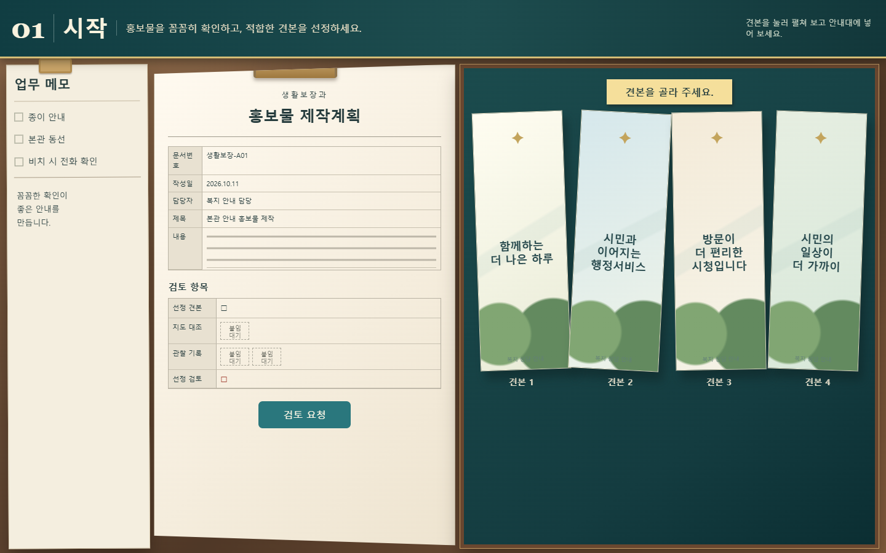
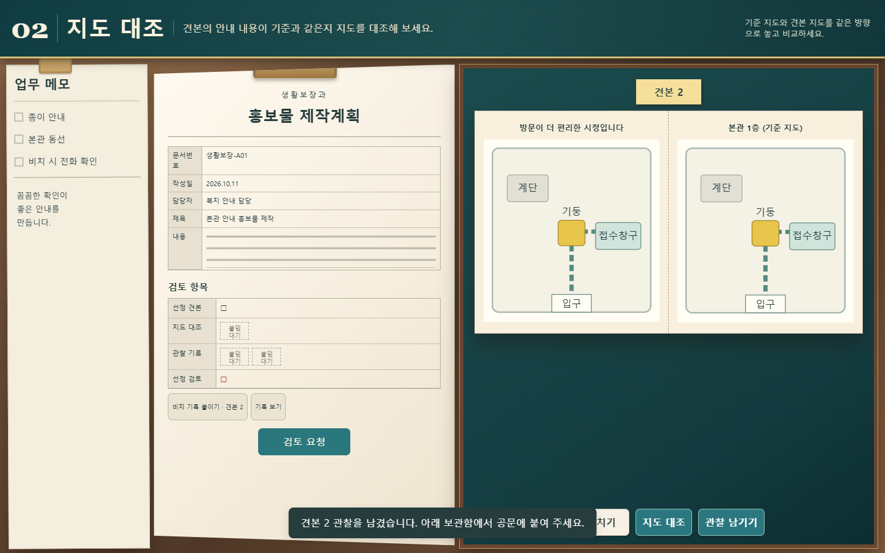
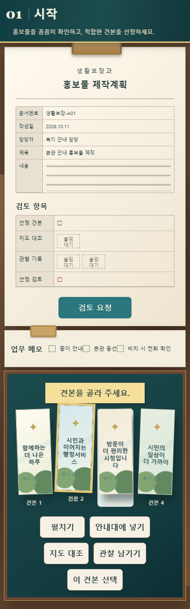
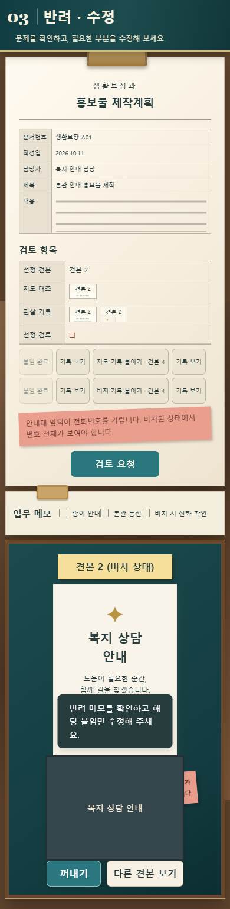
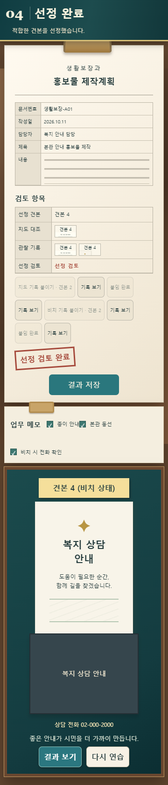

# A 입문 독립 구현 검증 · 2026-10-11

대상: [독립 화면](../../../src/leaflet-a/index.html). 기존 퍼즐 로직·외부 에셋 없이 신규 model.js/app.js/stage.css로 구현했다. 첨부 시안의 시작·지도 대조·반려·수정·선정 완료 4장면을 화면 기준으로 반영했다. 입문만 구현했으며 중간·도전·B/C·본편 통합·공개 배포는 범위 밖이다.

## 실제 실행

- Node 자체 검사 `node 생활보장과/tests/leaflet-a/model.test.cjs`: 18개 통과. 적합 후보 유일성, 세 오답, 누락·대상/환경/버전 불일치, 기록 중복·불변, 조사/선정 분리, 반려 수정, 복원·완료 ID 보존, 부분 손상, 표시 순서 보존을 검사했다.
- Chrome/Chromium 154.0.8037.100 · Playwright · `http://127.0.0.1:8897/`: 1440×900, 1366×768, 1024×768, 768×1024, 390×844, 360×800에서 실제 버튼 조작으로 견본2 조사→기록→반려→견본4 수정→새로고침→완료→새로고침→근거 확대/닫기 수행. 전부 통과.
- 여섯 크기 모두 페이지 가로 넘침 없음, 표시 버튼 높이 44px 미만 없음, 실행 중 pageerror 없음.
- 키보드 Tab 진입·Enter로 조사/기록/선정/붙임/검토 완료. Escape 확대 닫기. 390×844→844×390 크기 변경 후 완료 공문 유지.
- file:// 직접 실행도 앞선 네 화면 크기에서 플레이했다. 최종 일관된 결과는 HTTP 검사 JSON을 기준으로 한다.
- 로컬 서버 포트 충돌을 발견해 8897로 변경했다. 응답 문서 제목과 진입 스크립트로 A 화면임을 확인했다. 네트워크 제한 환경에서는 파일 검사 후 허용된 실행으로 HTTP 검사를 수행했다.

[브라우저 결과 JSON](browser-results.json) · [테스트 코드](../../../tests/leaflet-a/browser.test.cjs) · [자체 판정 검사](../../../tests/leaflet-a/model.test.cjs)

## 화면 비교

첨부 시안과 실제 구현은 비교용이며 시안의 픽셀 수치가 사용자 승인되었다는 뜻은 아니다. 장면 구조·색·문서/실물 배치를 우선 반영하고, 이미지는 외부 복사 없이 새 CSS/SVG로 다시 만들었다.

## 남은 검증

자동 브라우저 크기/터치 에뮬레이션은 실물 Android Chrome·iPhone Safari 검증을 대신하지 않는다. LAN 휴대폰 접속은 실제 기기에서 추가 확인한다. 사용자 재미·첫 행동 시간·발견의 설명·반복 부담은 아직 검증하지 않았다. 준비 계획의 실제 사용자 체험을 다음 단계로 유지한다. 시간제한이나 벌점은 없고 조사 도중 정답 체크는 하지 않는다.

입문 자동 저장은 독립 키만 사용하며 파일/localhost/내부IP 출처별로 별개다. 완료는 선정 검토 완료로 한정한다. 직전 완료본은 새 연습 시작 전에 last-completed 키로 보존한다.

## 최종 시안 대조 기록 · 2026-10-11

- 대상 시안을 `생활보장과/design/공문A_견본식별/시안_4단계_원본.png`으로 고정하고, 단계별 실제 캡처와 나란히 보는 비교 페이지를 추가했다: [시안-실제-나란히.html](시안-실제-나란히.html)
- 최종 자동 브라우저 검사에서 `견본 2 조사 → 두 기록 붙임 → 반려 → 견본 4 기록 교체 → 선정 검토 완료`가 1440×900, 1366×768, 1024×768, 768×1024, 390×844, 360×800 모두 통과했다.
- 공문에 표시되는 선정 견본 번호가 실제 선택 상태와 일치하도록 수정했고, 지도·비치 기록은 같은 후보의 기록만 붙여야 완료되는지 재검증했다.
