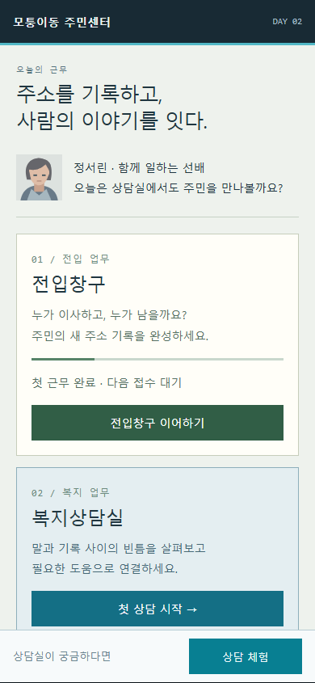
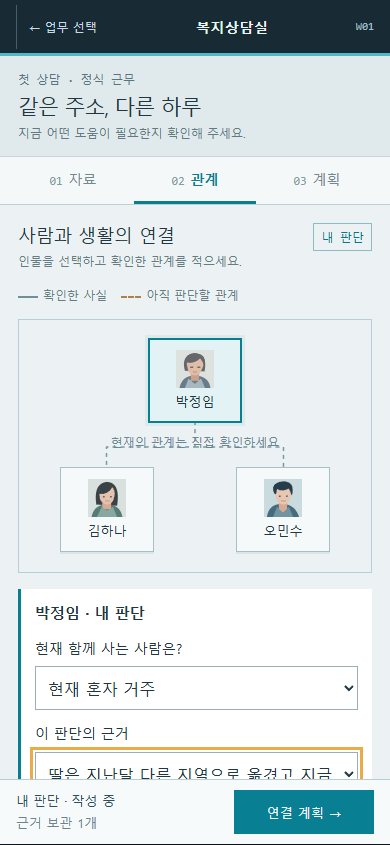
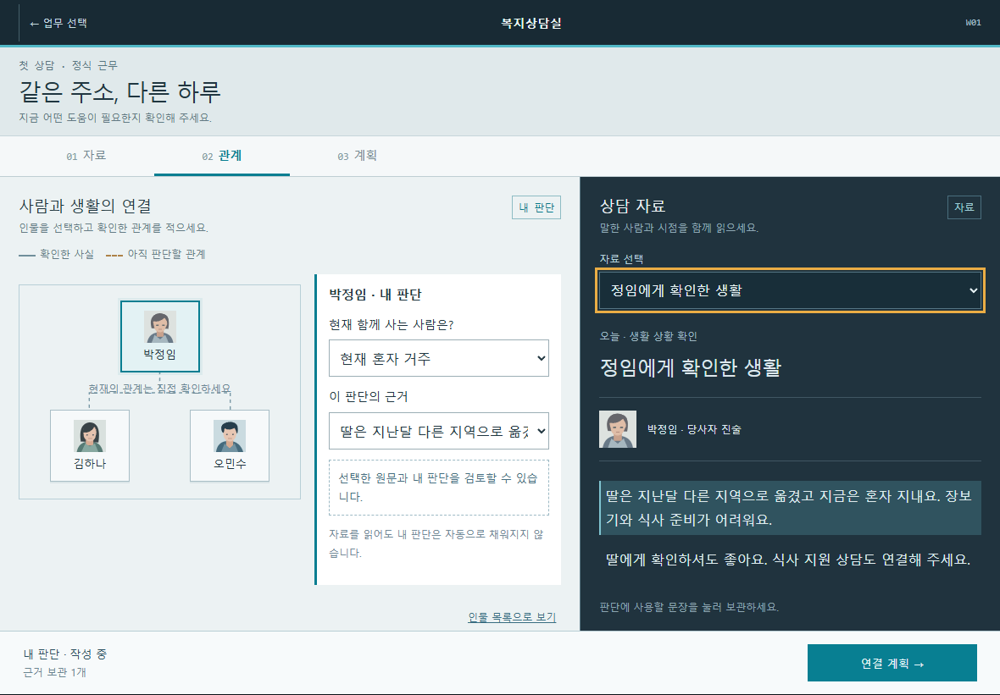

# 전입창구 완성 → 복지상담실 구현 · 상세 개발 명세

작성일: 2026-10-11. 담당: 주민센터. 최신 사용자 지시로 정식 복지 즉시 개방·하중상 각 3건 총 9건을 구현했다. 현재 계약은 [9건 명세](복지상담_난이도9건_명세.md)이며 아래 최초 3건/전입 후 개방 명세는 계획 이력으로 보존한다. 실제 기기·초심자 평가와 공개·본편 반영은 대기. 구현 계약은 [센터 구현검증](센터구현검증.md)을 함께 참조한다.

이 문서는 후속 구현의 게임 규칙·화면·데이터·완료 기준을 연결하는 실행 명세다. 활성 상태와 작업 순서는 [PROJECT_PLAN](../PROJECT_PLAN.md), 실제 결과는 [작업 로그](../2._WORK_LOG.md), 전체 작업 ID·의존성은 [개발작업목록](개발작업목록.json)에 관리한다.

## 1. 이렇게 이해했습니다

- 목적: 전입창구와 복지상담실이 서로 다른 재미를 제공하는 주민센터 챕터를 만든다.
- 확정 방향: 기존 전입신고의 규칙·화면·콘텐츠를 유지하고 완성도를 높인다. Orwell에서 착안한 관계망·자료 비교 화면은 새 복지상담실에 사용한다.
- 바뀌는 것: 업무 선택 화면, 복지상담실의 사건·관계/생활 상황 판단·지원 연결·저장·진행이 추가된다.
- 유지할 것: 기존 첫 접수, M01/M03를 포함한 사례 ID, 6사례·12방문·4일 결산, 기존 저장/보상, 공개 전입 테스트 페이지. 이전 Orwell 전입 시안은 참고 이력으로 보존한다.
- 완료 기준: 두 업무를 오가며 각각의 초안을 복원하고, 복지 상담 3건의 시작·확인·판단·연결 계획·후속 결과를 끝까지 플레이한다. 기존 전입 회귀와 실제 모바일·초심자 평가를 구분해 통과한다.
- 사용자 확정 선택(2026-10-11): 전입창구 첫 근무를 마친 뒤 복지상담실 개방, 따뜻한 생활 이야기 속에서 기록의 빈틈을 풀기, 첫 상담 1건을 완성·검증한 뒤 총 3건으로 확장. 후속 선택 답변으로 확정했으며 새 UI의 세부 수치 승인은 별도로 구분한다.

계획 작성 당시에는 문서·시안·계약 예시만 만들었다. 이후 사용자가 계획대로 단계별 자율 구현을 지시했으며, 실제 결과는 센터 구현검증·작업 로그·작업 그래프에서 관리한다. 공개 배포는 별도다.

## 2. 출발점: 이미 있는 것과 남은 것

| 항목 | 파일에서 확인한 현재 상태 | 이번 프로그램의 처리 |
| --- | --- | --- |
| 관계 추론 첫 접수 | `services/tutorial.js`, `tutorial-view.js`; 별도 도입 사건과 저장·완료 검증 존재 | 다시 만들지 않는다. 비경험자 이해와 모바일 실제 사용을 보완한다. |
| 전입 사건 | `data/cases.js`; 퍼즐 6사례, 챕터 12방문 | 사례 ID와 정답 데이터 보존. 오타·불명확한 설명·막힘만 근거를 남겨 수정한다. |
| 근무·지도 | `data/chapter.js`, `services/campaign.js`; 4일, 하루 3방문, 경로 탐색 지도 | 기존 진행 유지. 신규 업무 입구는 바깥 업무 선택 화면에 추가한다. |
| 독립판 저장 | `gong-game:resident-center:v1`, schema/contentVersion 1, revision·원본 보호·백업 | 기존 키를 덮어쓰지 않는다. 새 센터판은 별도 저장과 명시적 가져오기 사용. |
| 공개 테스트 | `resident-test/`에 전입 독립판 배포 완료; `배포검증_20261011.json` | 기존 링크를 유지한다. 새 센터판은 별도 주소로 공개할 계획이다. |
| 본편 연결 | `adapters/main-game.js`, `build_integrated.py`; 감사한 배포본에 격리 iframe을 주입한 **로컬 후보** | 공식 원본 통합 완료로 간주하지 않는다. 마지막 단계에서 확장계획 담당과 연결한다. |
| 본편 저장 | 공통 문서의 루트 소스는 `civil-servant-grow-v1`; 감사한 공개 사본은 `gongmuwon-proto-v1`; 로컬 후보는 `gong-game:integration:main:v2` | 실제 배포 원본과 파이프라인이 확정되기 전 저장 키를 통일하거나 자동 이전하지 않는다. |
| Orwell 시안 | `design/관계추론_Orwell풍_시안.html`; 임시 상태·샘플 판정 | 시각 체계·탭·자료 보관의 조작 참고. 실제 판정/저장 코드는 이식하지 않는다. |
| 남은 평가 | RC-R07, Android/iPhone 실제 기기 미실시 | 자동 검사와 사람 평가를 별도 게이트로 관리한다. |

이전 자동 검사 결과는 [첫 접수 구현검증](첫접수_구현검증.md), [최종 검사](최종검사.json)에 보존되어 있다. 그 문서의 ‘공개 배포 없음’은 당시 결과이며 최신 공개 상태는 배포 검증과 STATUS를 따른다.

## 3. 제품 구성과 플레이 진행

### 3.1 두 업무의 역할

| 전입창구 | 복지상담실 |
| --- | --- |
| 주민의 요청을 읽고 주소·세대 기록을 작성 | 말과 기록을 비교해 현재 생활 상황을 확인 |
| 인물 배치 → 기준 → 관계 → 신고 검토 | 자료 → 질문 → 근거와 판단 → 연결 계획 → 후속 확인 |
| 기록 정확성과 절차의 성취감 | 사람의 사정을 이해하고 적절한 다음 행동을 정하는 성취감 |
| 기존 베이지·녹색·픽셀 인물 화면 | 회청색 관계망·남색 자료 화면·기록용 인물 초상 |

두 업무는 장르를 구분하되 동일한 주민센터, 직원, 글꼴, 뒤로가기와 저장 안내 규칙을 공유한다. 복지상담실 때문에 전입신고 신고서나 관계 선택을 새로 설계하지 않는다.

### 3.2 정식 진행과 개방

1. 신규 센터판의 첫 진입은 업무 선택 화면 → 전입창구 첫 접수로 연결한다.
2. 전입의 첫 근무 결산(`dayClosed`에 1 존재)을 마치면 업무 선택 화면에 복지상담실 개방 장면을 1회 표시한다.
3. 가져온 ‘퍼즐 모드’ 기록은 M01·M02·M03 세 완료 기록이 기존 validator를 통과하면 같은 개방 자격으로 인정한다. 챕터 기록이나 결산을 가짜로 생성하지 않는다.
4. 두 경로 모두 기존 기록이 근거다. 화면의 개방 여부는 그 근거에서 계산하며 저장된 `unlocked:true`만 신뢰하지 않는다.
5. 개방 후 W01 → W02 → W03 순서로 진행한다. 전입 2~4일은 자유롭게 병행하며 기존 순서를 유지한다. 복지 사건 때문에 전입 방문 횟수를 늘리지 않는다.
6. 검토용 ‘상담 체험’은 처음부터 가능하다. 별도 메모리 세션으로 열고 정식 사건 완료·개방·기념품을 지급하지 않는다.
7. 기존 사용자의 진행 중 전입 초안이 있으면 ‘이어서 하기’를 첫 행동으로 제시한다. 새 튜토리얼을 강제 삽입하지 않는다.

첫 근무에는 도입 사건과 M01~M03이 포함된다. 체감 플레이 시간은 측정 전 목표로만 둔다: 도입 5~8분, 첫 근무 전체 15~25분, W01 8~12분, W02 10~15분, W03 12~18분. 빠른 완료를 점수 조건으로 삼지 않는다.

### 3.3 동기와 보상

- 전입: 기존 기념품 4종과 기존 본편 후보의 180XP/300포인트 총량·중복 방지 규칙 유지.
- 복지: W01 ‘첫 상담 메모’, W02 ‘연결 연락처 카드’, W03 ‘동네 관계 지도’라는 센터판 전용 기념품. 완료 기록을 근거로 각 1회만 지급한다.
- 복지의 첫 출시에는 본편 XP/포인트 지급을 추가하지 않는다. 센터의 기록·후속 장면·기념품을 보상으로 사용한다. 경제 연동은 확장계획의 별도 계약으로 추가한다.
- 평가 문구는 ‘확인한 사실 / 근거가 필요한 판단 / 다음 행동’이다. 주민의 어려움이나 의심을 점수화하지 않는다. 질문·도움·수정에 감점이 없다.

## 4. 전입창구 완성 범위

‘완성’은 이미 있는 시스템을 재작성하는 작업이 아니다. 다음 항목의 증거를 확보하는 단계다.

| 작업 | 구현 기준 | 인수 기준 |
| --- | --- | --- |
| 첫 접수 이해 | 시작 시 ‘누가 이사했는지 → 누구를 기준으로 기록할지 → 관계’를 짧게 설명. 기존 정답 비공개 유지 | 초심자 3명 중 2명 이상이 60초 내 다음 행동을 설명하고, 진행자 정답 개입 없이 첫 접수를 완료 |
| 작은 화면 조작 | 기존 44px 입력·16px select, 선택 결과·자료 복귀 위치 유지 | 320×568, 390×844, 430×932, 가로 844×390에서 모든 주요 조작 접근, 가로 잘림 0 |
| 자료와 초안 왕복 | 기존 자료 열람과 직접 판단 유지 | 오답을 포함한 선택이 자료·검토·목록 왕복과 새로고침 후 유지 |
| 전입 사건 품질 | 기존 데이터의 방문자·주소·기준·관계·보완 설명을 사례별 검토표로 확인 | 6사례 및 12방문 완주, M06 보완→재방문 연결, 중복 완료/보상 없음 |
| 저장·실패 복구 | 읽지 못하는 원본 보호·백업·다른 창 충돌 처리 유지 | 정상·구버전·손상·미지원 버전·저장 실패·다중 창 fixture 모두 기대 결과 |
| 모바일 실제 사용 | Android Chrome와 iPhone Safari, 주소창·안전 영역·회전·입력 확대·백업 확인 | 기기/OS/브라우저/검사일이 있는 실기기 기록. 에뮬레이션만으로 통과 처리 금지 |

사람을 구할 수 없으면 엔지니어링 완료와 평가 대기를 나누고, 독립적인 복지 기반 구현은 진행한다. RC-R07을 통과한 것으로 쓰거나 전체 사례의 게임성 재설계를 자동으로 확대하지 않는다. 인명·관계·주소 데이터 변경이 필요한 결함은 케이스 ID와 저장 호환 영향을 먼저 기록한다.

## 5. 복지상담실의 게임 규칙

### 5.1 핵심 반복

`도움 요청 접수 → 자료에서 근거 보관 → 필요한 질문 → 관계/현재 상황 판단 → 지원 연결 계획 → 검토·수정 → 인계 완료 → 후속 답신`

처음에는 모든 답이 비어 있다. 자료를 열면 읽음만 기록한다. 문장을 보관하면 근거 목록에만 추가한다. 질문 답변은 새 자료를 열어 주지만 관계·생활 문제·지원 선택을 자동으로 바꾸지 않는다.

플레이어는 관계망에서 인물 또는 관계를 선택하고, ‘무엇을 알 수 있는가’를 정한 다음 근거 1~2개를 연결한다. 이후 현재 생활 문제와 다음 행동을 작성한다. 모든 대화를 순서대로 클릭하는 것만으로 완료되지 않도록, **같은 자료에서 무엇을 판단했는지**를 검증한다.

### 5.2 정보의 층과 확실성

| 정보 | 의미 | 표시 |
| --- | --- | --- |
| 원문 | 특정 사람이 특정 시점에 말하거나 기록한 내용 | 출처·작성일·해당 시점 |
| 확인한 사실 | 해당 범위의 자료로 뒷받침한 사실 | 실선·‘확인’ 문구 |
| 내 판단 | 플레이어가 선택한 관계/현재 상황 | 점선·‘초안’ 문구 |
| 확인 필요 | 현재 자료로 결론을 낼 수 없는 부분 | 물음표·확인할 질문 |
| 과거 사실 | 당시에는 맞지만 현재 상태를 증명하지 않는 정보 | 날짜·‘이전 기록’ 문구 |

‘최신 문서’라는 이유만으로 모든 이전 사실을 덮지 않는다. 사실마다 대상·범위·유효 시점을 비교한다. 같은 주소, 가족관계, 실제 동거, 정기적인 돌봄은 각각 다른 관계다. 당사자 진술과 기관 기록이 충돌하고 추가 확인이 남으면 ‘확인 필요 + 구체적 다음 행동’도 사례 계약이 허용하는 올바른 처리로 인정한다.

### 5.3 선택·판정 규칙

- 관계 항목: 가족관계, 현재 함께 거주, 연락, 실질적 도움. 사건에 필요한 종류만 노출한다.
- 현재 상황 항목: 식사·생활비·주거 등 해당 사건의 1~2개 생활 문제. 의료 진단이나 실제 급여 자격 계산은 첫 3건의 규칙에 포함하지 않는다.
- 근거 연결: 판단 카드마다 `evidenceIds`를 저장한다. 자료가 답을 뒷받침하는지 정적 허용 규칙으로 판정한다. 원문에 없는 사실은 생성하지 않는다.
- 계획 항목: 문제, 연결할 기관/담당, 구체적 요청, 주민 동의 상태, 후속 확인 담당·게임 내 날짜.
- 검토 상태: `incomplete`(필수 입력 없음), `needs-check`(근거·시점·내용 충돌), `ready`(완료 가능).
- 질문을 많이 했다고 준비 완료로 판단하지 않는다. 불필요한 서비스를 전부 체크하는 전략은 근거 없는 추가 계획으로 안내하고 수정하게 한다.
- 정답 경로는 한 클릭 순서로 고정하지 않는다. 사건 계약의 허용된 근거 조합과 계획 조합을 충족하면 동일하게 완료한다.
- 제출 시 엔진이 draftRevision과 knowledgeRevision을 다시 확인한다. 검토 후 질문·답·근거가 바뀌면 기존 검토 결과로 완료할 수 없다.
- 완료 후 기록은 읽기 전용이다. 다시 풀기는 별도 연습 세션으로 시작하며 정식 기록과 기념품을 바꾸지 않는다.

### 5.4 도움과 실패

도움 1: 확인할 자료 위치. 도움 2: 비교해야 하는 사실의 종류. 도움 3: 관계를 읽는 방법의 짧은 예시. 현재 사건의 정답 이름·선택지는 제출 전 제공하지 않는다. 검토는 실제 오답과 근거를 유지한 채 해당 판단 카드로 이동시킨다.

질문에는 잘못된 선택으로 영구 잠기는 경로가 없다. 초기 사건은 질문을 모두 다시 열 수 있다. 실패는 수정 가능한 기록 상태이며 주민에게 가해진 피해를 반복 연출하는 방식으로 사용하지 않는다.

## 6. 사건별 제작 명세

등장 주민·주소·통화·기관은 게임용 창작이다. 실제 개인정보나 상담 원문을 전사하지 않는다. 공식 자료는 업무 흐름의 참고로 사용한다.

### W01 / 같은 주소, 다른 하루

- ID: `resident-center:welfare:W01`. 목표 8~12분. 주민 3명, 기관 카드 1개, 자료 총 5개, 핵심 질문 2개.
- 사람: 박정임(상담 당사자), 김하나(딸), 오민수(도움 요청 이웃). 기관: 가상의 모퉁이복지관.
- 도입: 이웃이 “요즘 식사를 거르는 날이 보여 걱정된다”고 요청한다. 초기 화면의 질문은 ‘지금 어떤 도움이 필요한지 확인해 주세요’다.
- S01 도움 요청 메모: 최근 관찰이지만 혼자 산다는 사실과 식사 곤란의 원인을 모두 확정하지 못한다.
- S02 3개월 전 상담 기록: 정임과 딸이 당시 같은 집에 거주했다. 가족관계·과거 동거만 뒷받침한다.
- Q01 당사자에게 생활 확인 → S03: 딸은 지난달 다른 지역으로 옮겼고 현재 혼자 지낸다. 장보기·식사 준비가 어렵다. 딸에게 확인하고 식사 지원 상담을 연결하는 데 동의한다.
- Q02 딸에게 현재 도움 확인 → S04: 현재 다른 지역에 거주해 매일 방문할 수 없지만 저녁 전화 연락을 하고 있다. Q01의 동의 확인 뒤 활성화한다.
- S05 기관 안내: 모퉁이복지관은 식사 지원 상담을 접수한다. 실제 제공 여부·일정은 기관 확인 후 결정한다. 이 게임의 가상 서비스 카드다.
- 플레이어가 작성할 판단: 딸과 가족관계 유지, 현재 별도 거주, 전화 연락 있음, 매일 방문 도움은 없음, 현재 식사 준비의 어려움.
- 필수 근거: 현재 거주는 S03 또는 S04의 해당 문장, 생활 문제·동의는 S03, 연락/방문은 S04, 연결 가능 창구는 S05. S01만으로 현재 생활을 모두 단정하면 재확인 안내.
- 완성할 계획: 당사자 동의에 근거한 식사 지원 **상담 의뢰**, 담당 직원의 ‘다음 근무일 상담 접수 여부 확인’. 실제 급여 승인·서비스 제공 완료로 처리하지 않는다.
- 허용 선택: 딸의 전화 연락은 관계 카드 또는 협력 메모 중 한 곳에 기록한다. 두 표현을 동일하게 인정한다. 딸을 매일 방문할 사람으로 지정하면 S04와 충돌한다.
- 대표 오답: 가족이 있으니 종결 / 과거 주소로 현재 동거 확정 / 문의 없이 식사 제공 완료 / 근거 없이 이웃을 매일 돌봄 담당으로 지정.
- 완료 장면: 정임이 “어디에 이야기하면 되는지 알겠네요”라고 말하고 의뢰서에 접수 예정이 찍힌다. 다음 근무의 답신에서 상담 일정이 잡혔음을 확인한다. 답신 도착은 게임 진행 이벤트이며 실제 시간을 기다리지 않는다.
- 기계 판정 예시: [W01 계약](../design/contracts/W01_사건계약.json). 이 파일은 기획 fixture 이력이다. 실제 사건은 `src/welfare/data/cases.js`에서 운영하고 독립 검증한다.

### W02 / 끝난 지원, 남아 있는 기록

- ID: `resident-center:welfare:W02`. 목표 10~15분. 사람 3명, 자료 6개, 핵심 질문 3개.
- 창작 주민 윤태호가 생활비 상담을 요청한다. 지난 상담표에는 단기 식사 지원이 ‘진행 중’으로 표시되어 있다.
- 자료: 요청서, 지난달 상담표, 당사자 진술, 제공기관의 종료 확인, 현재 안내 카드, 연락·동의 메모.
- 새로 배우는 것: 작성일과 적용 기간을 구분한다. 지원받았던 사실과 현재 지원 여부를 따로 기록한다.
- 필수 판단: 과거 지원 있었음 / 현재 해당 지원 종료 / 현재 생활 상담 필요. 종료 확인 전에는 ‘현재 지원 여부 확인 필요’를 선택하고 기관 질문을 할 수 있다.
- 필수 계획: 중단 시점·현재 요청을 근거로 복지 담당 상담 연결, 제공기관에 이미 확인한 내용을 중복 요청하지 않는 후속 확인.
- 허용 처리: 종료가 확인된 경로는 상담 의뢰로 완료. 기관 답변을 기다리는 분기 fixture는 확인 담당·다음 근무일을 지정한 후속 확인 계획으로 인계 완료할 수 있다. 두 분기는 데이터의 답변 가능 상태로 구분하며 무작위 대기시간을 쓰지 않는다.
- 대표 오답: 과거 지원 기록만 보고 현재 필요 없음 / 오래된 기록 삭제 / 모든 서비스를 중복 신청.
- 결과: 기존 기록은 남고 현재 상태가 새 이력으로 추가된다. 기념품 ‘연결 연락처 카드’.

### W03 / 한 집의 두 가지 부탁

- ID: `resident-center:welfare:W03`. 목표 12~18분. 화면의 사람 최대 4명, 기관 최대 2개, 자료 7개, 핵심 질문 3개.
- 창작 주민 한지후는 최근 일거리가 줄어 생활비와 주거 문제를 함께 이야기한다. 가족의 일시적 도움과 정기 지원이 자료에서 섞여 보인다.
- 자료: 당사자 요청, 이전 상담표, 최근 변화 확인, 가족의 도움 범위, 당사자의 연결 동의, 생활 상담 창구 카드, 주거 상담 창구 카드.
- 새로 배우는 것: 두 생활 문제를 각각 근거와 연결하고, 확인된 부분과 추가 확인이 필요한 부분을 구분한다.
- 필수 판단: 생활비 상담 필요 / 주거 상담 필요 / 가족의 도움은 임시이며 지속 가능 여부 확인 필요. 가족관계만으로 지원 가능·불가능을 판정하지 않는다.
- 계획: 주민이 요청한 생활·주거 상담을 각 담당으로 연결한다. 주민 선호와 자료에 명시된 기한을 근거로 우선 확인할 것을 정한다. 두 상담의 순서가 모두 가능한 fixture에서는 두 순서를 허용한다.
- 생활보장과 연결: ‘생활보장과 상담 담당’이라는 역할 ID로 전달한다. 나소라 등 기존 캐릭터 이름·말투는 해당 담당과의 전달 기록이 반영된 뒤 연결한다. 그전에는 일반 역할명으로 완결되므로 개발을 멈추지 않는다.
- 결과: 두 의뢰의 담당·다음 확인이 분명한 인계 기록과 기념품 ‘동네 관계 지도’. 주민센터 챕터의 짧은 마무리 장면.

### 난이도 한계

W01에서는 현재 관계와 생활 문제 하나, W02에서는 시점과 미확인 상태, W03에서는 문제 두 개와 기관 두 곳을 조합한다. 시간 제한·질문 횟수 벌점·무작위 문서 누락·자유문장 AI 판정은 첫 출시 범위에 없다. 동시에 편집하는 관계는 하나이며 전체 사람이 늘어도 화면 축소를 강요하지 않는다.

## 7. UX·화면·시안

[직접 조작하는 두 업무 시안](../design/두업무_연결_시안.html). 전입 화면 비교, 업무 선택, 복지 자료·관계·계획, 크기 전환을 제공한다. 실제 저장/해금/상담 엔진은 연결하지 않은 검토용이다.

| 현재 전입창구 · 유지 | 변경 후 진입 · 업무 선택 |
| --- | --- |
|  |  |

| 기존 Orwell 시안 · 이전 기록 | 복지상담실로 바꾼 새 제안 |
| --- | --- |
|  |  |



### 화면 목록

| ID | 화면 | 필수 상태·행동 |
| --- | --- | --- |
| H01 | 업무 선택 | 전입 이어하기, 상담 잠금 이유/개방, 무보상 체험, 각 업무 진행 수 |
| H02 | 업무에서 돌아오기 | 최신 초안 저장 확인, 저장 실패 시 재시도/백업/머무르기 |
| W01A | 사건 도입 | 도움 요청의 목적, 대상자, 이번 사건에서 해야 할 일 |
| W01B | 자료 | 출처·시점, 문장 보관, 질문, 새 답변 도착 |
| W01C | 관계·상황 | 관계 종류·현재 상태·근거 연결, 확인 필요 표시 |
| W01D | 연결 계획 | 생활 문제별 기관·요청·동의·후속 담당/날짜 |
| W01E | 검토 | 내 판단 요약, 근거가 필요한 카드 이동, 초안 보존 |
| W01F | 완료·답신 | 확정된 인계 기록, 기념품, 다음 근무 답신, 읽기 전용 |
| S01 | 저장·백업 | 저장 실패, 충돌, 구버전, 가져오기 미리보기·취소·복구 |

### 모바일와 PC의 배치 계약

- 제안 기준: 390×844, 320×568, 430×932, PC 1180×820. 시안 상단에 실제 프레임 치수·기본 글꼴·패널 비율을 표시한다. 사용자 승인 전 제안값이다.
- 전입은 기존 승인값 유지. 복지는 기본 16px 맑은 고딕, 본문 16px/1.65 이상, 주요 버튼·행 높이 44px 이상, 입력 글자 16px. 메타데이터 최소 12px 제안.
- 모바일: 자료 / 관계 / 계획 3탭, 헤더 56px, 탭 48px, 하단 행동 64px 목표. 각 탭 안쪽만 스크롤한다. 새 자료 표시가 선택한 답을 덮지 않는다.
- 관계망은 3~4명 요약을 먼저 표시한다. 인물 선택 → 관련 관계 카드 → 관계·근거 편집 패널 순서다. 드래그·핀치·작은 연결선 터치를 필수로 만들지 않는다. 동등한 목록 보기 제공.
- 문장을 누르면 보관됨 표시와 근거 개수만 갱신한다. ‘이 근거로 판단하기’를 눌러 대상 판단 카드와 연결할 수 있다.
- PC: 왼쪽 관계/계획 58%, 오른쪽 자료 42%. 자료가 긴 경우 독립 스크롤. 800px 미만에서는 모바일 탭으로 전환한다.
- 선택 패널은 native dialog 또는 동등한 초점 가두기·Escape·닫기 후 초점 복귀를 지원한다. 모바일 뒤로가기는 패널 → 작업 화면 → 업무 선택 순으로 닫는다.
- `100dvh`, 안전 영역 여백, 세로 공간 부족·200% 글자 확대 시 전체 세로 스크롤을 사용한다. 키보드가 입력을 가리면 입력과 완료 버튼이 보이도록 이동한다.
- 동작 효과: 근거 보관 강조·연결선 변화 150~220ms, 처리 스탬프 300ms 이하. 모션 감소 옵션에서는 생략. 음향은 기본 꺼짐이며 정답 여부의 유일한 표현으로 쓰지 않는다.

## 8. 기술 구조와 파일 단위 작업

### 8.1 기본 결정

기존 정적 HTML/바닐라 JS/순수 판정 모듈과 Python 빌드를 유지한다. 프레임워크·서버·외부 AI API·계정 기능은 도입하지 않는다. 새 센터판은 기존 전입 업무와 새 복지 업무를 각각 격리된 작업 화면으로 열고, **센터 호스트가 두 업무의 저장을 소유**한다.

새 센터 JSON 가져오기는 2MiB 상한과 알려진 사건·원문·질문 ID 검사를 적용한다. 원문과 인물 자산은 저장에 중복하지 않고 버전이 고정된 콘텐츠 ID를 저장한다.

새 산출물은 `주민센터_두업무.html`, `preview-center/index.html`로 만든다. 기존 `전입신고_퍼즐.html`, `preview-puzzle/index.html`, 기존 통합 후보는 배포/회귀 기준으로 보존한다. 새 빌드는 구 산출물을 덮어쓰는 전처리 단계에 의존하지 않는다.

센터 안의 전입 자식 화면은 기존 source/template을 재사용하여 별도 빌드하고, 새 복지 자식 화면과 함께 srcdoc로 포함한다. 활성 자식 iframe은 한 개다. 전입·복지 화면에 동일한 `allow-scripts allow-downloads` 격리를 사용하며 저장은 부모를 통해 전달한다. 기존 전입 화면의 `__RC_EMBED__` 경로가 출발점이다. 첫 H02에서 왕복 저장을 먼저 증명한다.

| 계획 파일 | 책임 | 주요 의존성 |
| --- | --- | --- |
| `src/center/shell.html`, `center.css`, `app.js` | 업무 선택·잠금·복귀·백업, 활성 자식 관리 | center 저장·브리지 |
| `src/center/storage.js` | 센터 envelope 검증·revision·충돌·가져오기 | 기존 MoveInStorage validator + welfare validator |
| `src/center/bridge.js` | 전입/복지 launch·token·flush·ack, 저장된 최신 모델만 복귀 처리 | 자식 통신 계약 |
| `src/welfare/data/cases.js` | W01~W03의 출처·질문·판단·계획·허용 완료 조합 | 명세 및 사건 계약 |
| `src/welfare/engine/session.js` | 빈 세션·조회·버전 | cases |
| `src/welfare/engine/actions.js` | 순수 상태 전이, 의존 근거 무효화 | session |
| `src/welfare/engine/review.js` | 근거·시점·관계·동의·계획 검증 | cases, session |
| `src/welfare/engine/resolve.js` | 최신 검토로만 완료, 불변 기록 | review |
| `src/welfare/services/storage.js` | 복지 부분의 pack/validate/migration | engine |
| `src/welfare/app.js`, `view.js`, `welfare.css`, `shell.html` | 탭·자료·관계·계획·도움·키보드·렌더 | engine, bridge |
| `src/welfare/assets/` | 자체 제작 SVG 인물·기관·상태 아이콘·선택 음향 | 정적 로컬 자산 |
| `build_center.py` | 두 작업 화면과 센터 호스트를 단일 파일로 빌드 | 기존/신규 모듈 순서 목록 |
| `tests/center-*.cjs`, `tests/welfare-*.cjs` | 상태·저장·통신·브라우저·콘텐츠 검사 | 해당 모듈 |
| `tests/run_center_checks.py` | 신규 검사 묶음, 기존 회귀 실행, 별도 결과 저장 | 기존 검사 명령 |

계획 작성 당시 `src/`는 생성하지 않았다. 후속 구현에서 위 역할을 소스로 추가했다. 현재 빌드 입력·실제 상태 계약은 센터 구현검증을 따른다. `design/contracts/`의 예시는 기획 이력으로 보존한다.

### 8.2 순수 상태와 데이터 계약

```text
WelfareCase
  id, contentVersion, title, people[], organizations[]
  sources[{id, author, recordedAt, effectivePeriod, statements[]}]
  questions[{id, prerequisites, answerSourceId}]
  claimDefinitions[{id, subjectId, choices, evidenceRequirements}]
  serviceCards[], acceptedPlanSets[], reviewRules[], epilogue

WelfareSession
  caseId, contentVersion, status(editing | resolved), revision
  knowledge{readSourceIds, pinnedStatementIds, askedQuestionIds, revision}
  draft{claimsById, evidenceByClaim, plans[], followup, revision}
  view{tab, selectedPersonId, sourceId, returnFocusId, scrollByTab}
  review|null, record|null, hintsSeen[]
```

`createSession(case)` / `dispatch(case, session, action)` / `review(case, session)` / `resolve(case, session, review)`를 제공한다. 반환값은 `{accepted, state, issues}` 형태로 맞추고 UI가 정답을 판정하지 않는다. 원문 ID는 자료 카드 ID보다 세밀한 statement ID를 사용한다. 후속 소스가 새로 생겨도 이전 원문을 지우지 않는다.

주요 액션: `OPEN_SOURCE`, `PIN_STATEMENT`, `ASK_QUESTION`, `SET_CLAIM`, `ATTACH_EVIDENCE`, `SET_PLAN`, `SET_FOLLOWUP`, `REVIEW`, `CONFIRM`, `SWITCH_TAB`, `SELECT_PERSON`.

탭·선택·스크롤은 검토를 무효화하지 않는다. 주장·근거·질문 답변·계획 변경은 해당 revision을 올리고 검토를 무효화한다. 근거를 보관 목록에서 제거하면 연결된 판단은 삭제하지 않고 ‘근거 연결 필요’로 바꾸어 재검토하게 한다. 완료 기록은 원문 ID와 확정 초안의 스냅샷을 가진다.

### 8.3 저장·이전·복귀

새 키 제안: `gong-game:resident-center:hub:v1`.

```json
{
  "schemaVersion": 1,
  "contentVersion": 1,
  "saveRevision": 0,
  "route": "hub",
  "moveIn": "기존 모델을 구조 변경 없이 포함",
  "welfare": {"version": 1, "active": null, "drafts": {}, "records": {}, "items": [], "shiftIndex": 1, "seenReplyIds": []},
  "hub": {"unlockSceneSeen": false, "lastDesk": "movein"},
  "settings": {"motion": true, "sound": false},
  "savedAt": null
}
```

복지 shiftIndex는 복지 업무의 근무 순서다. 완료 후 ‘다음 상담’을 누르면 1회 증가하며, 다음 사건 도입 전에 pending 답신을 보여 주고 seenReplyIds에 기록한다. 마지막 사건 뒤에는 마무리 답신으로 이동한다. 전입의 dayClosed는 바꾸지 않는다. 각 업무 진행을 별도로 표시해 두 근무 순서를 같은 날짜로 오해하지 않게 한다.

위 JSON은 형태 설명이며 실제 fixture의 moveIn에는 기존 유효 모델 객체가 들어간다. 기존 MoveInStorage를 고쳐 복지 데이터를 억지로 넣지 않는다. 구 standalone 키를 읽고 쓰는 저장소와 새 센터 키는 분리한다.

가져오기 절차: 사용자가 ‘기존 전입 기록 가져오기’ 선택 → 기존 validator로 확인 → 완료/초안 개수와 현재 센터 기록 변경 범위 표시 → 원본 JSON 내보내기 제공 → 확인 후 새 키에 복사. 기존 키는 보존한다. 센터 전입 기록이 이미 있으면 조용히 병합하지 않고 교체 범위를 표시하며 기존 센터 백업을 만든다. 복지 기록은 유지하지만 개방 근거가 줄어드는 가져오기에서는 정식 신규 상담 시작을 잠그고 기존 상담 기록 열람·진행 중 초안 보존은 허용한다.

미지원 버전·손상 JSON은 원문을 보존하고 자동 초기화로 덮지 않는다. 단일 localStorage 문자열 쓰기로 전입·복지·센터 상태를 함께 커밋한다. 읽기→revision 비교→쓰기를 [Web Locks 작업 초안](https://www.w3.org/TR/web-locks/)의 같은 저장 키 exclusive lock 안에서 수행해 다중 창의 동시 쓰기 경쟁도 막는다. 기능 탐지에서 Web Locks를 사용할 수 없으면 자동 저장을 조용히 흉내 내지 않고 메모리 체험·백업 내보내기를 제공한다. 이 경우 UI에 저장 제한을 명시한다. 대상 실기기의 지원 여부는 H02에서 확인한다. 저장 인수 검사는 localhost 또는 HTTPS에서 수행하고, 파일 직접 열기의 저장 제한은 별도로 확인한다. 다른 창의 saveRevision과 맞지 않으면 마지막 쓰기를 강제하지 않고 현재 초안 백업·최신 기록 불러오기를 제공한다.

브리지 v2 제안: `{channel, protocol:2, launchToken, requestId, seq, model}`. 부모는 `event.source`, 활성 iframe, token, 허용 channel, 모델 버전·validator, 저장 revision을 확인한다. 자식은 `saved` ack 뒤에만 ‘저장됨’을 표시한다. 중복 request는 같은 결과를 돌려주고 오래된 seq는 재적용하지 않는다.

기존 자식은 `resident-center`/`resident-center-ack`와 token을 쓰며 flush에 requestId가 없다. 새 센터용 전입 빌드에 **선택적 v2 통신**을 추가하고 구 embed 경로는 회귀 검사로 유지한다. 공용 소스 변경이 필요하면 기본 독립판의 행동이 동일한지 검사한다. 새 빌드만 v2 설정을 주입하고 기존 공개 HTML은 교체하지 않는다. 저장 확인 전 뒤로가기·업무 전환·iframe 제거를 하지 않는다. flush 타임아웃은 3초 후 재시도·백업 선택을 보여 주되 원본 화면을 유지한다.

전입에서 돌아올 때 중첩된 기존 active/tutorial 상태는 보존한다. 호스트 route만 hub로 바꾸므로 이어하기가 가능하다. 복지 초안도 같은 방식으로 보존한다. 독립 두 업무 판은 본편의 실제 저장을 읽지 않는다.

### 8.4 본편 연결의 별도 계약

본편 연결 단계에서는 검증된 새 envelope를 `residentCenterHub` 필드로 저장하는 방안을 제안한다. 이전 `residentCenter`는 호환용 전입 스냅샷으로 남기고, 새 센터가 저장할 때 `residentCenterHub.moveIn`에서 파생해 같은 본편 저장 트랜잭션으로 갱신한다. 두 필드가 각각 독립적으로 진행을 쓰지 않도록 이전 진입 버튼도 새 호스트로 연결한다. 이전 본편 저장만 있으면 기존 validator를 통과한 전입 모델로 새 envelope를 구성하며 원본 백업을 제공한다.

전입 보상은 기존 `rc:visit:*`, `rc:day:*` 원장을 사용해 같은 완료가 재지급되지 않게 한다. 복지 기념품은 센터 내부 기록만 사용한다. 이전 adapter를 유지하는 상태에서 새 adapter를 동시에 실행해 두 보상 경로를 만드는 변경은 금지한다. 이 필드 이름과 소스 반영은 I03에서 확장계획 담당이 실제 upstream 계약과 대조한 뒤 확정한다.

### 8.5 빌드와 배포

- 현재처럼 정적·오프라인 가능한 단일 HTML을 만든다. 외부 CDN·폰트·이미지 의존성은 없다.
- `build_center.py`는 입력 목록, 소스 버전, 출력 SHA-256을 `docs/센터빌드검증.json`에 기록한다. 기존 산출물은 별도 기준 해시로 검증한다.
- 신규 테스트 경로 제안: `resident-center-test/`. 기존 전입 테스트 `resident-test/`는 유지한다.
- 이전 배포에서는 root service worker가 모든 navigation을 본편 캐시에 넣어 `resident-test/`를 제외했다. 새 경로도 본편 캐시에 섞이지 않도록 해당 규칙을 확장계획 담당과 조율한다. 로컬 허브 완성 전에 루트 sw.js를 수정하지 않는다.
- 공개 전 검사: HTTPS 200, 로컬 내용 일치, 320px 조작, 새로고침 복원, 기존 전입 링크와 본편 오프라인 캐시 보존. 공개 후 첫 완료·복원 smoke test.
- 롤백: 새 경로의 이전 아티팩트와 해시를 보관하고 새 페이지 배포만 되돌린다. 지원하지 않는 저장 버전은 보존·내보내기하며 삭제하지 않는다. 이전 공개 전입 링크로 돌아갈 수 있다.

## 9. 단계별 작업과 완료 게이트

각 단계가 끝나면 산출물 링크·검증·남은 문제를 기록하고 다음 의존 작업으로 진행한다. 사람 평가나 본편 원본 확인이 대기여도 독립적으로 검증 가능한 다음 기반 작업은 진행할 수 있다. ‘배포 가능’과 ‘로컬 구현 완료’를 구분한다.

| 단계 | 작업 ID | 실제 작업과 산출물 | 다음 단계 진입 기준 |
| --- | --- | --- | --- |
| 0. 기준 고정 | RC-T01 | 현재 실행판·소스 목록·보호 해시·구 저장 fixture·기존 링크를 동결. 기존 검사 재실행 | 재현 가능한 빌드와 기존 자동 검사 통과. 실패가 있으면 범위를 기록하고 먼저 수정 |
| 1. 전입 완성 | RC-T02~T04 | 첫 접수 이해·오류/모바일 보완, 6사례·12방문 인수, 실기기·초심자 검사 | T02/T03 엔지니어링 통과. T04/RC-R07은 사람 평가 별도 게이트 |
| 2. 두 업무 기반 | RC-H01~H03 | 업무 선택, 기존 모델을 감싸는 새 저장, v2 flush/ack, 전입 열기·복귀·가져오기 | 전입 초안이 두 업무 센터를 통해 열기/닫기/새로고침에도 동일, 기존 키 미변경 |
| 3. 복지 규칙 | RC-W01~W02 | W01 데이터 계약·근거 조합·판정 엔진·validator, 정답/오답/순서 독립 fixture | UI 없이 W01 완주, 근거 없는 정답·오래된 검토·위조 완료 거부 |
| 4. 복지 첫 상담 | RC-W03~W05 | 자료·질문·관계·계획·검토 화면, 저장 연결, 완료·답신 | W01 시작부터 후속 답신까지, 320px 조작·저장 실패·왕복·회귀 통과 |
| 5. 첫 상담 평가 | RC-W06 | 초심자 3명 평가·관찰표, 텍스트·정보량·관계 편집 보완 | 2/3 이상 목표 이해·직접 완료·가족/실제 도움 차이를 설명. 실제 사람 검증 없으면 출시 게이트 대기 |
| 6. 사건 확장 | RC-W07~W08 | W02 시점/대기 분기, W03 다중 문제/기관, 콘텐츠 검증과 기념품 | 사건별 허용 경로·대표 오답 통과, W01의 대본 하드코딩 없이 동일 엔진 사용 |
| 7. 출시 후보 | RC-I01 | 전입+복지 완주, 성능·접근성·백업·업무 전환·전체 회귀, 결과 문서 | 중대 결함 0, 실기기/사람 평가 게이트 표시, 빌드·해시·복구 재현 |
| 8. 별도 공개 | RC-I02 | 새 테스트 경로·캐시 예외·온라인 검증·롤백 준비 | 공개 범위 승인과 실제 배포 성공, 기존 링크/캐시 보존 |
| 9. 본편 연결 | RC-I03 | upstream 확정, 센터 envelope를 별도 본편 필드로 검증, 기존 보상 유지 | 확장계획 담당 원본·저장 계약 합의 및 부서 왕복/보상/원본 회귀 |

### 작업 크기와 예상 순서

사람 평가의 대기 시간을 제외한 상대 작업량은 T01~T04 3단위, H01~H03 4단위, W01~W05 7단위, W06 2단위, W07~W08 4단위, I01~I03 5단위다. 1단위는 작은 구현·검증 묶음이며 하루 또는 확정 소요시간을 뜻하지 않는다. W01 완성까지 먼저 예측하고 그 결과로 후속 비용을 갱신한다.

우선순위: 저장 보존·초안 유실 방지 → 첫 접수/첫 상담 이해 → 핵심 조작 → 세 사건 → 연출 → 본편 경제·지도 확장. 일정이 밀리면 애니메이션·장식 자산부터 줄이고 자료의 근거·실패 복구·모바일 조작은 유지한다.

W06의 사람 평가가 대기인 경우 W01 엔지니어링 게이트를 통과한 뒤 W02/W03을 내부 후보로 제작할 수 있다. 사람 평가에서 같은 막힘이 반복 확인되면 확장을 잠시 보류하고 먼저 보완한다. 공개 단계는 T04·RC-R07·W06의 실제 평가를 통과해야 한다.

## 10. 검증 명세

| 영역 | 반드시 포함할 검사 | 증거 |
| --- | --- | --- |
| 전입 회귀 | 기존 엔진·저장·튜토리얼·6사례·12방문·보완 재방문·보상 | 기존 `tests/run_checks.py --browser` 및 원본 보호 |
| 복지 상태 | 초기 답 없음, 순서 독립, 미공개 답변 접근 거부, 질문 중복, 근거 제거, 시점 변경, 검토 만료, 완료 불변 | 순수 모듈 단위 테스트·fixture |
| 콘텐츠 | ID 유일, 모든 참조 존재, 질문 조건에 순환 없음, 허용 완료 경로 존재, 오답 자동완료 없음 | case schema 검사와 witness replay |
| 센터 저장 | 기존 가져오기·취소, 손상/미지원 보호, 저장 실패, 다중 창, 중복/지연 ack, stale iframe 메시지 | storage/bridge 테스트 |
| 브라우저 | 업무 잠금·개방, 전입 이어하기, W01~W03 완주·왕복·새로고침·연습 무보상 | 실제 빌드 E2E |
| 모바일 | 320/390/430, 가로, 큰 글자, 44px, 키보드·안전 영역·초점 | 캡처·기하 검사·실기기 기록 |
| 이해·재미 | 다음 행동, 근거 선택 이유, 가족/돌봄 구분, 막힌 지점, 다시 해볼 의향 | 익명 관찰표, 수행 결과와 말한 이유 |
| 성능 | 기준 Android에서 탭/선택 반응 200ms 이내 목표, 단일 HTML 압축 전 2MB 이하 목표, 외부 요청 0 | 측정 환경·파일 크기·trace 기록. 목표 달성 전 추정치를 실측으로 쓰지 않음 |
| 공개 | 새·기존 URL, HTTPS, 캐시 분리, reload, 백업, rollback | 배포 커밋/작업 ID·응답·공개 캡처 |

신규 runner는 `docs/센터검증.json`에 기록한다. 기존 최종검사 파일을 새 프로그램의 부분 검사 결과로 덮지 않는다. 원본 회귀 runner를 재사용할 때는 기존 보고서를 먼저 보관하고 두 보고서의 검사 범위를 명확히 한다.

### 사람 평가 질문과 통과선

진행자 설명 없이 ‘이 화면에서 해야 할 일은 무엇인가’, ‘이 근거로 알 수 있는 것과 아직 모르는 것은 무엇인가’, ‘왜 이 담당자에게 연결했는가’를 묻는다. 첫 접수 3명, W01 3명 이상을 목표로 하고 동일 참가자를 쓰면 학습 효과를 기록한다. 2/3 이상의 독립 완료·핵심 설명을 최소 진입선으로 사용하며 작은 표본을 보편적 재미의 증명으로 쓰지 않는다. 반복되는 동일 막힘 2건 이상은 다음 사건 확장 전에 우선 수정한다.

## 11. 이후 자율 진행 규칙

- 구현 지시 이후, 위 계약 안의 파일 구성·문구·정렬·버그 수정·테스트·정적 자산 제작은 담당이 판단해 진행한다. 매 단계마다 동일한 승인을 다시 요구하지 않는다.
- 단계 완료 보고는 ‘결과 링크 / 바뀐 것 / 통과 검사 / 남은 한계 / 다음 작업’으로 짧게 남긴다. 사용자가 응답하지 않아도 통과한 의존 단계는 이어 간다.
- 미정인 캐릭터 협업은 일반 역할명으로 구현하고 연결 지점을 남긴다. 실기기·초심자 평가를 수행할 사람이 없으면 독립 작업을 진행하되 평가를 완료로 표시하지 않는다.
- 추가 판단이 필요한 범위: 첫 3건을 넘는 콘텐츠, 기존 전입의 전면 재설계, 실제 급여 자격 계산, 기존 저장 삭제/자동 통합, 본편 보상 경제 변경, 새 공개 배포·본편 반영. 그때까지 만든 결과와 변경 범위를 검토 가능하게 제시한다.
- 검증 실패 시 원인을 좁혀 수정하고 해당 검사와 영향받은 회귀를 재실행한다. 테스트 기대값만 바꿔 실패를 숨기지 않는다.
- 루트 게임·공통 규격·타 부서 파일은 직접 수정하지 않고 전달 계약으로 연결한다. 사용자에게 다른 채팅을 반복 관리하게 하지 않도록 담당 폴더 안의 독립 구현을 먼저 완결한다.

## 12. 근거 자료와 적용 범위

확인일 2026-10-11. 아래 자료에서 상담·지원 연계의 큰 흐름만 확인했다. 상세 급여 선정 조건·처리 기한·지방별 조직·동의 서식을 검증했다고 주장하지 않는다.

1. [한국사회보장정보원 · 복지로 소개](https://www.ssis.or.kr/lay1/S1T756C779/contents.do): 본인 또는 이웃의 요청을 주민센터 담당자가 상담하고 가능한 서비스를 지원·연계하는 흐름. W01의 접수→상담→연결 구조에 반영.
2. [복지로 · 위기가구 발굴 안내 PDF](https://www.bokjiro.go.kr/ssis-tbu/cms/pc/news/promotion/__icsFiles/afieldfile/2021/08/12/154104652406127.pdf): 이웃의 도움 요청과 지역 기관 협력의 참고. 문서의 과거 정책 확대 표현을 현행 제도의 상세 기준으로 사용하지 않음.
3. 프로젝트 내부 기존 계약·코드·배포 검증: 전입판 재사용, 저장 키·본편 후보의 경계, 브리지 변경 필요성과 기존 서비스워커 예외의 근거.

사건의 날짜·인물·기관·질문·서비스 카드·다음 근무일 회신은 게임 설계다. 실제 제도명을 전면에 사용하는 추가 사건은 해당 연도 공식 사업안내와 관할 업무 범위를 별도 확인하고 출처·확인일·단순화한 부분을 사건 데이터에 기록한다.


## 13. 이번 계획 산출물의 검증

이번에 검증한 것은 계획·기획 계약·별도 시안이다. 두 업무 시안의 Headless Edge 검사 30개 통과, 스크립트 오류 0. 잠금/개방 예시, 기존 전입 이미지, 질문 선행 조건, 근거 보관 시 답 비자동입력, 자료·업무 왕복 시 임시 값 유지, 목록 대체, 검토 초점, 320/390/430px 넘침·44px 버튼·16px 입력, PC 동시 패널을 확인했다. [시안 결과](../design/화면/두업무/시안검증.json).

작업 그래프의 ID·의존성·순환 여부, W01 계약의 참조와 허용 근거, 문서 링크, 기존 산출물 해시·원본 보호는 [계획 정합성 결과](계획검증_두업무.json)에 기록한다. 실제 구현 단계의 엔진·저장·실기기·사람 평가를 완료한 결과로 사용하지 않는다.
