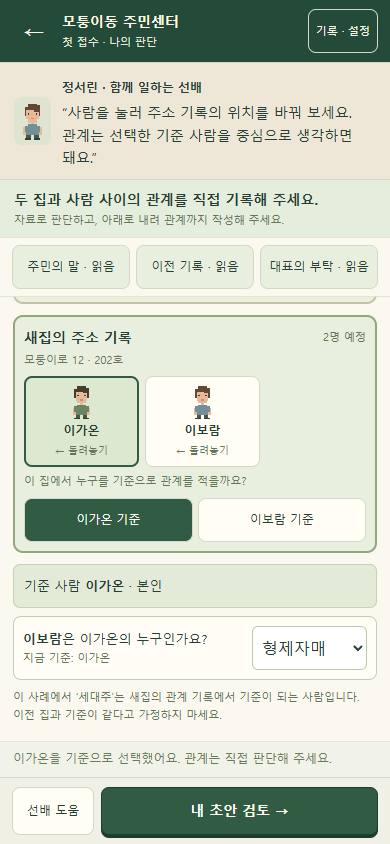
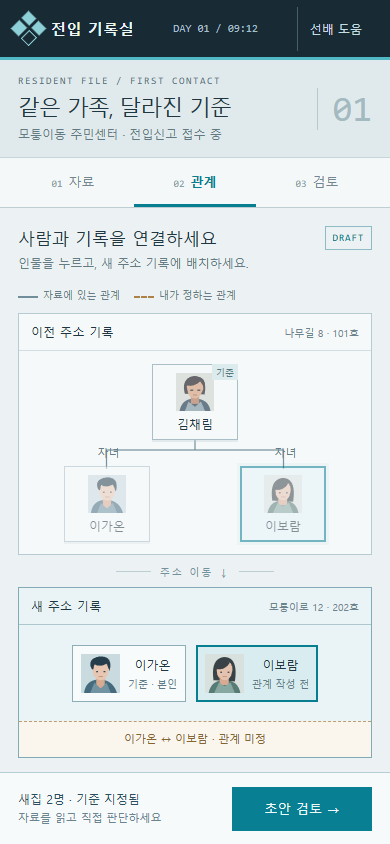
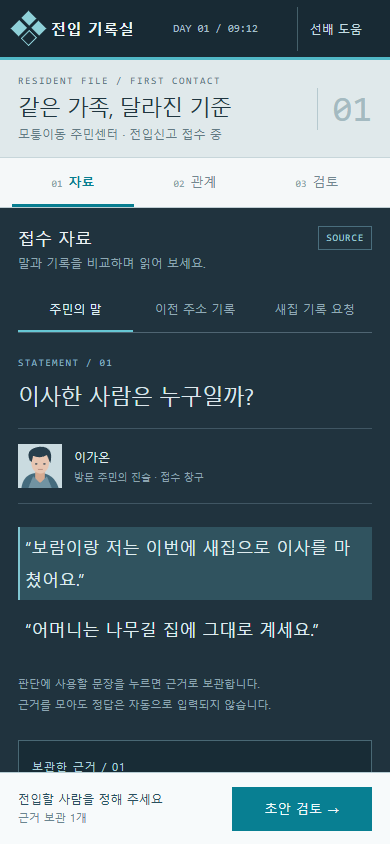
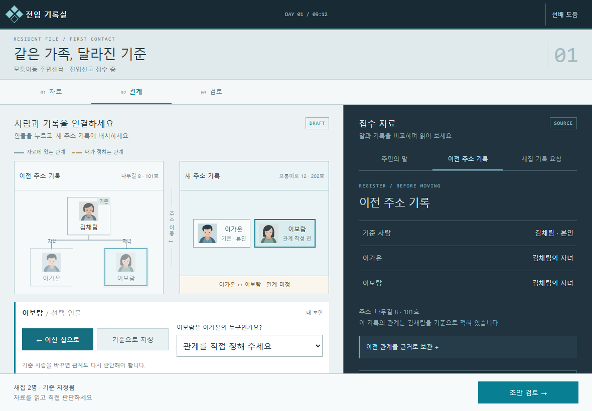
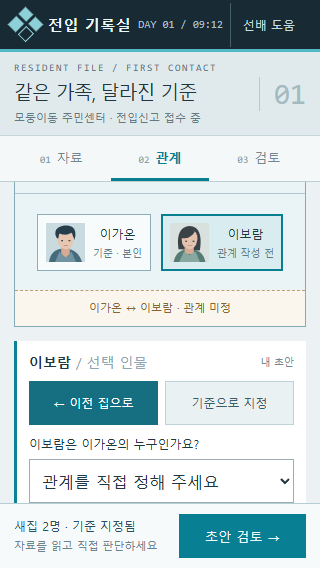

# 첫 접수 · 전입 기록실 UI/UX 시안

> 후속 방향(2026-10-11): 기존 전입창구를 유지하고 이 시각 체계는 새 복지상담실에 활용한다. 현재 실행 명세는 [전입창구→복지상담실 상세계획](전입창구_복지상담실_상세개발계획.md)이다. 아래 내용은 당시 제안의 이력으로 보존한다.

2026-10-11 · 첨부 Orwell 화면에서 착안한 **검토 제안**. 별도 HTML 시안 제작 완료. 실제 게임 소스, 저장, 공개 페이지는 변경하지 않았다. 기존 승인 수치를 대체하는 새 승인 명세가 아니다.

[직접 조작하는 시안](../design/관계추론_Orwell풍_시안.html) · [기존 구현 계약](첫접수_구현검증.md)

## 이번 방향

첨부 화면의 밝은 인물·관계망과 어두운 자료 패널, 얇은 선, 차가운 색감, 기록 중심의 정보 계층을 전입신고에 맞게 재해석했다. 기존의 베이지·녹색 안내 화면에서 ‘한 건의 기록을 조사하고 작성하는 게임’ 분위기로 옮기는 제안이다. 첨부 사진을 참고했으며 Orwell의 실제 조작·규칙을 플레이 검증한 결과는 아니다. 상표·게임 이미지·실제 인물 사진은 사용하지 않고 인물 초상을 SVG로 직접 구성했다.

첫 접수 범위는 주민의 말, 이전 주소 기록, 새집 기록 요청 → 사람 배치 → 새 기준·관계 판단 → 초안·판단 이유 확인이다. 지도, 접수 목록, 나머지 사례는 이번 시안에 포함하지 않는다.

사전 선택 질문의 답이 아직 없어 밝은 회청색 기록 화면 + 짙은 남색 자료 화면, 모바일 탭, 첫 접수 범위를 추천 가정으로 적용했다. 이 선택과 아래 수치는 검토용이며 사용자 승인으로 기록하지 않는다.

## 현재 화면과 변경 후

같은 사건의 두 사람이 새집에 배치된 상태를 비교한다. 현재 캡처는 기존 구현 검증의 저장 이미지이며 관계를 선택한 상태다. 변경 시안은 답을 미리 채우지 않은 ‘관계 미정’ 상태다.

| 현재 구현 · 390×844 | 변경 제안 · 390×844 |
| --- | --- |
|  |  |

모바일 자료 화면은 어두운 자료 뷰어로 전환한다. 주민 진술의 특정 문장을 누르면 보관 색과 보관 목록에 반영된다. 인물 배치나 관계 답은 자동으로 정하지 않는다.

PC는 기록 작업 58%, 자료 42%로 나누어 두 화면을 동시에 보여 준다. 왼쪽 인물 선택·배치·기준·관계 입력과 오른쪽 원문 비교가 연결된다.

## 정보와 조작

| 영역 | 보이는 정보 | 플레이어가 하는 일 |
| --- | --- | --- |
| 접수 헤더 | 사건명, 첫날의 시각, 접수 번호 | 현재 사건을 인지한다. 시각은 시안의 장식이며 제한 시간 규칙이 아니다. |
| 자료 | 주민의 말, 이전 주소 기록, 새집 기록 요청 | 자료를 바꾸고 판단 근거를 보관한다. |
| 이전 주소 | 김채림 기준의 기존 관계 실선 | 인물을 선택한다. 이전 기록 자체는 수정하지 않는다. |
| 새 주소 | 내 배치와 기준, 미정/작성한 관계 | 새집에 배치·되돌리기·기준 지정·관계 선택을 한다. |
| 선택 인물 편집 | 현재 인물, 이동 버튼, 기준 버튼, 관계 질문 | 모바일에서 인물을 누르면 편집 영역이 보이도록 스크롤한다. 드래그는 필수가 아니다. |
| 초안 | 내가 선택한 사람·기준·관계, 판단 이유 | 제출하거나 관계망으로 돌아가 수정한다. |
| 검토 결과 | 확인할 근거 자료 | 틀린 값을 유지한 채 다시 판단한다. |

이전 관계와 새집의 판단을 선 모양·문구로 구분한다. 색만으로 상태를 알리지 않는다. 초안에 적힌 형제자매·자녀 등은 플레이어가 실제로 고른 값이다. 검토 전에 새 관계를 정답으로 그리거나 보관한 문장으로 자동 입력하지 않는다.

선배 도움은 누른 경우에만 열리고 기준을 비교하는 관점만 제공한다. 누구를 옮기고 어떤 답을 고를지는 알려 주지 않는다. 완료 후에만 이 사례의 관계 해설을 제공한다. 이동 또는 기준 변경 시 종속된 관계·판단 이유를 비운다. 자료와 근거 보관은 유지한다.

## 모바일 배치와 제안 수치

시안 상단에서 320×568, 390×844, 430×932, PC 1180×820을 전환할 수 있다. 표시된 프레임의 실제 폭·높이, 기본 글꼴·크기, PC 패널 비율을 함께 표시한다. ‘기기 화면’은 도구 영역을 감추고 현재 브라우저 크기로 시안을 보여 준다. 새로고침하면 기본 검토 화면으로 돌아온다.

| 항목 | 제안 수치·행동 |
| --- | --- |
| 기본 글꼴 | 현재 앱과 같은 맑은 고딕, sans-serif 대체 · 기본 16px |
| 핵심 자료 진술 | 모바일 17px, PC 18px · 줄 간격 1.9 |
| 입력 | 관계 선택 16px, 최소 높이 44px |
| 주요 버튼 | 최소 높이 44px · 외부 시안 도구 버튼은 별도 |
| 모바일 좌우 여백 | 390/430px: 18px · 짧은 화면: 14px |
| 상단·하단 | 상단 최소 60px, 짧은 화면 52px · 하단 최소 72/65px |
| 작업 탭 | 자료 / 관계 / 검토, 최소 50/46px 높이 |
| PC | 800px 이상 두 패널 · 기록:자료 58:42 |
| 세로 공간 | 가운데만 스크롤, 조작 버튼은 하단 유지 · 인물 선택 시 편집 영역 노출 |
| 큰 글자 | 상단이 화면의 65%를 넘으면 전체 세로 스크롤로 전환 |

작은 메타데이터와 캡션은 10~12px 제안이다. 실기기 가독성 확인 후 확대할 수 있다. 아래 320px 이미지는 관계 입력까지 스크롤한 상태다. 전체 관계망을 무리하게 축소해 한 화면에 넣지 않는다.

## 실제 구현으로 옮길 때

1. 이번 화면·색·글자 크기의 검토 결과를 확정하고 실제 승인 값으로 기록한다.
2. 기존 `src/tutorial-view.js`의 표시와 `src/puzzle.css`를 바꾼다. 시안의 독립 상태·샘플 판정을 실제 저장이나 엔진 대신 가져오지 않는다.
3. 기존 tutorial 액션에 인물 선택·배치·기준·관계 UI를 연결한다. 기존 자료 읽기, 엔진 검토, 완료 스냅샷, 저장 복원, M01/M03 호환을 유지한다.
4. ‘문장 보관’이 화면 장식인지 저장해야 하는 실제 기능인지 별도 결정한다. 현재 시안의 보관 개수는 완료 조건이 아니다. 실제 구현의 자료 확인 조건을 대체하지 않는다.
5. 실기기와 초심자 평가에서 인물 선택 후 다음 조작을 알아차리는지, 기존 기록과 현재 판단을 구분하는지 확인한다. 필요하면 선택 인물 편집을 모바일 아래 패널로 발전시킨다.
6. 기존 첫 접수·저장·본편 회귀를 검증한 뒤 공개 테스트 페이지 반영은 별도 요청 범위에서 진행한다.

## 검증과 한계

별도 시안의 Windows Headless Edge 검증: 34개 확인 통과, 스크립트 오류 0. 초기 답 없음, 근거 보관이 답을 바꾸지 않음, 오답 초안 유지, 수정·완료, 기준 변경 무효화, 자료 왕복 값 유지, 도움 초점·복귀, 키보드 탭 이동, 320/390/430px 가로 넘침 없음, 관계 입력 16px, 주요 버튼 44px, PC 두 패널, 현재 이미지 비교, 200% 글자 시 세로 스크롤을 확인했다. 주요 캡처를 직접 확인했다.

[검증 결과](../design/화면/Orwell풍/검증결과.json) · [검증 스크립트](../design/검증_Orwell풍.cjs)

실제 실행판 3개의 SHA-256은 기존 최종 검사와 일치했고 원본 보호 37개가 통과했다. 새 UI의 실제 저장·보상·엔진 통합, iPhone/Android 실기기, 초심자 이해·재미는 이번 작업으로 검증한 것이 아니다. 이 HTML은 새로고침하면 초기화되는 화면·조작 시안이다.
