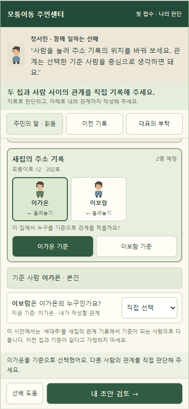
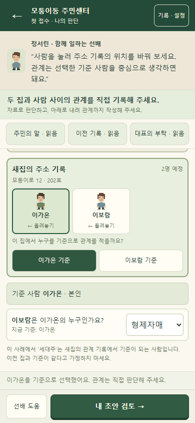

# 관계 추론 첫 접수 · 실제 구현과 검증

2026-10-11 · 로컬 독립판과 통합 후보 구현. 공개 사이트 배포 없음.

## 승인 기준과 구현 범위

사용자는 관계 추론 시안대로 첫 접수를 구현하고, 선배가 답을 알려주지 않으며 모바일에서 편하게 조작할 것을 요청했다. [계획 v2](첫접수_재설계_계획.md)의 가족·자료 3개·4장면·요청형 도움·실제 초안 구조를 적용했다. 승인 화면 기준은 390×844, 맑은 고딕 기본 16px·주요 대화 14px·44px 이상 조작이다. 짧은 화면은 대화 13px와 간결한 조작 안내로 작업 공간을 확보했다. 관계 선택 입력은 iOS 자동 확대를 피하도록 16px로 보완했다.

## 실제 진입과 기존 진행 호환

- 새 플레이의 ‘첫 접수 시작’과 기존 M01의 ‘접수하기’는 `resident-center:tutorial-family` 도입 사건을 먼저 연다. 주민센터 챕터 첫 출근의 창구에서도 동일하게 연결된다.
- 별도 도입 사건은 기존 M01/M03의 ID·사실관계·기록을 바꾸지 않는다. 완료 뒤 기존 첫 미완료 접수로 이어진다. 기존 6사례와 12회 방문 순서는 유지된다.
- 기존 진행 중 초안과 완료 기록이 있는 저장은 강제로 새 도입 사건으로 보내지 않는다. 접수 목록의 첫 접수 버튼으로 별도로 열 수 있다.
- 뒤로 가거나 목록으로 나가도 첫 접수 초안을 유지한다. 작성/검토/완료와 자료 열람, 도움 단계, 판단 이유는 새로고침 후 복원된다. 완료 기록은 읽기 전용이다.

## 판단·완료 계약

주민의 말에서 이동 범위를, 새집 부탁에서 기준 사람을, 이전 기록에서 가족 연결을 찾는다. 최초 이동 인물·기준·관계·이유는 비어 있다. 이미 제공된 새 주소와 새 세대 구성은 사례의 고정 맥락으로 설정하며 이번 추론 항목으로 요구하지 않는다.

신고 기록은 현재 엔진 초안에서 만들므로 오답과 빈칸도 그대로 나온다. 이동 범위나 기준을 바꾸면 종속 관계와 판단 이유를 다시 정하게 한다. 자료를 읽어도 플레이어의 관계 선택은 바뀌지 않는다. 검토 복귀는 현재 값을 유지한다.

선배 도움은 누를 때만 나타나며 최대 2단계다. 관계를 적을 기준과 이전 기록의 연결을 짚고 올바른 이름·관계 선택을 대신 알려주지 않는다. 오류 확인도 관련 자료로 돌아가는 안내이며 자동 정답 교체가 없다. 올바른 처리 이후에만 형제자매라는 관계의 해설을 보여준다.

완료하려면 자료 3개를 확인하고, 실제 엔진의 이동·기준·관계 판정과 ‘새집에서 선택한 기준 사람의 관계’라는 판단 이유를 모두 만족해야 한다. engine/review.js·resolve.js의 기존 검증과 스냅샷 생성을 그대로 사용한다. 별도 UI 정답 판정을 실제 엔진 대신 사용하지 않는다.

도입 완료는 tutorial.session.record에 저장한다. 기존 records·dayClosed·items와 본편 보상 원장에 접수나 보상을 추가하지 않으므로 12방문·4결산의 지급 기준은 유지된다.

## 저장 계약과 소스

기존 저장 키와 schemaVersion/contentVersion 1을 유지하고 선택적 tutorial 필드를 추가했다. 옛 저장은 이 필드 없이도 유효하다. tutorial.version 1에는 active, session, reason, hintLevel, attempted가 있으며 session은 기존 엔진 형식이다. 미지원 버전·변조된 완료 스냅샷·동시에 활성화된 두 접수는 거부하고 기존 원본 보호 및 JSON 백업 흐름을 유지한다.

판단 상태는 [services/tutorial.js](../src/services/tutorial.js), 화면은 [tutorial-view.js](../src/tutorial-view.js), 진입·저장 연동은 [puzzle-app.js](../src/puzzle-app.js)에서 관리한다. 기존 판정 엔진과 사례 데이터는 수정하지 않았다. build_puzzle.py와 build_integrated.py가 신규 모듈을 포함해 독립판 및 본편 내 격리 iframe을 생성한다. 공개 본편 사본·루트 게임·배포 저장은 보존했다.

## 화면 검증

| 승인 시안 · 390×844 | 실제 관계 판단 · 390×844 |
|---|---|
|  |  |

[320px 실제 입력](검증화면/첫접수/관계_320.png) · [오답 초안](검증화면/첫접수/오답초안_390.png) · [검토](검증화면/첫접수/검토_390.png) · [완료](검증화면/첫접수/완료_390.png) · [320px 200% 글자 입력](검증화면/첫접수/확대입력_320.png).

390/430px 및 320px 화면은 가운데 작업 영역을 스크롤한다. 짧은 화면은 대화를 간결화하지만 사실 자료를 생략하지 않는다. 가로 844×390 및 200% 글자 확대는 문서 스크롤로 전환해 내용을 읽고 조작할 수 있다. 탭으로 사람을 옮기고 선택 입력으로 관계를 정하므로 드래그 정확도를 요구하지 않는다. 자료 패널은 모달과 Escape/뒤로가기, 원래 버튼으로 초점 복귀를 지원한다.

## 검증 결과

- 첫 접수 엔진·저장 검사 20개: 오답 보존, 기준 변경 무효화, 근거와 판단 이유 필요, 실제 스냅샷, 완료 불변, 레거시 저장 및 변조 거부.
- 첫 접수 브라우저 검사 29개: 실제 진입·오답 수정·자료·요청형 도움·초점·새로고침·완료·기존 M01 연결, 320×568/390×844/430×932/844×390 가로 넘침 없음·44px 조작, 320px 200% 글자 확대 입력과 결과, 기존 작성 중 접수 복원. 실행 오류 0.
- 기존 원본 core 20개, 현재 엔진 70개, 저장/캠페인/지도 15개, 원본 보호 37개 통과. 기존 6사례·12방문, 본편 iframe 연결, 저장 플러시·복원, 180XP/300포인트 및 중복 방지, 기존 23모듈/2,070레벨 판정·화면 검사도 통과했다.
- 전체 11개 검사 묶음 통과 후 짧은 화면의 안내 문구만 간결화했다. 최종 빌드에서 첫 접수 브라우저 29개를 재실행하고 화면·해시를 갱신했다. [전체 결과 및 산출물 해시](최종검사.json), [첫 접수 브라우저 근거](검증화면/첫접수/검증결과.json).

검증은 Windows의 headless Edge에서 수행했다. 실제 Android Chrome/iPhone Safari, 주소창·안전 영역 변화와 업무 미경험자의 이해·재미 평가는 아직 수행하지 않았다. RC-R01~RC-R06은 구현·자동 검증 완료, RC-R07은 사람 평가 대기다.
