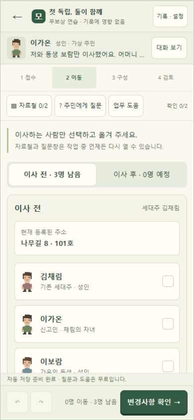
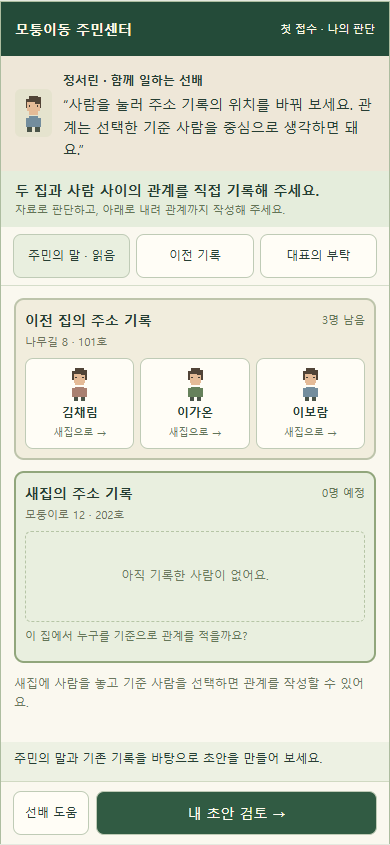

# 첫 접수 재설계 계획 · 관계 추론 검토안 v2

2026-10-11 · 사용자 시안 승인 후 실제 구현. 승인 기준 390×844·맑은 고딕 기본 16px·주요 대화 14px·조작 최소 44px. 짧은 화면 13px 대화. 관계 선택은 iOS 입력 확대 방지를 고려해 16px로 구현.

## 목적과 확정 범위

사용자는 관계 추론을 중심으로 첫 접수 계획과 시안을 다시 만들고, 선배가 답을 알려주기보다 플레이어가 직접 판단하는 흐름을 요청했다. 이 방향과 계획·시안만 만드는 이전 범위는 후속 구현 지시로 해제됐다. 후속 사용자 요청으로 첫 접수의 실제 소스·실행판·저장 복원을 구현한다. 기존 사례 ID·완료 기록·보상과 나머지 사례의 규칙은 유지한다.

플레이어는 이미 이사한 주민의 주소 기록을 바꾸는 직원이다. 첫 접수는 **주민의 말과 이전 기록을 연결해 새집의 기록을 작성하는 작은 추론 사건**으로 만든다. 완료 기준은 직원의 목적을 이해하고, 옮긴 사람과 남은 사람을 구분하며, 관계가 어느 사람을 기준으로 하는지 자기 말로 설명할 수 있는 것이다.

별도 첫 접수 ID는 `resident-center:tutorial-family`를 유지한다. 승인 시안의 M03 가족과 사실관계를 활용하며 원본 M01/M03 ID, 완료 기록과 기존 저장을 재해석하지 않는다. 도입 사건은 기존 M01보다 먼저 체험하며 기존 6사례·12방문 순서는 유지한다. 기존 진행 중 접수는 강제로 대체하지 않는다.

## 사건과 플레이어가 얻을 자료

가상의 성인 가족 김채림·이가온·이보람을 사용한다. 이전 주소는 나무길 8 · 101호, 새 주소는 모퉁이로 12 · 202호다. 실제 절차 전체를 가르치는 서비스가 아니라 관계 판단에 집중한 게임 사례다.

| 자료 | 플레이어에게 보이는 정보 | 여기서 할 판단 |
|---|---|---|
| 주민의 말 | “보람이랑 저는 새집으로 이사를 마쳤어요. 어머니는 나무길 집에 그대로 계세요.” | 가온·보람의 주소만 변경하고 채림의 주소를 유지한다. |
| 이전 기록 | 기준 사람 김채림 / 김채림 본인 / 이가온 자녀 / 이보람 자녀 | 가온과 보람이 같은 부모의 자녀로 연결되어 있다는 사실을 읽는다. |
| 대표의 부탁 | “새집에서는 제 이름, 이가온을 기준으로 함께 사는 사람을 적어 주세요.” | 새집의 관계 기준을 가온으로 정한다. |

주민은 처음부터 ‘동생’ 또는 ‘형제자매’를 말하지 않는다. 이전 기록도 새집의 관계 답을 보여주지 않는다. **같은 부모의 자녀라는 연결 + 새집의 기준이 가온이라는 사실 → 보람은 가온의 형제자매**라는 추론을 플레이어가 수행한다. 주소는 주민이 제공하며 첫 접수에서 별도의 주소 추리까지 요구하지 않는다.

## 플레이 흐름 · 4장면

첫 체험 목표는 5~7분이며 측정 전 가설이다. 제한시간·감점·실패 종료는 없다. ‘처음부터’로 시작하거나 검토 장면을 선택할 수 있지만 장면 선택이 정답을 채우지는 않는다.

| 장면 | 조작 | 판단과 결과 |
|---|---|---|
| 1. 주민의 이야기 | 대화를 읽고 ‘내가 기록해 보기’ | 이사는 끝났고 지금 하는 일은 주소 기록 변경임을 이해한다. |
| 2. 직접 기록 작성 | 사람을 눌러 이전 집/새집에 놓고, 새집의 기준 사람을 선택한 뒤 관계를 직접 선택한다. 자료를 자유롭게 다시 읽는다. | 어떤 사람이 옮겼는지, 누구를 기준으로 관계를 적을지, 그 사람과 어떤 연결인지 판단한다. 선배가 정한 클릭 순서를 따라야 통과하는 구조는 피한다. |
| 3. 내 초안 검토 | 실제 선택값으로 만들어진 신고 기록을 보고 관계를 적은 이유를 선택한다. ‘직접 수정’으로 돌아갈 수 있다. | 오답·빈칸도 그대로 반영한다. ‘새집 기준 관계’인지 ‘이전 표 복사’인지 판단 이유를 확인한다. |
| 4. 처리 결과 | 근거와 초안을 확인해 처리하고 주민의 반응을 본다. | 채림의 주소 유지, 두 사람의 새 주소, 새 기준과 관계를 자기 선택의 결과로 확인한다. 올바른 처리 후에만 관계 해설을 보여준다. |

사람·기준·관계의 논리적 의존은 유지하지만, 자료를 여는 순서와 수정 순서는 강제하지 않는다. 관계는 선택한 기준 이름을 넣어 “이보람은 이가온의 누구인가요?”처럼 묻는다. 보람을 기준으로 바꾸면 질문의 방향도 바뀐다. 기준 자신은 ‘본인’으로 표시한다. 이는 정의 표시이며 다른 사람의 정답을 자동으로 채우는 동작이 아니다.

## 첫 접수 안의 난이도

| 판단 | 난이도 | 도움 방식 |
|---|---|---|
| 주소가 바뀐 사람 | 낮음: 대화의 명시적 사실 | 사람을 잘못 놓아도 허용하며 검토에서 주민의 말을 다시 확인하게 한다. |
| 새집의 기준 사람 | 낮음~중간: 요청을 기록 방식으로 바꾸기 | 부탁 자료와 기준 표시를 제공한다. 이름을 대신 선택하지 않는다. |
| 새집에서의 관계 | 중간: 두 자료를 연결하고 기준을 바꾸기 | 이전 기록에는 어머니 기준 관계만 있다. 새 기준 이름과 관계 질문을 나란히 보여준다. |
| 판단한 이유 | 이해 확인: 외운 답과 추론 구분 | 현재 초안과 이유를 대조한다. 더 어려운 새 규칙을 추가하지 않는다. |

첫 사건은 관계 추론 한 가지를 중심으로 끝낸다. 상세주소 오류, 서류 누락, 복잡한 편입, 위임과 복수 가족 구조는 이후 사례 후보다. 이후 난이도 확장은 첫 접수 이해 평가 후 별도로 설계하며 이번에 게임 데이터에 추가하지 않는다.

## 선배의 역할과 오답 피드백

정서린은 처음에 조작과 기준 개념을 알려준다. 기본 대사는 “사람을 눌러 주소 기록의 위치를 바꿔 보세요. 관계는 선택한 기준 사람을 중심으로 생각하면 돼요”다. 플레이어가 판단하기 전에 이동할 이름·기준의 이름·형제자매라는 답을 직접 말하지 않는다.

‘선배 도움’은 요청했을 때만 열린다. 1단계는 현재 기준 이름과 이전 표의 기준 이름을 비교하도록 한다. 다시 요청한 2단계는 이전 표에서 같은 부모의 자녀로 연결된 두 사람을 찾아 새 기준과의 관계를 생각하도록 한다. 도움은 특정 선택지 클릭이나 정답 자동 입력으로 이어지지 않는다. 시안의 도움은 단계별 방향 제시이며 실제 사용자가 어떻게 느끼는지는 평가해야 한다.

오답이면 ‘주민의 말과 옮기는 사람의 범위를 대조’, ‘기준 사람과 부탁을 대조’, ‘선택한 관계가 새 기준의 관계인지 대조’처럼 확인할 지점을 알려준다. 관련 자료 버튼을 제공하고 현재 선택을 유지한다. 틀린 항목의 올바른 값이나 정답 관계는 처리 전에 출력하지 않는다.

자료 확인 자체는 이해의 증거가 아니다. 시안은 이전 기록과 부탁을 열어 보았는지, 관계와 기준 및 이유가 사례의 근거와 맞는지를 함께 확인한다. 실제 구현의 완료 판정은 기존 엔진으로 검증한 결과와 연결해야 한다. 정답 선택 또는 자료 열람만으로 교육 효과를 주장하지 않는다.

## 상태와 의존 관계

시안의 초안 상태는 이동 인물, 기준 사람, 인물별 관계, 선택한 이유, 읽은 자료, 도움 단계, 현재 장면이다. 실제 게임 저장의 선택적 tutorial 필드에 연결한다. 아래 설계 상태를 기존 저장 키에서 검증·복원한다.

- 초기 이동 인물·기준·관계·이유는 비어 있다. 기본 대화는 읽은 것으로 시작하며 ‘처음부터’로 이야기 장면을 체험한다.
- 신고 기록은 항상 현재 초안에서 생성한다. 예컨대 보람을 ‘자녀’로 고르면 신고 기록에도 ‘이보람: 자녀’가 남는다.
- 검토에서 작성으로 돌아가도 선택을 보존한다. 오류 확인도 답을 바꾸지 않는다.
- 기준 사람이 바뀌면 다른 사람의 관계와 판단 이유를 비운다. 기준 사람이 이전 집으로 돌아가면 기준도 해제한다.
- 이동 인물을 바꾸면 관계·이유·이전 검토 결과를 재판단 대상으로 만든다. 읽은 자료는 유지한다.
- 처리 전까지는 미확정 초안이다. 실제 구현에서는 기존 엔진으로 완료 스냅샷을 만들고 저장한다. 도입 사건의 완료는 기존 접수·챕터 완료나 보상 지급을 뜻하지 않는다.

## 모바일 화면과 전후 시안

[직접 조작하는 시안](../design/첫접수_재설계_프로토타입.html)은 현재 실행 게임과 제안 화면을 나란히 보여준다. 비교 선택에서 이전 안내 중심 시안도 볼 수 있다. 폭·높이를 입력하거나 320×568 / 390×844 / 430×932를 선택하면 제안 화면의 치수와 비율이 표시된다. 왼쪽 캡처는 390×844 고정이다. 검토용 바깥 도구는 실제 게임에 넣을 UI가 아니다.

제안 기준은 390×844, 기존과 같은 맑은 고딕 기본 16px, 주요 대화 14px, 조작 영역 최소 44px다. 높이 650px 미만의 시안은 대화 13px와 간결한 여백을 사용한다. 시안대로 구현하라는 요청으로 해당 화면 기준을 채택했다. 선택 입력의 16px 보완과 실제 실행 화면은 구현 검증 기준에 함께 기록한다.

휴대폰 안은 장소/진행 → 짧은 대화 → 현재 판단 → 자료 3개 → 두 집과 관계 작업 영역 → 반응 → 행동 버튼으로 구성한다. 자료는 화면 내부의 아래쪽 패널로 열고 닫아 현재 초안으로 돌아온다. 작은 화면은 가운데만 스크롤하며 ‘아래로 내려 관계까지 작성’ 안내를 유지한다. 드래그 대신 탭으로 사람을 옮긴다. 관계와 기준은 색 외에 이름·문장·선택 상태로 표시한다.

| 현재 게임 · 390×844 | 변경 후 판단 화면 · 390×844 |
|---|---|
|  |  |

[관계 직접 선택](../design/화면/관계추론/새시안_관계.png) · [오답도 반영한 초안](../design/화면/관계추론/새시안_오답초안.png) · [재확인 피드백](../design/화면/관계추론/새시안_재확인.png) · [검토](../design/화면/관계추론/새시안_검토.png) · [처리 결과](../design/화면/관계추론/새시안_완료.png) · [320px 화면](../design/화면/관계추론/새시안_320.png).

이전안은 [계획 v1](첫접수_재설계_계획_v1_보관.md)과 [안내 중심 시안](../design/첫접수_안내중심_이전시안.html)에 이력으로 보존한다. 현재 계획은 이 v2 한 곳에서 관리한다.

## 구현 단계 · RC-R01~RC-R06 구현, RC-R07 사람 평가 대기

| 단계 | 작업 | 통과 조건 |
|---|---|---|
| RC-R01 목적·대본 고정 | 4장면, 자료 3개, 근거 연결, 도움·오답 문구 | 처리 전 대사·화면에 새집 관계 정답을 직접 제공하지 않는다. |
| RC-R02 첫 접수 후보 분리 | 후보 데이터와 초안/자료/장면 상태, 기존 엔진 입력 변환 명세 | 기존 M01/M03와 저장 키·완료 기록 보호, 실제 완료는 기존 판정과 일치한다. |
| RC-R03 집 배치 조작 | 탭 이동·되돌림, 두 집 표시, 비선형 수정 | 틀린 이동도 시도 가능하고 초안에 반영된다. |
| RC-R04 기준·관계 추론 | 선택 기준에 따른 질문, 자료 패널, 요청형 도움 | 기준 변경 시 관계 재판단; 정답 자동 입력 없음; 화면과 키보드 초점 일치. |
| RC-R05 초안·근거·완료 | 실제 상태에서 신고 기록 생성, 판단 이유, 처리 피드백 | 오답/빈칸을 정답으로 교체하지 않음; 올바른 처리 뒤에만 해설 표시. |
| RC-R06 복원·모바일 검수 | 수정/종료/복원, 의존 상태 무효화, 작은 화면·키보드·확대 글자 | 검토 복귀는 초안 유지, 실제 저장 보호, 가로 넘침·조작 충돌 없음. |
| RC-R07 초심자 평가 | 업무 미경험자 관찰과 이해·재미 점검 | 아래 기준 확인 후 이후 사례 확장 여부 판단. |

실제 구현에서 presenter가 관계 질문과 자료를 제어하고 기존 판정 엔진이 업무 결과를 검증한다. 시안의 독립 판정 함수를 실제 엔진 대신 복사하지 않는다. 자료 열람은 별도 사건의 knowledge에 검증 사실로 연결하며, 이유 선택은 이 사건의 학습 피드백으로 다룬다. 이유 선택은 이 도입 사건의 학습 완료 조건이며 new-head 선택과 기존 엔진의 업무 판정을 모두 만족해야 완료한다. 전체 맵·본편 경제·배포는 이 작업 범위 밖이다.

## 검증 결과와 남은 확인

별도 시안은 Windows Edge에서 초기 자동 답 없음, 잘못된 이동/기준/관계의 초안 반영, 오답 수정, 기준 변경과 복귀 시 종속 상태 해제, 패널 닫기와 키보드 초점, 320/390/430px 가로 넘침·44px 조작을 확인했다. [검토 결과](../design/화면/관계추론/검토결과.json)를 근거로 삼는다. 실제 실행판 3개는 기존 해시와 일치했고 원본 보호 검사 37개가 통과했다. 게임 기능 전체를 다시 테스트한 작업은 아니다.

실제 휴대폰, 브라우저 주소창/안전 영역/회전, 200% 글자 확대는 미확인이다. 초심자 이해·재미와 5~7분 목표도 아직 평가하지 않았다. 가능하면 업무 미경험자 3명으로 작게 시작하되 인원·일정은 확정 전이다.

평가에서는 (1) 직원이 하는 일 설명, (2) 누가 남고 옮겼는지 설명, (3) 선배가 값을 알려주지 않아도 근거로 수정, (4) 보람의 관계를 가온 기준으로 설명, (5) 자신의 판단과 신고 기록 대응 설명을 확인한다. 추가로 ‘시킨 버튼을 눌렀다’와 ‘자료를 보고 내가 판단했다’ 중 어떤 경험인지 듣는다. 정답 제출만으로 통과시키지 않으며 이해가 부족하면 안내를 늘리기보다 자료 표현과 질문의 연결을 고친다.

남은 것은 실제 휴대폰 확인과 업무 미경험자의 이해·재미 평가다. 공개 배포와 사람 대상 평가는 별도 확인 사항이다. 실제 구현 결과는 아래 문서를 따른다.

## 실제 구현 연결 명세

[첫 접수 구현·검증](첫접수_구현검증.md)에 진입·저장·판정·모바일·회귀 결과를 기록한다. 과거 시안과 그림은 승인 비교 기준으로 보존한다. 실제 신규 구현은 독립판과 로컬 통합 후보에 포함되며 공개 사이트는 갱신하지 않았다.
