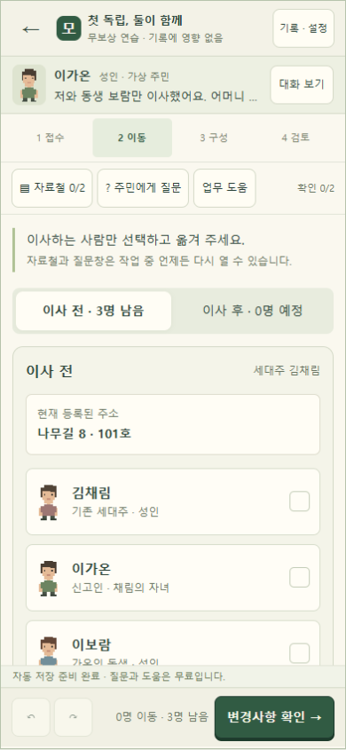
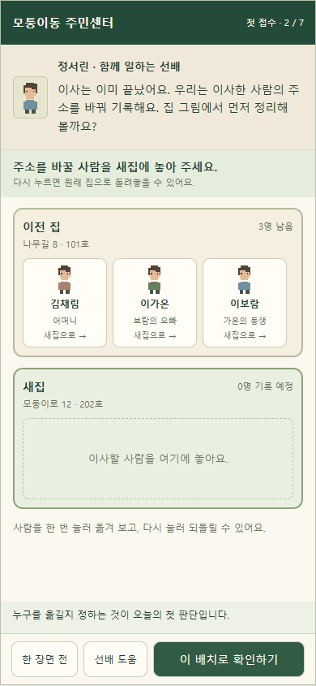

# 첫 접수 재설계 계획 · 검토안

2026-10-11 · 계획 작성 완료 / 실제 게임 수정 전 / 화면 치수 승인 전.

## 이렇게 이해했습니다

목적은 전입신고를 해본 적 없는 플레이어가 직원의 일을 이해하고, 주민의 이사 상황을 판단하는 재미를 느끼게 하는 것이다. 사용자는 선배와 한 가족의 이사를 단계별로 처리하기, 집에 사람을 배치한 결과를 서류에 연결하기, 첫 접수부터 개선하기를 선택했다. 이번에는 계획만 요청했으므로 게임 소스·현재 실행판·저장·보상은 수정하지 않는다.

바뀌는 것은 첫 접수의 이야기, 개념을 알려 주는 순서, 화면의 중심과 피드백이다. 기존 전입신고 판정 규칙, 나머지 6사례·4일 챕터 및 본편 연결은 이번 구현 대상에서 제외한다. 원래의 M01을 즉시 덮어쓰는 대신 별도 첫 접수 후보를 검토한다.

완료 기준은 처음 하는 사람이 왜 이 업무를 하는지 설명하고, 누가 옮기고 누가 남는지 판단하며, 새집에서 관계를 적는 기준을 이해하는 것이다. 기능 검사의 통과와 이해·재미 검증을 분리한다.

## 핵심 방향

플레이어는 이사를 수행하는 사람이 아니라 이미 이사한 주민의 주소 기록을 바꾸는 직원이다. 첫 대화에서 이 목적을 생활 언어로 밝힌다. 집 그림의 이동은 주소 변경 초안이고, 마지막 확정 전에는 실제 기록이 바뀌지 않는다는 사실도 안내한다.

현재는 행정 용어 → 입력 항목 → 정답 검토 순서다. 제안 흐름은 주민의 사정 → 집 그림에서 판단 → 선배와 결과 확인 → 행정 용어 연결 → 신고 기록 → 주민 반응이다.

첫 접수의 재미는 잘못된 배치도 시도하고, 사람과 집의 변화로 결과를 이해하며, 주민의 부탁을 해결하는 데 둔다. ‘정답’ 도장이나 감점으로 끝내지 않는다. 서류는 플레이의 결과가 모이는 마지막 화면이다. 모든 답을 주민의 말에서 제공하는 첫 접수는 안내용 사례이며, 독립적인 고난도 퍼즐로 평가하지 않는다. 이후 사례에서 도움을 줄이고 같은 판단을 스스로 하게 만드는 것은 별도 확장 단계다.

## 첫 가족과 이야기

기존 M03의 김채림·이가온·이보람과 사실관계를 활용하는 후보를 권한다. 성인 가온과 보람이 함께 독립했고 어머니 채림은 이전 집에 남는다. 새집 대표는 가온이며 보람은 새 대표 기준으로 형제자매다. 주소는 기존 가상 주소를 유지한다. ‘남는 사람’과 ‘관계의 기준 변화’를 하나의 일상적인 사건으로 설명할 수 있다.

주민은 “동생 보람이랑 둘이 독립했어요. 어머니는 원래 집에 계세요”라고 말한다. 시작부터 세대·편입·세대주를 말하지 않는다. 선배 정서린이 “이사는 이미 끝났어요. 우리는 이사한 사람의 주소를 바꿔 기록해요”라고 업무 목적을 짚는다.

첫 접수 후보의 교차 섹션 ID는 resident-center:tutorial-family다. 기존 M03의 사실관계와 판정 입력으로 매핑하는 방향을 제안하며, 원본 M03 및 M01 ID를 바꾸거나 완료 기록을 재해석하지 않는다. 실제 캠페인의 첫 자리로 배치하는 결정은 후보 검토 후 한다.

## 플레이 순서 · 첫 체험 목표 5~7분

시간은 설계 목표이며 플레이 중 제한시간·초읽기는 없다.

| 장면 | 플레이어가 하는 일 | 이해시키는 내용 | 선배/주민의 반응 |
|---|---|---|---|
| 1 주민의 이야기 | 짧은 대화를 듣고 접수를 시작 | 이사한 사람의 주소를 기록하는 업무 | 생활 언어로 목적 설명; 가상 확인 자료는 접수 맥락에서 함께 소개 |
| 2 이사한 사람 배치 | 주소를 바꿀 사람을 눌러 새집에 놓음; 다시 누르면 복귀 | 이번에 옮긴 사람과 남는 사람은 다름 | 어머니를 옮겨도 시도 가능; 확인할 때 주민의 말을 짚어 수정 유도 |
| 3 두 집의 결과 확인 | 어머니 1명/남매 2명을 함께 보고 확인 | 일부 이동은 이전 집의 기록도 남김 | 남은 사람의 주소는 그대로라는 결과를 설명 |
| 4 새집 대표 정하기 | 주민의 부탁에 따라 가온을 표시 | 새집의 기록에는 기준 사람이 있음 | 행동 후 ‘행정 기록에서는 세대주라고 불러요’ 연결 |
| 5 관계의 기준 바꾸기 | 보람은 가온의 누구인지 선택 | 예전 집의 ‘자녀’를 그대로 옮겨 적으면 안 됨 | 자녀 선택 시 어머니 기준인지 가온 기준인지 다시 묻고 이유를 설명 |
| 6 집 → 신고서 연결 | 완성된 집 배치와 신고 기록을 대조 | 조작이 실제 어떤 기록으로 연결되는가 | 옮기는 사람/세대주/관계 항목이 하나씩 대응; 주소도 다시 확인 |
| 7 처리와 주민 반응 | 최종 기록을 확인한 뒤 처리 확정 | 주민 요청을 해결하고 이전 집도 유지함 | “어머니 주소는 그대로고 저희 둘만 새집으로…”라는 구체적 반응 |

첫 접수에서는 상세주소 추리·보완 안내·복잡한 편입·제한시간·재화 소비를 동시에 요구하지 않는다. 주민이 제시한 주소를 안내에 따라 확인한다. 실제 절차 전체를 교육하는 도구로 표기하지 않으며, 생략 범위는 도움말에 유지한다.

## 판단과 피드백

- 사람 카드: 선택만 한 뒤 별도의 이동 버튼을 누르는 이중 조작을 첫 접수에서는 줄인다. 한 번 누르면 기록상 위치를 바꾸고, 다시 누르면 돌린다. 드래그는 필수가 아니다. 최종 확인 전에는 초안이다.
- 오답: 어머니도 옮길 수 있다. 다음 확인에서 “어머니는 원래 집에 계신다고 했어요”라고 근거를 보여 주고 배치를 유지한 채 수정하게 한다. 틀린 카드를 자동으로 정답 자리로 보내지 않는다.
- 관계: 대표의 테두리와 기준 이름을 함께 표시한다. 색만으로 기준을 전달하지 않는다. ‘보람 → 가온’의 질문을 먼저 보여 주고 선택 후에 형제자매라는 기록 용어를 연결한다.
- 결과: 추상적인 ‘처리 성공’ 대신 누가 어느 주소를 갖게 됐고 누가 그대로인지 보여 준다. 첫 접수에서는 감점·실패 종료가 없다. 도움은 주민의 말이나 기준 사람을 다시 보여 준다.
- 연출: 카드 위치 변화, 대표 표시, 그림에서 신고서 행으로 이어지는 짧은 강조를 제안한다. 길게 기다리는 타이핑·강제 애니메이션은 피하고 줄인 동작 설정을 따른다. 효과음은 선택 사항이다.

## 모바일 화면과 시안

권장 기준은 390×844다. 기본 글꼴은 기존과 같은 맑은 고딕 16px, 주요 대화·목표는 14px, 조작 버튼은 최소 44px를 제안한다. 이는 개발자가 제안한 값이며 사용자 직접 선택·승인값은 아직 없다.

위에서부터 장소/접수 진행 → 인물 대화 → 지금 할 판단 한 문장 → 이전 집/새집 작업 영역 → 반응 → 다음 행동 순서다. 상단에 접수/이동/구성/검토와 자료철/질문/힌트를 모두 노출하는 기존 도구 막대는 첫 접수에서 숨긴다. 필요한 도구는 해당 장면에만 나타난다.

이전 집과 새집은 모바일에서도 위아래로 함께 표시한다. 집당 사람은 첫 가족 기준 최대 3명이다. 화면이 짧으면 가운데 작업 영역을 스크롤하며 대화·행동을 유지한다. 현재 카드마다 지나치게 많은 용어를 넣지 않는다. 관계 선택 단계에는 대표와의 관계만 보여 준다. 320px·200% 글자 대응은 실제 구현 단계에서 다시 검증하고 화면 높이에 따라 문서 스크롤로 전환한다.

[직접 조작하는 HTML](../design/첫접수_재설계_프로토타입.html)에서 320/390/430px, 화면 높이, 7장면과 오답 반응을 확인할 수 있다. 기존 앱의 실행판을 바꾸지 않는 검토용이다. 단계 선택은 표준 예시 상태를 불러오고, 처음부터 버튼으로 순서대로 체험할 수도 있다. 실제 저장·처리 엔진·보상에는 연결하지 않았다.

| 현재 화면 · 390×844 | 변경 후 시안 · 390×844 |
|---|---|
|  |  |

[관계 선택 시안](../design/화면/변경후_관계.png), [신고서 연결 시안](../design/화면/변경후_신고서.png), [320px 시안](../design/화면/변경후_320.png).

## 구현 착수 후 단계별 계획

이번 표는 후속 구현 계획이며 현재 완료된 구현으로 표시하지 않는다.

| 단계 | 작업/산출물 | 통과 조건 |
|---|---|---|
| RC-R01 목적·대본 고정 | 7장면 대사, 첫 가족의 정보 공개 순서, 예시 오답 대사 | 시작 대화만 읽고 직원의 목적과 주민의 요청을 알 수 있음 |
| RC-R02 첫 접수 후보 분리 | 별도 후보 데이터·튜토리얼 상태; 기존 엔진으로 변환하는 presenter | 기존 M01/M03 기록 및 저장 키를 변경하지 않음 |
| RC-R03 집 배치 조작 | 탭 이동·되돌림, 두 집 동시 표시, 확인 피드백 | 남는 사람/옮기는 사람 판단을 소프트웨어가 대신하지 않음; 오답 수정 가능 |
| RC-R04 대표·관계 장면 | 대표 표시와 기준 인물 질문, 단계별 도움 | 관계의 기준이 화면에 지속 표시; 자녀→형제자매의 이유가 전달됨 |
| RC-R05 서류·완료 연결 | 배치에서 신고 기록으로 대응, 처리 전후 결과 | 최종 처리 전에 기록 미변경; 판정·스냅샷은 기존 엔진과 일치 |
| RC-R06 복원·모바일 검수 | 장면/초안 저장·복원, keyboard/뒤로가기/작은 화면 | 장면 뒤로 가면 답이 사라지지 않음; 선행 판단 수정 시 의존 결과 재확인; 기존 저장 보호 |
| RC-R07 초심자 평가 | 관찰 기록, 이해도 질문, 막힌 지점과 재설계 | 아래 이해·게임성 기준 확인 후에만 나머지 사례 확장 여부 결정 |

기술적으로 기존 판정 엔진을 유지하고 그 앞에 이야기와 조작을 연결하는 presenter를 둔다. 거짓 완료 판정을 UI에 추가하지 않는다. 지도·전체 챕터·본편 경제는 이 후보에 연결하지 않는다. 튜토리얼 상태(버전·현재 장면·본 대화·초안)는 별도로 다루며, 주민의 말을 읽거나 자료 상태를 확인한 사실을 기존 knowledge에 어떻게 연결할지 RC-R02에서 명세한다. 자동으로 정답을 넣어 통과시키지 않는다. 배치를 되돌리거나 대표를 바꾸면 해당 관계·검토를 다시 확인하는 기존 무효화 규칙을 유지한다.

## 이해와 게임성 검증

기능 시험은 시작→처리의 정상 경로, 어머니 이동 오답, 잘못된 대표, 관계 오답, 수정 후 재검토, 종료·복원, 접근성을 확인한다. 실제 구현 때만 기존 엔진 검사·회귀를 다시 실행한다. 현재는 계획용 HTML만 조작 확인했다.

업무를 모르는 사람을 대상으로 실제 체험을 관찰한다. 가능하면 3명으로 작게 시작하되, 인원과 평가 일정은 아직 정하지 않았다. 다음 기준을 제안한다.

1. 시작 대화 후 “이미 이사한 사람의 주소 기록을 바꾸는 직원”이라고 설명할 수 있다.
2. 집 그림에서 두 사람이 옮기고 어머니는 남는다는 사실을 추가 설명 없이 파악한다.
3. 실수했을 때 선배 반응을 읽고 자기 행동으로 수정한다.
4. “왜 보람을 자녀가 아니라 형제자매로 적는가”를 기준 사람으로 설명한다.
5. 완료 뒤 자기 선택이 신고 기록에 어떻게 반영됐는지 말할 수 있다.
6. ‘시키는 버튼만 눌렀다’는 느낌과 ‘상황을 보고 내가 판단했다’는 느낌을 구분해 듣는다. 첫 접수에서 안내량이 많다는 점을 평가에 포함한다.

기능이 모두 통과해도 1~5를 이해하지 못하면 확장하지 않는다. 설명을 계속 덧붙이는 대신 막힌 장면의 정보·조작 순서를 다시 바꾼다. 재미는 브라우저 자동 검사로 확인했다고 주장하지 않는다.

## 지금 결정된 것과 남은 것

선배와 배우기, 집 배치 후 서류 연결, 첫 접수 우선, 이번에는 계획만 작성하는 범위는 사용자 선택으로 확정됐다. 남은 것은 이 가족과 장면 구성의 적합성, 안내량, 시안 치수·폰트 승인 및 후속 실제 구현 지시다. 원본 첫 접수 교체·챕터 확장·공개 배포는 아직 결정하지 않았다.
