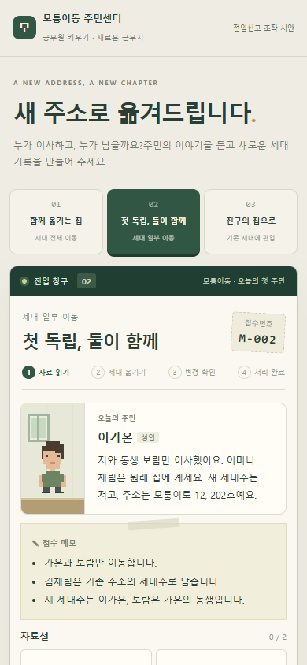
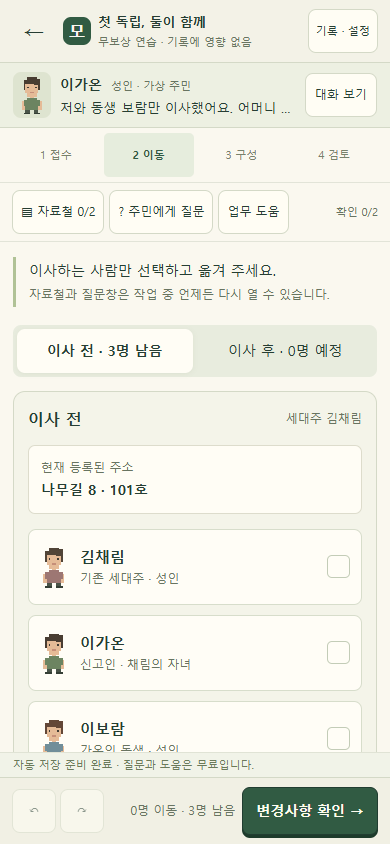

# 주민센터 출시 후보 검증

2026-10-11 · 로컬 후보 검증 완료. 공개 배포 없음.

| 대상 | 실제 결과 |
|---|---|
| 판정·콘텐츠 | engine.test.cjs 70개 통과; 12방문 정답·대표 오답·오래된 검토·3,000회 조작 검사 |
| 저장·진행·지도 | storage.test.cjs 15개 통과; 저장 불가·손상/미래 버전·순서·한 번 지급·경로 |
| 원본 보호 | protection.py 37개 파일 해시 일치 |
| 독립 전체 흐름 | puzzle-browser.cjs 6사례 완료·reload, 질문 필수, 무보상 연습, 12방문+4결산+기념품 통과 |
| 모바일 | 320×568, 360×640, 390×844, 412×915, 430×932, 가로 844×390; 가로 넘침·필수 버튼 검사 통과 |
| 추가 UX | ux-browser.cjs 키보드 진입·중첩 모달 포커스·뒤로가기·정상 백업 적용·320px 200% 글자·원본 보존과 복구 통과 |
| 본편 통합 | integration-browser.cjs 체험 무보상·즉시 복귀 초안·발령 중 reload·12방문/4결산·180XP/300포인트·중복 방지·기존 상태 보존·연습 제출·저장 키 보존 통과 |
| 기존 퍼즐 회귀 | legacy-regression.cjs 기존 23모듈의 2,070레벨 및 정답 판정 결과가 배포본과 후보에서 동일 |
| 오프라인 | 독립판 실행 중 HTTP 요청 0, script 오류 0; 본편 후보는 file URL로 실행 |

환경: Windows의 headless Microsoft Edge + Playwright. 재현 명령은 `python 주민센터/tests/run_checks.py --browser`, 최종 실행 결과와 빌드 해시는 [최종검사.json](최종검사.json)에 기록한다. 화면 폭 검사는 에뮬레이션이며 실제 휴대폰 시험으로 표기하지 않는다. Android Chrome·iPhone Safari·주소창 변화·가상 키보드·실제 안전 영역은 미검증이다. 본편 기존 결재 canvas의 모든 수동 플레이는 이번 회귀 범위에 포함하지 않았으며 원본 파일 보호 및 registry 레벨 비교를 별도로 수행했다.

## 이전/현재 화면

같은 390×844 크기로 캡처했다. [직접 조작하는 비교 HTML](../UI_비교_프로토타입.html)에서 화면 치수와 비율을 변경할 수 있다.

| 이전 시안 | 현재 구현 |
|---|---|
|  |  |

[모바일 지도](검증화면/모바일_주민센터.png), [모바일 검토](검증화면/모바일_검토.png), [PC 세대 구성](검증화면/PC_세대구성.png), [320px·200% 글자](검증화면/320px_200퍼센트.png), [본편 후보](검증화면/본편_통합후보.png).

## 산출물과 빌드

전입신고_퍼즐.html: 독립 실제 퍼즐+4일 챕터. 공무원키우기_주민센터_통합후보.html: 배포본 사본의 연결 후보. UI_비교_프로토타입.html: 이전/현재 실제 화면 비교. 전입신고_퍼즐시안.html: 보존한 최초 시안.

빌드 순서는 build_puzzle.py → build_integrated.py다. 후보를 공개하려면 현재 배포 소스 프로젝트와 저장 이관 정책을 확인한 뒤 별도 반영한다. 현재 배포 파일과 사용자의 기존 저장을 자동 교체하지 않았다.
